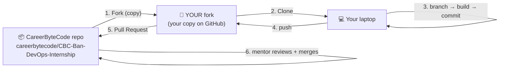

# 🧑‍💻 How to Use This Repo (Fork → Work → Submit)

This is the complete beginner guide for your **Week-4 DevOps capstone**. Follow it **in order**. ☕
There's also a shorter printable version in [`SUBMISSION-GUIDE.md`](SUBMISSION-GUIDE.md).

> ## 🔑 THE GOLDEN RULE
> You work in **your own copy (fork)** of this project, only inside **`interns/Firstname-Lastname/`**.
> You **cannot** edit or delete anything in the CareerByteCode repo — so your work is always safe, and you can never affect another intern's work. Everything reaches the main repo through a **Pull Request** that mentors review.

---

## ⭐ Before you begin
This is a **paid, live, 4-week internship**: 3 weeks of live Cloud & DevOps training + a Week-4 capstone you ship here. **No prior DevOps experience required — we start from Linux basics.**
- ✅ **Pay & confirm your seat** — see [`ENROLLMENT-AND-ONBOARDING.md`](ENROLLMENT-AND-ONBOARDING.md).
- 💬 **Join the cohort WhatsApp group:** https://chat.whatsapp.com/JvShK68sncb4IreV26k4sJ
- On **day one**, add the internship to your LinkedIn profile and post your "I've joined" announcement — copy-paste scripts are in [`WEEKLY-SCRIPTS.md`](WEEKLY-SCRIPTS.md).

> 📌 You only **use this repo in Week 4** (the capstone). Weeks 1–3 are live training + weekly posts.
> 💳 **Cloud cost reminder:** your Azure account is billed directly for VM/AKS/Application Gateway run-time. Use free credits and delete resources after each lab.

---

## 🧠 The whole picture (read once)



- **Fork** = your personal copy of the whole project on GitHub.
- **Clone** = downloading your fork to your laptop.
- **Branch** = your personal work line (`intern/your-name`).
- **Pull Request (PR)** = "please pull my work into the main repo" — mentors review it.

---

## ✅ Step 1 — Install the tools (one time)

- **Git** → https://git-scm.com/downloads (installs **Git Bash** on Windows)
- **Visual Studio Code** → https://code.visualstudio.com/
- **Docker Desktop** → https://www.docker.com/products/docker-desktop/
- **kubectl** → https://kubernetes.io/docs/tasks/tools/
- **Azure CLI (`az`)** → https://learn.microsoft.com/cli/azure/install-azure-cli
- Accounts: a **GitHub account** (https://github.com/), a **Docker Hub account** (https://hub.docker.com/), and a **Microsoft Azure account** (https://azure.microsoft.com/free/)
- _(optional, for free local practice)_ **minikube** or **kind** for a local Kubernetes cluster

Check Git works:
```bash
git --version
```
📸 New to Git? The [`How-to-GitHub/`](How-to-GitHub/) folder has screenshots for forking, cloning, and opening the project in VS Code.

> 💳 **Cloud cost reminder:** your Azure account is billed directly for VMs/AKS/Application Gateway run-time. Use free credits and delete resources after each lab.

---

## ✅ Step 2 — Fork this repo (one time) 🍴

A **fork** is your own copy on GitHub that you're allowed to change.

1. Open the CareerByteCode repo: **https://github.com/careerbytecode/CBC-Ban-DevOps-Internship**
2. Click **Fork** (top-right corner).
3. Click **Create fork**.
4. You now have your own copy at **`https://github.com/YOUR-USERNAME/CBC-Ban-DevOps-Internship`**.

> ✅ You're now working in **YOUR** repository. You cannot delete or modify files in the CareerByteCode repository — which is exactly what keeps everyone safe.

---

## ✅ Step 3 — Clone YOUR fork to your laptop (one time)

1. On **your fork's** page, click the green **Code** button → copy the **HTTPS** URL
   (it has *your* username: `https://github.com/YOUR-USERNAME/CBC-Ban-DevOps-Internship.git`).
2. Open **Git Bash** in the folder where you keep projects, then:
```bash
git clone https://github.com/YOUR-USERNAME/CBC-Ban-DevOps-Internship.git
cd CBC-Ban-DevOps-Internship
```
3. Set your identity once:
```bash
git config --global user.name "Your Name"
git config --global user.email "your-email@example.com"
```

> 💡 Clone **your fork**, not the CareerByteCode repo. Your fork's URL has *your* username in it.

---

## ✅ Step 4 — Create your personal branch (one time)

You'll use **one branch for the whole capstone**.
```bash
git checkout -b intern/your-name      # e.g. git checkout -b intern/aarav
git branch                            # confirm: * intern/your-name
```

---

## ✅ Step 5 — Create your folder (one time)

```bash
cd interns
mkdir Firstname-Lastname              # e.g. mkdir Aarav-S
cd Firstname-Lastname
cp ../../_template/SUBMISSIONS.md .
cd ../..                              # back to the repo root
```
> 📌 Only ever create/edit files inside **`interns/Your-Name/`**. Never touch `_template/`, the root files, or another intern's folder.

---

## ✅ Step 6 — Confirm your assigned DevOps project

Your capstone is **one DevOps project** from the fixed set of 10.
1. Each intern is assigned **one of the 10 projects** in [`PROJECTS-CATALOG.md`](PROJECTS-CATALOG.md).
2. **Confirm your assigned project with your mentors**, and check you're listed in the Cohort Capstone Registry in that same file.
3. You only log your own work in **your** `SUBMISSIONS.md` — `PROJECTS-CATALOG.md` is a root file you don't edit.

---

## ✅ Step 7 — Build your capstone

From inside your own folder, copy the template and rename it with the `[DEVOPS]` tag:
```bash
cd interns/Firstname-Lastname
cp -r ../../_template "Project01-[DEVOPS]-Your-DevOps-Project"
cd "Project01-[DEVOPS]-Your-DevOps-Project"
mv PROJECT_README_TEMPLATE.md README.md
```
Your project folder already contains a working starter you can adapt:
1. Put your application in `app/` (and edit `app/Dockerfile`).
2. Edit the Kubernetes manifests in `k8s/` — `deployment.yaml`, `service.yaml`, `ingress.yaml` (Application Gateway), `configmap.yaml`, `secret.yaml`, `hpa.yaml`.
3. Edit `azure-pipelines.yml` for your CI/CD (build → push to ACR → deploy to AKS).
4. Use `scripts/provision.sh` as a starting point to create your Azure resources.
5. Put architecture diagrams in `architecture/` and proof screenshots in `screenshots/`.
6. **Fill in your `README.md` completely** (problem, architecture, workflow, tech, future enhancements).
7. Record a **3–5 minute demo video** and link it in your README.

Try it locally first (free) before Azure:
```bash
# build & run your container locally
docker build -t my-app ./app
docker run -p 5000:5000 my-app
# or deploy to a local cluster (minikube/kind) using your k8s/ manifests
kubectl apply -f k8s/
```

Then deploy to Azure (incurs small costs — clean up afterwards):
```bash
bash scripts/provision.sh          # creates RG + ACR + AKS (edit values first)
kubectl apply -f k8s/              # deploy your manifests to AKS
# ... when done practising:
az group delete --name cbc-devops-rg --yes --no-wait   # stop charges
```
See the worked example in [`interns/EXAMPLE-Intern-Aarav-S/`](interns/EXAMPLE-Intern-Aarav-S/).

---

## ✅ Step 8 — Save & push to YOUR fork (every time you finish some work)

The **3 commands**:
```bash
git add .
git commit -m "Add my DevOps capstone"
git push origin intern/your-name
```
> 🔐 If it asks for a password, use a **Personal Access Token** (GitHub → Settings → Developer settings → Personal access tokens), **not** your account password.

---

## ✅ Step 9 — Submit with ONE Pull Request

1. Open **your fork** on GitHub. A banner says **"Compare & pull request"** — click it.
   (No banner? Click **Contribute → Open pull request**, or the **Pull requests** tab → **New pull request**.)
2. Check the direction carefully:
   - **base repository:** `careerbytecode/CBC-Ban-DevOps-Internship`  **base:** `main`
   - **head repository:** `YOUR-USERNAME/CBC-Ban-DevOps-Internship`  **compare:** `intern/your-name`
3. **Title:** `Intern Submission — Your Name`
4. **Description:** what you built (e.g., "Project01 Banking Application on AKS — capstone complete").
5. Click **Create pull request**. 🎉

> 🔁 **You only ever open ONE pull request.** Every later `git push origin intern/your-name` **updates that same PR automatically.** Don't open new ones.

---

## ✅ Step 10 — Post every week (required for your certificate)

This is a **weekly** habit across all 4 weeks, not just at the end. Each week you post on LinkedIn + a short video on LinkedIn & Instagram. Full rules: [`SOCIAL-MEDIA-AND-VIDEO.md`](SOCIAL-MEDIA-AND-VIDEO.md). Copy-paste scripts: [`WEEKLY-SCRIPTS.md`](WEEKLY-SCRIPTS.md).

In short, every post:
1. Tags **@CareerByteCode + all 7 mentors** (Manish Kumar, Gowrishankar, Kesavan, Mamtha, Srinivas, Manoj, Sunil).
2. Comes with a short video posted on **LinkedIn** and **Instagram**.
3. On Instagram, add **`careerbytecode`** as a **collaborator**.

Then **log all your post & video links** in your folder's `SUBMISSIONS.md` and push again — your mentors verify and sign off your certificate from there. ✅

---

## ✅ Step 11 — Keep your fork up to date

Your fork can fall behind the CareerByteCode repo (new templates, updates). To catch up:
- On **your fork's** GitHub page, click **Sync fork → Update branch**.
- Then on your laptop: `git pull origin main` (if needed).

Do this **before starting new work** so your PR stays clean.

---

## ✅ Step 12 — If a mentor requests changes

Your PR gets reviewed: **Approved**, **Changes requested**, or comments. To update it:
```bash
# make your edits, then:
git add .
git commit -m "Update based on mentor feedback"
git push origin intern/your-name
```
The PR updates **automatically** — no new PR needed. ✅

---

## 🆘 Common problems

| Problem | Fix |
|---------|-----|
| Asked for a password on push | Use a **Personal Access Token**, not your password |
| "Updates were rejected" | `git pull origin intern/your-name`, then push again |
| "src refspec ... does not match" | You're on the wrong branch — run `git checkout intern/your-name` |
| Accidentally worked on `main` | `git checkout -b intern/your-name` (carries your changes over), then push |
| PR shows hundreds of changes | Your fork is stale — **Sync fork**, then `git pull origin main` |
| Surprise Azure bill | **Delete your resource group after every lab** (`az group delete ...`); never leave an AKS cluster running overnight |
| `ImagePullBackOff` on AKS | Make sure your AKS is attached to your ACR (`az aks update --attach-acr <acr>`) and the image tag matches |
| Big files won't upload | Don't commit images/videos over 100 MB; share large demos via a Google Drive link in your README |

---

## 📏 The rules (keep everyone safe)

1. **Never** try to push to the CareerByteCode repo — only to **your fork**.
2. Always work on your **`intern/your-name`** branch.
3. Only create/edit files inside **`interns/Your-Name/`**.
4. **Never** touch another intern's folder, the `_template/`, or any root file.
5. Submit work **only** through your one Pull Request.
6. **Sync your fork** before starting new work.

Following this, every intern in the cohort works safely without ever affecting each other. 🙌

_Part of the CareerByteCode Bangalore — Cloud & DevOps Internship Program._
