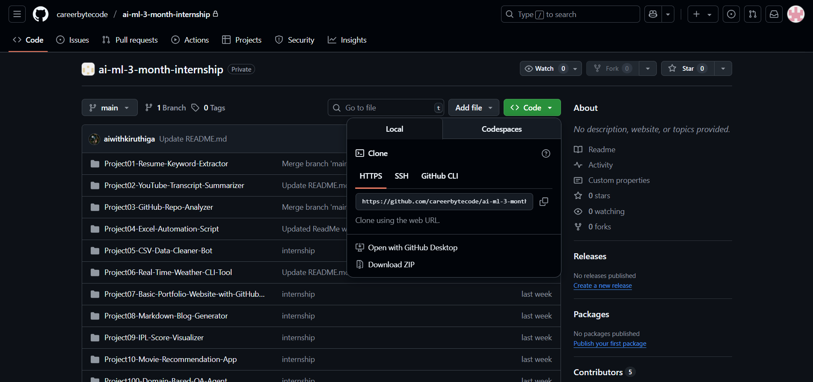
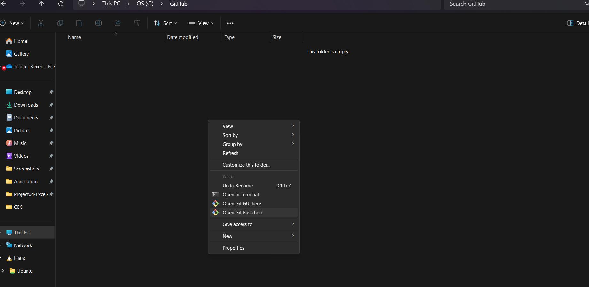
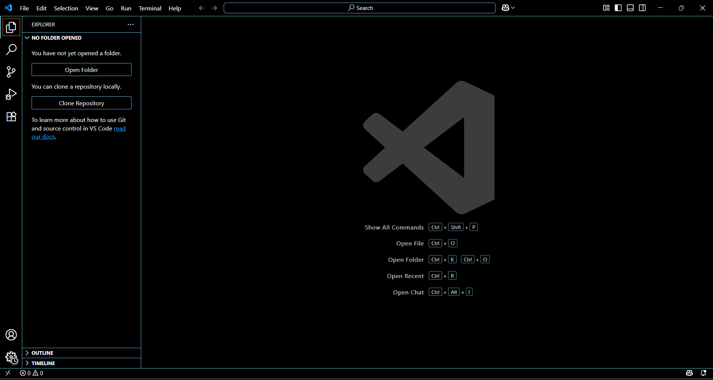
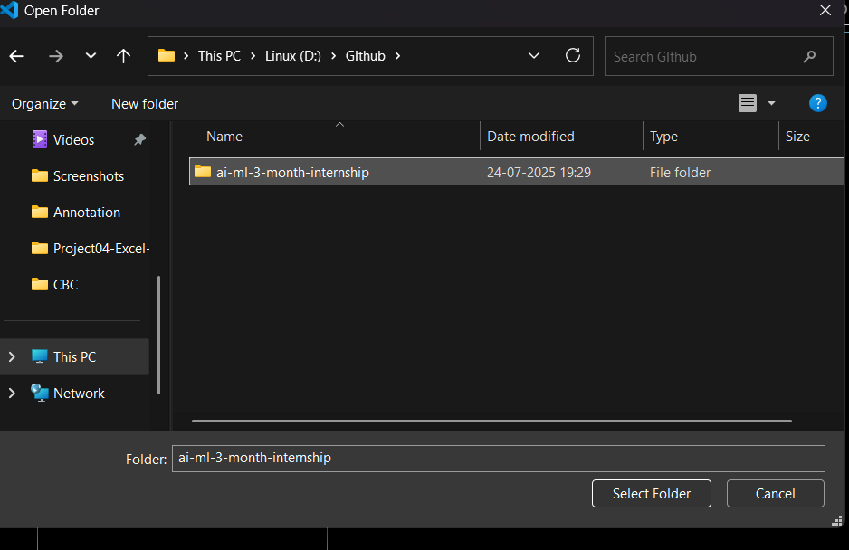
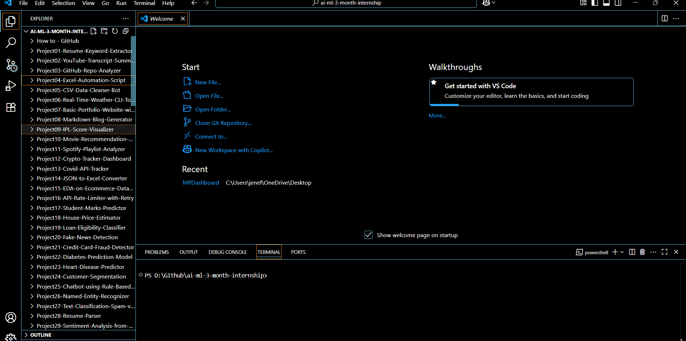

# 📁 How to Clone a GitHub Repository Using Git Bash and Open in VS Code

This guide walks you through the steps to **clone a GitHub repository using Git Bash** and **open it in Visual Studio Code**.

---

## 🍴 STEP 0 — Fork the repository first (do this before cloning)

In this internship you don't clone the CareerByteCode repo directly — you **fork** it (make your own copy), then clone *your fork*.

1. Open the repo: **https://github.com/careerbytecode/CBC-Ban-DevOps-Internship**
2. Click **Fork** (top-right corner).
3. Click **Create fork**.
4. You now have your own copy at `https://github.com/YOUR-USERNAME/CBC-Ban-DevOps-Internship`.
5. On **your fork's** page, click the green **Code** button and copy the **HTTPS** URL — this is the URL you'll clone in Step 1 below.

> ✅ Because you only have your own fork, you can never edit or delete files in the CareerByteCode repo. You submit your work with a **Pull Request** (see [`CONTRIBUTING.md`](../CONTRIBUTING.md)).

---

## ✅ Prerequisites

Before you begin, make sure the following are ready:

- ✅ Git (includes Git Bash)
- ✅ Visual Studio Code
- ✅ GitHub account (with access to the repository)
- ✅ A `GitHub` folder on your system to store repositories
- ✅ `code` command configured in PATH  

---

## 🔗 Step-by-Step Instructions

### 🔹 1. Copy the GitHub Repository URL

- Go to **your fork** of the repository (the one with *your* username — see Step 0).
- Click the green **Code** button.
- Select **HTTPS** and copy the repository URL. 

> Example:  
> `https://github.com/username/repository-name.git`

---

### 🔹 2. Open Git Bash

- Right-click inside the folder where you want to clone the project (e.g., `D:/GitHub`).
- On **Windows 11**, click **“Show more options”**.
- Then click **“Git Bash Here”** from the extended context menu.

---

### 🔹 3. Use `git clone` Command

•	Run the following command in Git Bash

•	git clone https://github.com/username/repository-name.git
[Paste the link copied from GitHub]

•	✅ This will download the repository into a folder named repository-name.

---

### 🔹 4. Navigate into the Repository Folder and Push Code

• **Open the cloned folder:**  
  `cd CBC-Ban-DevOps-Internship/`

• **View the files inside the folder:**  
  `ls`

• **Stage all the files for commit:**  
  `git add .`

• **Commit the changes with a message:**  
  `git commit -m "project"`

• **(First-time setup only) Configure your Git identity:**  
  `git config --global user.email "your-email@gmail.com"`  
  `git config --global user.name "your-name"`

• **Push the committed code to YOUR fork:**  
  `git push origin intern/your-name`

> 🔁 After pushing, open **one Pull Request** from your fork into `careerbytecode/CBC-Ban-DevOps-Internship` → `main`. Full steps in [`CONTRIBUTING.md`](../CONTRIBUTING.md). Every later push updates the same PR automatically.
  
---
### 🔹 5. Open the Project in Visual Studio Code

•	Open Visual Studio Code.

•	Click the open folder at Visual Studio code.

•	Navigate to the folder where you cloned the repository.

•	Select the folder and click “Select Folder” (or “Open”).

•	The project will now be loaded in VS Code.

📝 You can now explore the files, make changes, and start coding in your cloned repository.

---
