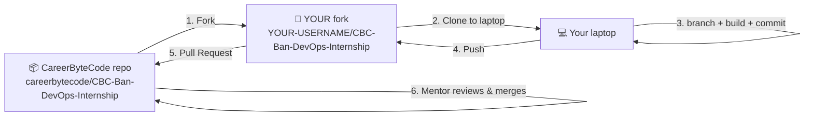

<div align="center">

# 🚀 CareerByteCode Bangalore — Cloud & DevOps Internship
### A paid, mentor-led 4-week program · Live on Google Meet · Monthly cohorts

**Learn it. Build it. Ship it in public.**

Three weeks of live Cloud & DevOps training (Linux, Docker, Kubernetes, Azure & CI/CD) + one week building and shipping a real **DevOps capstone** to GitHub — with a verifiable certificate and a public, recruiter-ready portfolio at the end.


</div>

---

> 🧭 **New here? → Read [`START-HERE.md`](START-HERE.md) first.** It walks you through everything: using the repo, contributing, submitting, sharing on LinkedIn & Instagram, and earning your certificate.

---

## 🎯 What this program is

A **paid, live, mentor-led internship** focused on **Cloud & DevOps engineering**. It's **beginner-friendly — no prior DevOps experience required; we start from Linux basics.** Over four weeks you go from the command line to deploying a real application on **Azure Kubernetes Service (AKS)** with a full **CI/CD pipeline**:

- **Weeks 1–3 — Live training** on Google Meet (occasional in-person sessions in Bangalore where possible): Linux + Shell + Docker → Kubernetes + Monitoring → Azure & CI/CD.
- **Week 4 — Capstone.** You build one real **DevOps project** with your mentors — containerize it, ship it through an Azure CI/CD pipeline onto AKS, set up monitoring, document it, and present it on Demo Day.
- **Throughout — Build in public.** One LinkedIn post + one short video every week, so your network watches you grow and recruiters can find your work.

> 💡 **The mindset:** *Execution over certificates. Projects over theory. Build in public over building in silence.*

**Who it's for:** any graduate, 3rd-year, final-year, or passed-out student. **Prerequisite:** none — we start from Linux basics.

> 💳 **Honest heads-up on cloud costs:** Week 3 and your capstone use **your own Azure account**. Hands-on labs (VMs, AKS, Application Gateway) run on real cloud resources, so expect **small charges** for the time your lab resources are running. We show you how to use the free tier and **delete/stop resources after each lab** to keep costs minimal. See [`ENROLLMENT-AND-ONBOARDING.md`](ENROLLMENT-AND-ONBOARDING.md).

---

## 👩‍🏫 Your mentor team (Bangalore)

This cohort is run by a shared mentor team of industry professionals, cloud architects, and DevOps engineers — **tag all of them on every post**:

| Mentor | LinkedIn |
|--------|----------|
| **Manish Kumar** | https://www.linkedin.com/in/manishkumarai/ |
| **Gowrishankar** | https://www.linkedin.com/in/gowrishinsights/ |
| **Kesavan** | https://www.linkedin.com/in/engineerkesavan/ |
| **Mamtha** | https://www.linkedin.com/in/mamthainnovates/ |
| **Srinivas** | https://www.linkedin.com/in/srinivasmaestro/ |
| **Manoj** | https://www.linkedin.com/in/manojwithdevopsai/ |
| **Sunil** | https://www.linkedin.com/in/sunilmdev/ |

---

## 🧗 Your 4-week journey

```
 WEEK 1                WEEK 2                  WEEK 3                      WEEK 4
 Linux · Shell    →   Kubernetes &       →   Azure & CI/CD          →    DEVOPS CAPSTONE
 Docker · Git         Monitoring             AKS · Pipelines             build → ship → Demo Day
   │                    │                       │                            │
   └── post #1          └── post #2             └── post #3                   └── project post + Demo
       + video              + video                 + video                       + video  →  🎓 Certificate
```

**Before Week 1 even starts**, you do two things on day one:
1. **Add the internship to your LinkedIn profile** (ready-made script provided).
2. **Post your "I've joined" announcement**, tagging CBC + all 7 mentors.

---

## 🎥 Class recordings & 📝 notes

Missed a live session or want to revise? Every week's **recordings** live in **[`CLASS-RECORDINGS.md`](CLASS-RECORDINGS.md)**, and the matching **class notes / cheat-sheets** live in the **[`docs/`](docs/)** folder.

**✅ Week 1 — Linux · Shell · Git (completed 04 July 2026):**

| # | Session | 🎥 Recording | 📝 Notes |
|---|---------|-------------|----------|
| 1 | Linux — Session 1 | [▶ Watch](https://drive.google.com/file/d/1zYFj_e8B5q0DXTUCiLhJAqtWzv5nIxNt/view?usp=drive_link) | [Linux Basics & Troubleshooting](docs/week-1/linux.md) |
| 2 | Bash Scripting — Session 2 | [▶ Watch](https://drive.google.com/file/d/1NRgFoLE7f9qqXcsftnltSsqOj1igN3eC/view?usp=drive_link) | [Bash Shell Scripting Cheat Sheet](docs/week-1/shell-scripting.md) |
| 3 | Git & GitHub — Session 3 | [▶ Watch](https://drive.google.com/file/d/1k-VuEhTjZoRgimHu0womar8UATN2He29/view?usp=drive_link) | [Git & GitHub Complete Guide](docs/week-1/git-and-github.md) |
| 4 | Ubuntu Install — Session 4 | [▶ Watch](https://drive.google.com/file/d/1ifRipeUS-9r0tsk6_vw00DZ8c-qcs0Y2/view?usp=drive_link) | — |

> 🔒 Recordings are for enrolled interns only — please don't re-share. Weeks 2–4 recordings and notes will be added to [`CLASS-RECORDINGS.md`](CLASS-RECORDINGS.md) and [`docs/`](docs/) as each week completes.

---

## 📖 Start here — read these in order

| # | File | What's inside |
|---|------|---------------|
| 0 | 🧭 [`START-HERE.md`](START-HERE.md) | ⭐ **New here? Read this first** — the complete step-by-step student walkthrough |
| 1 | 📄 [`ENROLLMENT-AND-ONBOARDING.md`](ENROLLMENT-AND-ONBOARDING.md) | Fee, payment, cloud-cost note, WhatsApp group, and your day-one checklist |
| 2 | 📄 [`CURRICULUM.md`](CURRICULUM.md) | The full 4-week syllabus (every session & topic) |
| 3 | 📄 [`COHORT-SCHEDULE.md`](COHORT-SCHEDULE.md) | Week-by-week plan, the weekly live class, attendance & weekly tasks |
| 4 | 📄 [`SOCIAL-MEDIA-AND-VIDEO.md`](SOCIAL-MEDIA-AND-VIDEO.md) | The weekly post + video rules and tagging |
| 5 | 📄 [`WEEKLY-SCRIPTS.md`](WEEKLY-SCRIPTS.md) | ⭐ Copy-paste LinkedIn posts + video scripts for every week |
| 6 | 📄 [`CONTRIBUTING.md`](CONTRIBUTING.md) | **How to use this repo** — full fork → build your DevOps capstone → submit walkthrough |
| 6b | 📄 [`SUBMISSION-GUIDE.md`](SUBMISSION-GUIDE.md) | Short printable fork + Pull Request cheat-sheet |
| 7 | 📄 [`PROJECTS-CATALOG.md`](PROJECTS-CATALOG.md) | The 10 DevOps capstone projects + the cohort registry |
| 8 | 📄 [`CERTIFICATE-CRITERIA.md`](CERTIFICATE-CRITERIA.md) | Exactly what you must complete to earn your certificate |
| 9 | 🏆 [`LEADERBOARD.md`](LEADERBOARD.md) · [`HALL-OF-FAME.md`](HALL-OF-FAME.md) | Cohort ranking + all-time top interns |
| 10 | 📄 [`ABOUT-CAREERBYTECODE.md`](ABOUT-CAREERBYTECODE.md) | Who we are and the wider community you join |
| 11 | 🛠️ [`MENTOR-SETUP.md`](MENTOR-SETUP.md) | (Mentors) GitHub settings for the fork/PR workflow |

---

## ✅ What "done" looks like (certificate checklist)

To earn your **verifiable CareerByteCode certificate**, across the 4 weeks you complete:

- 🟢 **Attend the live classes** (Weeks 1–3) — attendance logged by mentors
- 🟢 **5 LinkedIn posts** — joining + Week 1 + Week 2 + Week 3 + capstone (each tagging CBC + all 7 mentors)
- 🟢 **5 short videos** — one per week, posted on **LinkedIn** and **Instagram** (with `careerbytecode` as Instagram collaborator)
- 🟢 **1 DevOps capstone** — built with mentor guidance, deployed to AKS, shipped via your **fork + Pull Request** into `interns/Your-Name/`, and **listed in [`PROJECTS-CATALOG.md`](PROJECTS-CATALOG.md)**
- 🟢 **Demo Day presentation** in Week 4

Full details in [`CERTIFICATE-CRITERIA.md`](CERTIFICATE-CRITERIA.md).

---

## 🧭 How the Week-4 capstone works (fork → work → submit)

> 🛡️ **Important — how submissions work:** you do **not** push to this repository directly. You make your **own copy (a "fork")**, do all your work there, and send it back with a **Pull Request** that mentors review. This way nobody can ever edit or delete anyone else's work. 🙌
>
> 📘 **Full beginner walkthrough with every command + screenshots → [`CONTRIBUTING.md`](CONTRIBUTING.md)** · 📄 **short printable version → [`SUBMISSION-GUIDE.md`](SUBMISSION-GUIDE.md)**



### 1️⃣ Fork this repo (your own copy — do once)
Open this repo on GitHub → click **Fork** (top-right) → **Create fork**. You now have `https://github.com/YOUR-USERNAME/CBC-Ban-DevOps-Internship`.

### 2️⃣ Clone YOUR fork & make your branch (do once)
```bash
git clone https://github.com/YOUR-USERNAME/CBC-Ban-DevOps-Internship.git
cd CBC-Ban-DevOps-Internship
git checkout -b intern/your-name        # your personal branch (use it the whole capstone)
```
> ⚡ **Golden rule:** you work **only inside your own fork**, and only inside **`interns/Firstname-Lastname/`**. You can't touch the CareerByteCode repo — so no one can delete your work, and you can't affect anyone else's.

### 3️⃣ Build your DevOps capstone from the template
Create `interns/Firstname-Lastname/`, copy `SUBMISSIONS.md` into it, then **copy the whole `_template/` folder** into your folder, rename it `Project01-[DEVOPS]-Your-DevOps-Project`, rename its template README to `README.md`, and build (app in `app/`, manifests in `k8s/`, pipeline in `azure-pipelines.yml`, proof in `screenshots/`).
➡️ Details in [`CONTRIBUTING.md`](CONTRIBUTING.md) · template at [`_template/PROJECT_README_TEMPLATE.md`](_template/PROJECT_README_TEMPLATE.md)

### 4️⃣ Push to your fork (the 3 commands, every time you finish work)
```bash
git add .
git commit -m "Add my DevOps capstone"
git push origin intern/your-name
```

### 5️⃣ Submit with ONE Pull Request
Open **your fork** on GitHub → click **Compare & pull request** → make sure base is **`careerbytecode/CBC-Ban-DevOps-Internship` → `main`** and compare is **your `intern/your-name`** → title it `Intern Submission — Your Name` → **Create pull request**.
> 🔁 After this first PR, **every new push updates the same PR automatically** — you never open a second one. Click **Sync fork** on your fork's page now and then to stay up to date.

---

## 🗂️ Repository structure

```
CBC-Ban-DevOps-Internship/
├── README.md                      ← you are here
├── START-HERE.md                  ← ⭐ complete student walkthrough (read first)
├── ENROLLMENT-AND-ONBOARDING.md   ← fee, payment, cloud costs, WhatsApp, day-1 steps
├── CURRICULUM.md                  ← the 4-week syllabus
├── COHORT-SCHEDULE.md             ← week-by-week plan + attendance + weekly tasks
├── SOCIAL-MEDIA-AND-VIDEO.md      ← weekly post + video rules & tagging
├── WEEKLY-SCRIPTS.md              ← ⭐ copy-paste posts + video scripts (per week)
├── CLASS-RECORDINGS.md            ← 🎥 weekly live-session recordings (Week 1 added)
├── CONTRIBUTING.md                ← fork → build your DevOps capstone → submit (start here)
├── SUBMISSION-GUIDE.md            ← short printable fork + PR cheat-sheet
├── PROJECTS-CATALOG.md            ← the 10 DevOps projects + cohort registry
├── CERTIFICATE-CRITERIA.md        ← how to earn your certificate
├── LEADERBOARD.md                 ← 🏆 current cohort ranking (auto-generated)
├── HALL-OF-FAME.md                ← 🏛️ all-time top interns
├── ABOUT-CAREERBYTECODE.md        ← about the platform & community
├── MENTOR-SETUP.md                ← (mentors) GitHub settings for the fork/PR workflow
│
├── docs/                          ← 📝 class notes & cheat-sheets, by week
│   └── week-1/                    ← Linux · Bash scripting · Git & GitHub
│       ├── linux.md
│       ├── shell-scripting.md
│       └── git-and-github.md
│
├── .github/                       ← (mentors) PR template + CODEOWNERS
│   ├── CODEOWNERS
│   └── pull_request_template.md
│
├── _template/                     ← COPY this to build your capstone (DevOps)
│   ├── PROJECT_README_TEMPLATE.md
│   ├── SUBMISSIONS.md             ← your weekly post tracker
│   ├── app/                       ← sample app + Dockerfile
│   ├── k8s/                       ← deployment, service, ingress, configmap, secret, hpa
│   ├── azure-pipelines.yml        ← Azure DevOps CI/CD pipeline (build → ACR → AKS)
│   ├── scripts/provision.sh       ← sample Azure CLI provisioning script
│   ├── architecture/  screenshots/
│
├── scripts/                       ← (mentors) leaderboard auto-builder
│   └── build_leaderboard.py
├── How-to-GitHub/                 ← screenshots: fork, clone & open in VS Code
├── tracking/
│   ├── MASTER-TRACKER.csv         ← mentor's master tracking sheet
│   └── MENTOR-HOURS.md            ← live class & hours log
│
└── interns/                       ← you work ONLY inside your own fork's folder
    └── Firstname-Lastname/
        ├── SUBMISSIONS.md
        └── Project01-[DEVOPS]-Your-DevOps-Project/
```

---

## 💬 Join your cohort

- 🟢 **WhatsApp group (cohort hub):** https://chat.whatsapp.com/JvShK68sncb4IreV26k4sJ
- 🌐 **Website:** https://www.careerbytecode.com
- 📧 **Email:** careerbytec@gmail.com
- 🔗 **CareerByteCode on LinkedIn:** https://www.linkedin.com/in/careerbytecode/

<div align="center">

**Built and run by CareerByteCode — the global platform for tech professionals.**

*Learn it. Build it. Ship it in public.* 🚀

</div>
