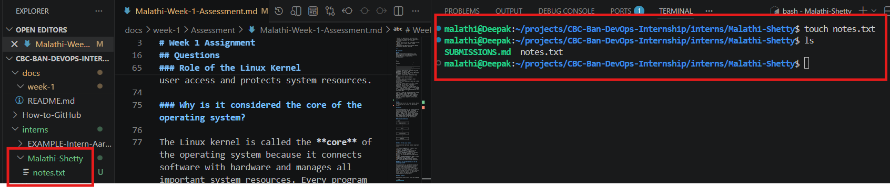
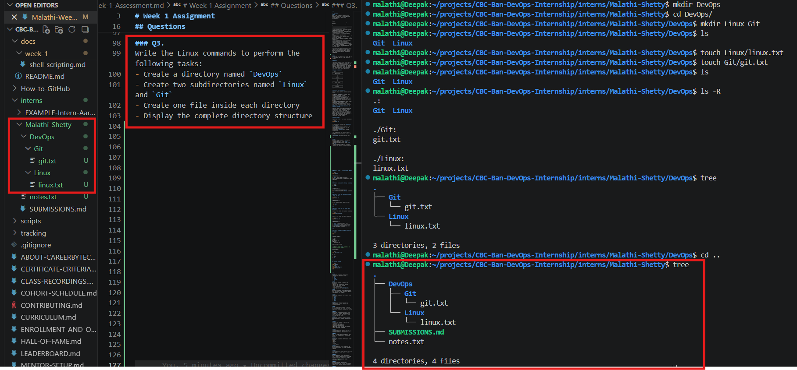
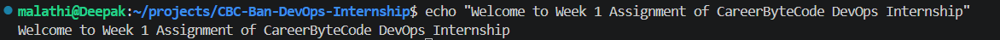
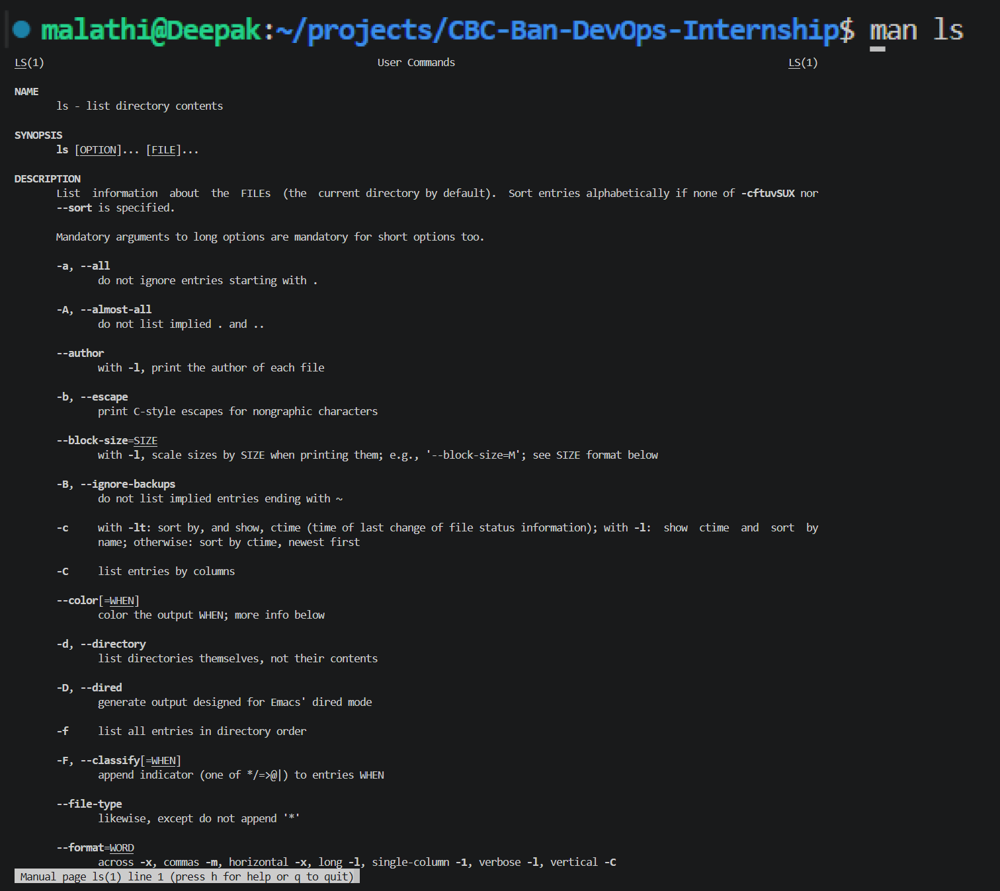
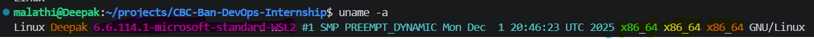
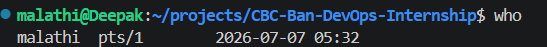

# 🚀 CareerByteCode DevOps Internship

# Week 1 Assignment 

## Instructions

- Answer all questions in your own words.
- Execute the commands wherever applicable.
- Include screenshots for practical questions.
- Submit your work in PDF or Markdown format.
- Upload your scripts to your GitHub repository.
- Explore a few additional concepts beyond the training wherever required.

---

## Questions

### Q1.
What is the difference between a Linux Operating System and a Windows Operating System? Mention at least **five differences**.


| Linux                                                                        | Windows                                                                    |
| ---------------------------------------------------------------------------- | -------------------------------------------------------------------------- |
| Linux is open-source, so anyone can view and modify its source code.         | Windows is closed-source, so only Microsoft can modify its source code.    |
| Linux is usually free to download and use.                                   | Windows usually requires a paid license.                                   |
| Linux is more secure and gets fewer viruses and malware.                     | Windows is more commonly targeted by viruses and malware.                  |
| Linux is widely used for servers, cloud computing, and software development. | Windows is mainly used on personal computers, offices, and gaming systems. |
| Linux supports both the Command Line Interface (CLI) and Graphical User Interface (GUI).        | Windows is mainly operated through a graphical user interface (GUI).       |

Linux is a free and secure operating system that is widely used by developers and companies for servers and cloud computing. 
Windows is user-friendly and is commonly used for personal computers, office work, and gaming.

```text
                Operating Systems
                       │
          ┌────────────┴────────────┐
          │                         │
      Linux                     Windows
          │                         │
   Open Source              Closed Source
   Free                     Paid Licensed
   CLI + GUI                Mainly GUI Focused
   Cloud & Servers          Personal PCs & Gaming
   More Secure              More Malware Targeted

```


---

### Q2.
Explain the role of the Linux Kernel. Why is it considered the core of the operating system?

### Answer

The **Linux Kernel** is the **core part** of the Linux operating system. It manages communication between the software and the hardware. When a user runs a program or enters a command, the request goes through the shell to the Linux kernel. The kernel then communicates with the hardware and returns the result to the application.

### Linux Architecture

```text
+----------------------+
|     Applications     |
+----------------------+
           |
           v
+----------------------+
|        Shell         |
+----------------------+
           |
           v
+----------------------+
|     Linux Kernel     |
+----------------------+
           |
           v
+----------------------+
|      Hardware        |
+----------------------+
```

### Role of the Linux Kernel

The Linux kernel performs several important tasks:

* **Process Management:** Creates, runs, schedules, and stops programs.
* **Memory Management:** Allocates and manages memory for running programs.
* **Device Management:** Controls hardware devices such as the keyboard, mouse, printer, and storage devices using device drivers.
* **File System Management:** Reads, writes, and manages files stored on disks.
* **Security and Permissions:** Controls user access and protects system resources.

```text
               APPLICATIONS
                    │
                    ▼
                 SHELL
                    │
                    ▼

         ┌────────────────────┐
         │      KERNEL        │
         └────────────────────┘

     ╱         │        │         ╲
Process     Memory    Device     File
  │            │         │         │
Create      RAM Mgmt  Drivers   Storage

             ╲        │        ╱
               SECURITY
      Users • Permissions • Access

                    │
                    ▼
                HARDWARE
```


### Why is it considered the core of the operating system?

The Linux kernel is called the **core** of the operating system because it connects software with hardware and manages all important system resources. Every program depends on the kernel to access the CPU, memory, storage, and other hardware devices. Without the Linux kernel, the operating system cannot run applications or communicate with the hardware.

### Real Example

Suppose you create a file using the command:

```bash
touch notes.txt
```

* The **Shell** receives the `touch notes.txt` command.
* The **Shell** sends the request to the **Linux Kernel**.
* The **Kernel** communicates with the storage device (hardware).
* The file **`notes.txt`** is created successfully.

This example shows how the Linux kernel manages communication between software and hardware.



---

### Q3.
Write the Linux commands to perform the following tasks:
- Create a directory named `DevOps`
- Create two subdirectories named `Linux` and `Git`
- Create one file inside each directory
- Display the complete directory structure

### Task 1: Create a directory named `DevOps`

```bash
mkdir DevOps
```

**Explanation:**

* `mkdir` means **make directory**.
* This command creates a new directory named **DevOps**.

---

### Task 2: Go inside the `DevOps` directory

```bash
cd DevOps
```

**Explanation:**

* `cd` means **change directory**.
* It moves you inside the `DevOps` directory.

---

### Task 3: Create two subdirectories named `Linux` and `Git`

```bash
mkdir Linux Git
```

**Explanation:**

* This command creates two directories:

  * `Linux`
  * `Git`

---

### Task 4: Create one file inside each directory

Create a file inside the **Linux** directory:

```bash
touch Linux/linux.txt
```

Create a file inside the **Git** directory:

```bash
touch Git/git.txt
```

**Explanation:**

* `touch` creates a new empty file.
* `Linux/linux.txt` means create **linux.txt** inside the **Linux** directory.
* `Git/git.txt` means create **git.txt** inside the **Git** directory.

---

### Task 5: Display the complete directory structure

```bash
tree
```

**Example Output**

```text
DevOps
├── Git
│   └── git.txt
└── Linux
    └── linux.txt

2 directories, 2 files
```

> **Note:** If the `tree` command is not installed, install it first.

Ubuntu/Debian:

```bash
sudo apt install tree
```

Or use:

```bash
ls -R
```

---

## Complete Commands

```bash
mkdir DevOps
cd DevOps
mkdir Linux Git
touch Linux/linux.txt
touch Git/git.txt
tree
```



---

### Q4.
Explain the purpose of the following commands with one example each:
- `echo`
- `man`
- `uname`
- `hostname`
- `who`


## 1. `echo`

### Purpose

The `echo` command is used to **display text or the value of a variable** in the terminal.

### Syntax

```bash
echo [text]
```

### Example

```bash
echo "Welcome to Week 1 Assignment of CareerByteCode DevOps Internship"
```

### Output

```text
Welcome to Week 1 Assignment of CareerByteCode DevOps Internship
```

### Real Example

You can display a welcome message or check the value of a variable while writing Bash scripts.



---

## 2. `man`

### Purpose

The `man` (manual) command is used to **view the user manual** of a Linux command. It provides information about the command, its options, and how to use it.

### Syntax

```bash
man [command]
```

### Example

```bash
man ls
```

### Real Example

If you forget how the `ls` command works, you can use `man ls` to read its manual.



---

## 3. `uname`

### Purpose

The `uname` command displays **system information**, such as the operating system name and kernel version.

### Syntax

```bash
uname [option]
```

### Example

```bash
uname -a
```

### Example Output

```text
Linux Deepak 6.6.114.1-microsoft-standard-WSL2 #1 SMP PREEMPT_DYNAMIC Mon Dec  1 20:46:23 UTC 2025 x86_64 x86_64 x86_64 GNU/Linux
```



| Part                                                 | Meaning                            | Equivalent Command    |
| ---------------------------------------------------- | ---------------------------------- | --------------------- |
| `Linux`                                              | Kernel Name (Operating System)     | `uname` or `uname -s` |
| `Deepak`                                             | Hostname (Computer name)           | `uname -n`            |
| `6.6.114.1-microsoft-standard-WSL2`                  | Kernel Release                     | `uname -r`            |
| `#1 SMP PREEMPT_DYNAMIC Mon Dec 1 20:46:23 UTC 2025` | Kernel Version (build information) | `uname -v`            |
| `x86_64`                                             | Machine Hardware Name              | `uname -m`            |
| `x86_64`                                             | Processor Type                     | `uname -p`            |
| `x86_64`                                             | Hardware Platform                  | `uname -i`            |
| `GNU/Linux`                                          | Operating System                   | `uname -o`            |


### Real Example

A system administrator can use `uname -a` to check the Linux kernel version before installing software.

#### Common Commands

| Command    | Stands for                  | Purpose                                                      |
| ---------- | --------------------------- | ------------------------------------------------------------ |
| `uname`    | *(same as `-s` by default)* | Displays the **kernel name** (e.g., `Linux`).                |
| `uname -s` | **System**                  | Displays the **kernel name** (e.g., `Linux`).                |
| `uname -a` | **All**                     | Displays all available system information.                   |
| `uname -r` | **Release**                 | Displays the Linux **kernel release** (version number).      |
| `uname -m` | **Machine**                 | Displays the machine hardware architecture (e.g., `x86_64`). |
| `uname -n` | **Node**                    | Displays the system hostname (computer name).                |
| `uname -v` | **Version**                 | Displays the Linux kernel build version and build date.      |
| `uname -p` | **Processor**               | Displays the processor type.                                 |
| `uname -i` | **Hardware Platform**       | Displays the hardware platform.                              |
| `uname -o` | **Operating System**        | Displays the operating system (e.g., `GNU/Linux`).           |


https://github.com/shettymalathib/CBC-Ban-DevOps-Internship/blob/intern/malathi-shetty/interns/Malathi-Shetty/images/Q4%20Explain%20the%20purpose%20of%20the%20following%20commands%20with%20one%20example%20each/3.%20uname-common_commands.png?raw=true

---

## 4. `hostname`

### Purpose

The `hostname` command displays the **name of the current computer (host)** on the network.

### Syntax

```bash
hostname
```

### Example

```bash
hostname
```

### Example Output

```text
ubuntu / Deepak
```

https://github.com/shettymalathib/CBC-Ban-DevOps-Internship/blob/intern/malathi-shetty/interns/Malathi-Shetty/images/Q4%20Explain%20the%20purpose%20of%20the%20following%20commands%20with%20one%20example%20each/4.%20hostname.png?raw=true

### Real Example

When connecting to another computer over a network, you can use the hostname to identify the system.

#### Common Commands

| Command       | Purpose                                                                           | Example Output                           |
| ------------- | --------------------------------------------------------------------------------- | ---------------------------------------- |
| `hostname`    | Displays the current hostname (computer name).                                    | `Deepak`                                 |
| `hostname -I` | Displays the IP address(es) assigned to the system.                               | `192.168.x.x 192.168.x.x`                |
| `hostnamectl` | Displays detailed hostname and system information **(on systems using systemd)**. | Hostname, OS, Kernel, Architecture, etc. |
| `hostname -f` | Displays the Fully Qualified Domain Name (FQDN), if configured.                   | `server.example.com`                     |
| `hostname -A` | Displays all configured hostnames (if available).                                 | Depends on the system                    |

https://github.com/shettymalathib/CBC-Ban-DevOps-Internship/blob/intern/malathi-shetty/interns/Malathi-Shetty/images/Q4%20Explain%20the%20purpose%20of%20the%20following%20commands%20with%20one%20example%20each/4.%20hostname-common_commands.png?raw=true


---

## 5. `who`

### Purpose

The `who` command displays **the users who are currently logged in** to the Linux system.

### Syntax

```bash
who
```

### Example

```bash
who
```

### Example Output

```text
malathi  pts/1        2026-07-07 05:32
```



### Real Example

On a shared Linux server, an administrator can use `who` to see which users are currently logged in.


#### Common Commands

| Command    | Purpose                                                                  | Example Output                                                 |
| ---------- | ------------------------------------------------------------------------ | -------------------------------------------------------------- |
| `who`      | Displays the users currently logged in to the system.                    | `malathi pts/1 2026-07-07 05:32`                               |
| `who am i` | Displays information about the current login session.                    | `malathi pts/1 2026-07-07 05:32` *(may show no output in WSL)* |
| `who -b`   | Displays the last system boot time.                                      | `system boot 2026-07-07 05:32`                                 |
| `who -q`   | Displays the usernames of logged-in users and the total number of users. | `malathi`<br>`# users=1`                                       |
| `who -H`   | Displays the output with column headings.                                | `NAME LINE TIME COMMENT`                                               |

> Note: On WSL2, who am i may not display any output because WSL does not create a traditional Linux login session. This is expected behavior.

https://github.com/shettymalathib/CBC-Ban-DevOps-Internship/blob/intern/malathi-shetty/interns/Malathi-Shetty/images/Q4%20Explain%20the%20purpose%20of%20the%20following%20commands%20with%20one%20example%20each/5.%20who-common_commands.png?raw=true

---

## Summary Table

| Command    | Purpose                              | Example                   |
| ---------- | ------------------------------------ | ------------------------- |
| `echo`     | Displays text or variable values.    | `echo "Welcome to Linux"` |
| `man`      | Opens the manual page for a command. | `man ls`                  |
| `uname`    | Displays system information.         | `uname -a`                |
| `hostname` | Displays the computer's hostname.    | `hostname`                |
| `who`      | Shows the users currently logged in. | `who`                     |


---

### Q5.
Write Linux commands to perform the following:
- Display the current Linux version
- Display the system hostname
- View command history
- Create a file named `practice.txt`
- Copy the file into another directory

### Q6.
Research any **three Linux commands** that help you obtain system information. Explain their purpose with examples.

### Q7.
Explain the purpose of the following Linux directories:
- `/root`
- `/bin`
- `/sbin`
- `/dev`
- `/proc`

### Q8.
Differentiate between a **File** and a **Directory** in Linux. Explain with suitable examples.

### Q9.
A file was accidentally moved to another directory, and you don't know its location. Which Linux command(s) would you use to find it?

### Q10.
Suppose you accidentally deleted a file using the `rm` command. What precautions should you follow in the future to avoid deleting important files?

### Q11.
Explain the difference between a **Local Repository** and a **Remote Repository** in Git.

### Q12.
Write the Git commands to perform the following:
- Create a new branch
- Switch to the new branch
- Check available branches
- Merge the branch into the main branch
- Push the changes to GitHub

### Q13.
Research any **three commonly used Git commands** that were not covered during the training and explain their purpose.

### Q14.
What is a GitHub Repository? Explain why a README file is important in every GitHub project.

### Q15.
Explain the purpose of the following GitHub features:
- Star
- Watch
- Fork
- Issues
- Pull Requests

### Q16.
Write a Bash shell script to display the multiplication table of a number entered by the user.

### Q17.
Write a Bash shell script to check whether a given year is a **Leap Year** or **Not a Leap Year**.

### Q18.
Write a Bash shell script that accepts a user's **Name** and displays the following message five times using a **for loop**:

**Welcome to CareerByteCode DevOps Internship, <Name>**

### Q19.
Research any **two popular Linux distributions** used in cloud environments. Explain their features and where they are commonly used.

### Q20.
Create a GitHub repository named **week1-practice-set3** and upload:
- Linux command practice
- Two Bash shell scripts
- A well-formatted README.md
- Minimum **5 Git commits**
- Screenshots of your terminal output

---

## 🎥 Q21. Self-Speech Video (Mandatory)

Record a **3-minute self-speech video** covering the following:

- Introduce yourself.
- Share what you learned during the first week.
- Which Linux command did you use the most?
- Which Git concept did you understand well?
- What additional concept did you learn by exploring on your own?
- What are your goals for the upcoming weeks?

---

**Best of Luck! 🚀**  
**CareerByteCode DevOps Internship**
