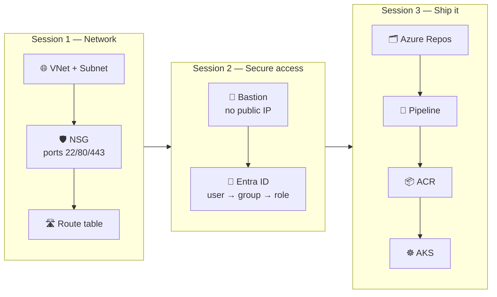

# 📘 Week 3 — Azure, AKS & CI/CD

**Classes held:** Saturday **18 July 2026** (Class 4) and Sunday **19 July 2026** (Class 5)

This week we left the laptop behind and built everything **live in Azure**: a network, a locked-down VM, identity and permissions, a managed Kubernetes cluster, and a pipeline that ships an image without anyone pressing a button.

---

## 🗺️ Notes index

### 🌐 Session 1 — Azure Networking *(Class 4, Session 1)*

| Note | What it covers |
|---|---|
| [Azure Networking — VNet, Subnet, NSG & Ports](session-1/azure-networking.md) | Resource groups, VNet & CIDR, subnets, **why SSH failed**, ports 22/80/443, NSG source options |
| [Route Tables & UDR](session-1/route-tables.md) | System routes, user-defined routes, **next hop None**, overriding the default route |

### 🏰 Session 2 — Bastion & Identity *(Class 4, Session 2)*

| Note | What it covers |
|---|---|
| [Azure Bastion](session-2/bastion-host.md) | Private VM with **no public IP**, browser login, enabling copy/paste |
| [Entra ID & RBAC — concepts](session-2/entra-id-rbac-concepts.md) | AuthN vs AuthZ, **why groups**, scope hierarchy, built-in roles |
| [Entra ID — hands-on walkthrough](session-2/entra-id-user-group-rbac.md) | 🗺️ Full click-by-click portal steps with in-repo schematic diagrams |

### ☸️ Session 3 — AKS, ACR & Azure DevOps *(Class 5)*

| Note | What it covers |
|---|---|
| [AKS — managed Kubernetes](session-3/aks-cluster.md) | **Managed vs on-prem**, node sizing, **raising a vCPU quota request** |
| [Azure Container Registry](session-3/acr.md) | Private registry, image naming, `--attach-acr` and `ImagePullBackOff` |
| [Azure DevOps — org & project](session-3/azure-devops-org-project.md) | The two portals, organization, project, the five services |
| [Service Connections](session-3/service-connections.md) | The bridge from DevOps to Azure, all the auth options |
| [Azure Repos — Git](session-3/azure-repos-git.md) | Cloning, **recovering a forgotten Git password**, pushing the app |
| [Building the CI Pipeline](session-3/pipelines-ci.md) | The YAML line by line, running it, confirming the image in ACR |
| [Agents — hosted vs self-hosted](session-3/agents-hosted-vs-selfhosted.md) | **Where the job actually runs**, registering your own agent |

### 💻 Demo code

[`session-3/demo-app/`](session-3/demo-app/) — the exact Flask app, Dockerfile and pipeline YAML used in Class 5.

---

## 🔗 How the week fits together



---

## 💳 Cloud cost — please read

From Week 3 onward you use **your own Azure account**, and these are **real billable resources**.

| Resource | Billing note |
|---|---|
| VM | Per minute while running |
| Public IP | Charged even when the VM is stopped |
| **Bastion** | ⚠️ **Hourly, whether or not anyone is connected** |
| AKS control plane | ✅ Free |
| AKS worker nodes | Per minute, per node |
| Load Balancer | Hourly |
| ACR | Per GB stored |

```bash
# The one command to run at the end of EVERY lab
az group delete --name cbc-intrenship-program --yes --no-wait
```

> 🧯 Put everything in **one resource group** so a single delete removes it all. `az aks stop` pauses node billing if you want to resume tomorrow.

---

## 📝 Assessments

Your Week 3 assignment is in [`Assessment/`](Assessment/) — find the file with your name.

---

## 🎥 Recordings

Links are in [`CLASS-RECORDINGS.md`](../../CLASS-RECORDINGS.md).

_Part of the CareerByteCode Bangalore — Cloud & DevOps Internship Program._
