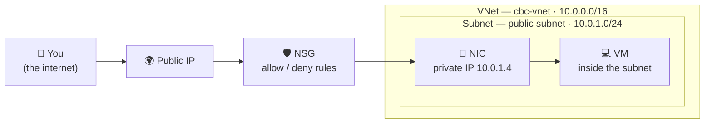
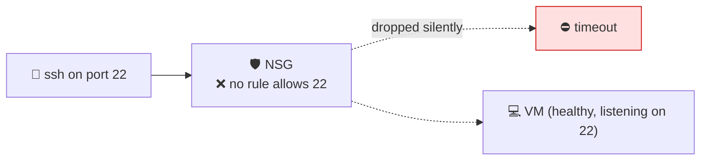
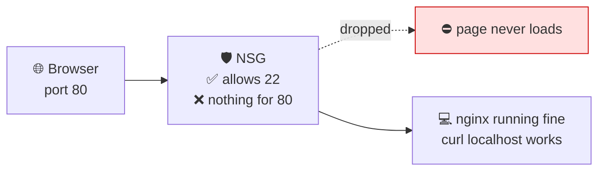
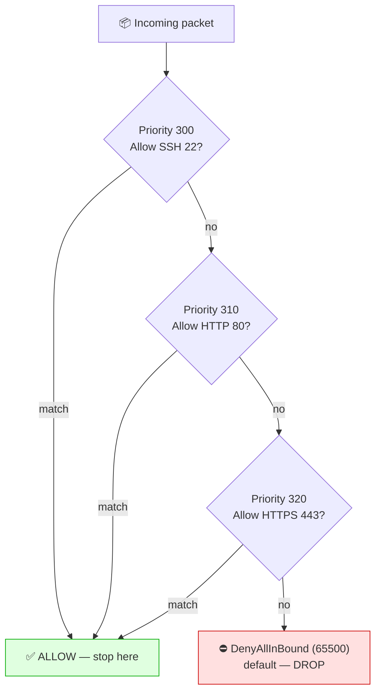

# 🌐 Azure Networking — VNet, Subnet, NSG & Ports

**Week 3 · Session 1 (Class 4 — Saturday, 18 July 2026)**

In this class we built a small network **live in the Azure portal**, deliberately hit two failures, and fixed them one at a time. That "break it, then fix it" order is the whole point — it shows you *why* each piece exists.

---

## 🎯 What you will learn

- What a Resource Group, VNet, Subnet and NSG are
- Why a VM with a public IP still refuses your SSH login
- Why a web server that is "running" still shows nothing in the browser
- How ports 22, 80 and 443 change the picture
- How to clean up so you stop paying

---

## 🧠 The mental model (read this first)

Think of Azure networking like an **apartment building**:

| Azure thing | Building analogy |
|---|---|
| **Resource Group** | The folder of paperwork for the whole property |
| **VNet** (`10.0.0.0/16`) | The building itself, with its own address range |
| **Subnet** (`10.0.1.0/24`) | One floor in that building |
| **NIC + Private IP** | The flat number of one apartment |
| **Public IP** | The street address visible to the outside world |
| **NSG** | The security guard at the door, holding a list of who may enter |

The lesson of this class: **having a street address (public IP) is useless if the guard (NSG) turns everyone away.**



---

## 🧱 Understanding CIDR (the `/16` and `/24`)

CIDR just says **how many addresses** you get.

| CIDR | Address range | Roughly how many IPs | Typical use |
|---|---|---|---|
| `10.0.0.0/16` | 10.0.0.0 → 10.0.255.255 | ~65,536 | A whole VNet |
| `10.0.1.0/24` | 10.0.1.0 → 10.0.1.255 | 256 (251 usable) | One subnet |

> 🧮 **Simple rule:** the *bigger* the number after the slash, the *smaller* the network. `/16` is a building; `/24` is one floor of it.
> ⚠️ Azure reserves **5 IPs** in every subnet, so a `/24` gives you 251 usable, not 256.

---

## 🛠️ Step-by-step — what we built in class

### Step 1 — Create the Resource Group

A Resource Group (RG) is a container. Deleting the RG deletes everything inside it — which is exactly how we clean up at the end.

1. Portal → search **Resource groups** → **+ Create**
2. Fill in:

| Field | Value used in class |
|---|---|
| Subscription | Your Azure subscription |
| Resource group | `cbc-intrenship-program` |
| Region | East US |

3. **Review + create** → **Create**

```bash
# CLI equivalent
az group create --name cbc-intrenship-program --location eastus
```

---

### Step 2 — Create the Virtual Network (no subnet yet)

We created the VNet with the **default CIDR only**, and deliberately left the subnet for the next step so you can see them as two separate ideas.

1. Portal → search **Virtual networks** → **+ Create**
2. Fill in:

| Field | Value used in class |
|---|---|
| Resource group | `cbc-intrenship-program` |
| Name | `cbc-vnet` |
| Region | East US |
| IPv4 address space | `10.0.0.0/16` |

3. **Review + create** → **Create**

```bash
az network vnet create \
  --resource-group cbc-intrenship-program \
  --name cbc-vnet \
  --address-prefix 10.0.0.0/16
```

---

### Step 3 — Add the subnet manually

1. Open `cbc-vnet` → left menu **Subnets** → **+ Subnet**
2. Fill in:

| Field | Value used in class |
|---|---|
| Name | `public subnet` |
| Subnet address range | `10.0.1.0/24` |

3. **Save**

```bash
az network vnet subnet create \
  --resource-group cbc-intrenship-program \
  --vnet-name cbc-vnet \
  --name public-subnet \
  --address-prefix 10.0.1.0/24
```

> 💡 We called it "public subnet" because the VMs in it get a public IP. Azure has no special "public subnet" type — the name is just a label. **What actually makes it reachable is the NSG rules**, not the name.

---

### Step 4 — Create the VM with **no ports open** (this is intentional)

| Field | Value used in class |
|---|---|
| Resource group | `cbc-intrenship-program` |
| Virtual machine name | `cbc-vm` |
| Region | East US |
| Image | Ubuntu Server 24.04 LTS — x64 Gen2 |
| Size | `Standard_B1s` (1 vCPU, 1 GiB) |
| Authentication type | Password |
| Username | `learning` |
| Password | *(your own strong password)* |
| Virtual network | `cbc-vnet` |
| Subnet | `public subnet` |
| Public IP | Create new |
| **Public inbound ports** | **None** ⬅️ deliberately |

**Review + create** → **Create**, then copy the VM's **Public IP address** from the Overview page.

---

## ❌ Failure #1 — "Why can't I SSH in?"

```bash
ssh learning@<public-ip>
# ssh: connect to host <public-ip> port 22: Connection timed out
```

The VM is **Running**. It **has** a public IP. So why does this fail?



**The answer:** every Azure VM sits behind a **Network Security Group (NSG)**. Its default inbound rule set **denies everything from the internet**. The VM is fine; the guard at the door is turning you away.

> 🔍 **Why a *timeout* and not "connection refused"?**
> - **Timeout** = something silently dropped your packet → almost always a firewall/NSG problem.
> - **Connection refused** = the packet arrived but nothing is listening → an application problem.
>
> Learning to read this difference will save you hours. It is a classic interview question too.

### Fix — open port 22 only

1. VM → **Networking** → **Network settings** → **Add inbound port rule**
2. Fill in:

| Field | Value |
|---|---|
| Source | Any *(better: **My IP address**)* |
| Source port ranges | `*` |
| Destination | Any |
| Service | SSH |
| Destination port ranges | `22` |
| Protocol | TCP |
| Action | Allow |
| Priority | `300` |
| Name | `Allow-SSH` |

3. **Add**, wait ~30 seconds, then retry:

```bash
ssh learning@<public-ip>     # ✅ now it works
```

---

## 🌍 Install nginx — and hit Failure #2

Inside the VM:

```bash
sudo apt update
sudo apt install nginx -y
systemctl status nginx        # should show: active (running)
curl http://localhost         # ✅ HTML comes back — it IS working locally
```

Now open `http://<public-ip>` in your **browser** → ⏳ it hangs, then fails.



**The answer:** opening port 22 only allowed **SSH**. Web traffic uses **port 80 (HTTP)** and **port 443 (HTTPS)**. NSG rules are **per-port** — one open door does not open the others.

### Fix — open 80 and 443

Repeat the inbound-rule steps twice:

| Name | Port | Service | Priority |
|---|---|---|---|
| `Allow-HTTP` | 80 | HTTP | 310 |
| `Allow-HTTPS` | 443 | HTTPS | 320 |

Refresh the browser → 🎉 **"Welcome to nginx!"**

---

## 🎯 The Source field — we looked at every option

While adding the rule, we opened the **Source** dropdown. This is the single most important security choice in the whole form.

| Source option | What it means | When to use |
|---|---|---|
| **Any** | The entire internet | Demos only — ⚠️ never for SSH in production |
| **IP Addresses** | A specific IP or CIDR you type | Lock SSH to your office/home IP |
| **My IP address** | Azure fills in your current public IP | ✅ Best choice while learning |
| **Service Tag** | A named Azure group (e.g. `AzureLoadBalancer`, `Internet`) | Allow Azure services without hardcoding IPs |
| **Application Security Group** | A logical group of VMs | Grouping app tiers at scale |

> 🔐 **Rule of thumb:** port **80/443 = Any** is normal (it's a public website). Port **22 = Any** is dangerous — bots scan for it within minutes. Always scope SSH to **My IP address**.

---

## 📊 How NSG rules are actually evaluated



Three rules you must remember:

1. **Lower priority number = evaluated first** (100 beats 4096).
2. **First match wins** — evaluation stops immediately.
3. There is always a hidden final rule: **DenyAllInBound**. If nothing matched, the packet dies.

---

## 🧹 Cleanup — do this every single time

This is the most important habit of Week 3. Azure charges by the minute.

```bash
az group delete --name cbc-intrenship-program --yes --no-wait
```

Or: Portal → Resource groups → `cbc-intrenship-program` → **Delete resource group**.

> 💳 **A `Standard_B1s` VM left running for a month costs real money.** A public IP costs money even when the VM is stopped. **Delete the whole resource group** after every lab — that is why we put everything in one RG.

---

## 🆘 Troubleshooting cheat-sheet

| Symptom | Most likely cause | Fix |
|---|---|---|
| SSH times out | No NSG rule for port 22 | Add inbound rule, source = My IP |
| SSH says "connection refused" | VM still booting, or sshd stopped | Wait 60s; check `systemctl status ssh` |
| Browser hangs on port 80 | No NSG rule for 80 | Add `Allow-HTTP` |
| `curl localhost` works, browser doesn't | Network problem, not an app problem | It is the NSG — always |
| Browser fails but nginx is stopped | Application problem | `sudo systemctl start nginx` |
| Rule added but still blocked | A lower-priority Deny rule wins | Sort rules by priority and check |
| Everything works, bill is growing | Resources still alive | `az group delete ...` |

---

## ✅ Key takeaways

1. A **public IP alone gives you nothing** — the NSG decides who gets in.
2. NSG rules are **per port**. 22 for SSH, 80 for HTTP, 443 for HTTPS.
3. **Timeout = firewall. Refused = application.** Learn this difference.
4. `curl localhost` working while the browser fails **proves** it is a network problem.
5. Scope SSH to **My IP address**, never `Any`.
6. **Delete the resource group** after every lab.

---

➡️ **Next:** [Route Tables & User-Defined Routes](route-tables.md)

_Part of the CareerByteCode Bangalore — Cloud & DevOps Internship Program._
