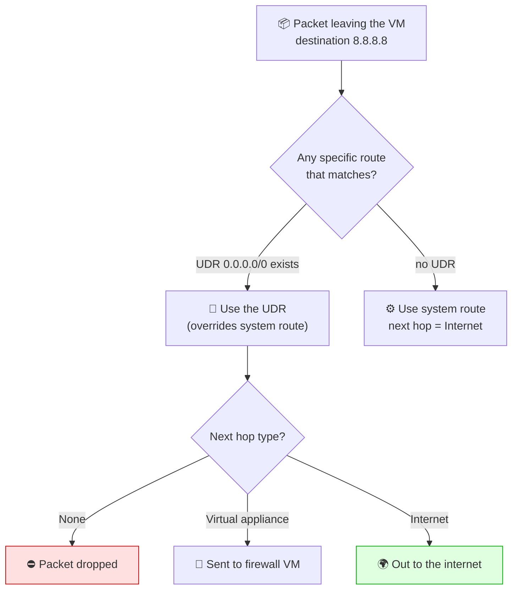
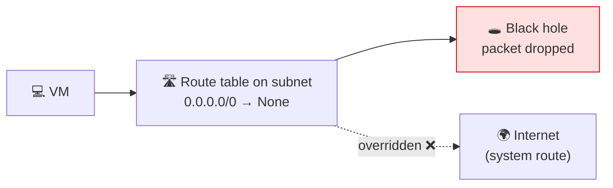

# 🛣️ Route Tables & User-Defined Routes (UDR)

**Week 3 · Session 1 (Class 4 — Saturday, 18 July 2026)**

NSGs control **who is allowed in**. Route tables control **where traffic goes next**. In class we used a route table to *deliberately cut off the VM's internet access* — because breaking it is the clearest way to prove the route table is really in charge.

---

## 🎯 What you will learn

- What Azure's invisible "system routes" already do for you
- What a User-Defined Route (UDR) is and when you need one
- What each **next hop type** means
- How to override a system route (and why that's powerful)

---

## 🧠 System routes — the ones you never created

The moment you create a VNet, Azure silently adds routes for you. That is why a fresh VM can reach the internet without you configuring anything.

| Destination | Next hop | What it does |
|---|---|---|
| `10.0.0.0/16` (your VNet) | Virtual network | VM-to-VM traffic inside the VNet |
| `0.0.0.0/0` | **Internet** | ⬅️ everything else goes out to the internet |
| `168.63.129.16` | Azure platform | Azure's internal DNS/health service |

> 🔑 `0.0.0.0/0` means **"any destination I don't have a more specific route for."** It is the default route — the catch-all.

---

## 🧭 The rule that makes routing work

Azure always picks the **most specific match** (the longest prefix), and a **UDR beats a system route** at the same specificity.



---

## 🔌 Next hop types — what each one means

| Next hop type | Plain-English meaning | Real use case |
|---|---|---|
| **Internet** | Send it out to the public internet | The default behaviour |
| **None** | 🚫 Drop the packet — a black hole | Block internet access (what we did in class) |
| **Virtual appliance** | Send it to a specific IP first | Force traffic through a firewall for inspection |
| **Virtual network gateway** | Send it over VPN / ExpressRoute | Route traffic back to your on-prem datacentre |
| **Virtual network** | Keep it inside the VNet | Custom subnet-to-subnet paths |

---

## 🛠️ Step-by-step — what we built in class

### Step 1 — Create the route table

1. Portal → search **Route tables** → **+ Create**
2. Fill in:

| Field | Value used in class |
|---|---|
| Resource group | `cbc-intrenship-program` |
| Region | East US |
| Name | `cbc-route-table` |
| Propagate gateway routes | Yes (default) |

3. **Review + create** → **Create**

```bash
az network route-table create \
  --resource-group cbc-intrenship-program \
  --name cbc-route-table
```

---

### Step 2 — Add a route that overrides the internet

This is the interesting part. We add a route for `0.0.0.0/0` — the **same destination as the system route** — but point it at **None**.

1. Open `cbc-route-table` → **Routes** → **+ Add**
2. Fill in:

| Field | Value used in class |
|---|---|
| Route name | `block-internet` |
| Address prefix destination | IP Addresses |
| Destination IP addresses | `0.0.0.0/0` |
| **Next hop type** | **None** ⬅️ the whole point |

3. **Add**

```bash
az network route-table route create \
  --resource-group cbc-intrenship-program \
  --route-table-name cbc-route-table \
  --name block-internet \
  --address-prefix 0.0.0.0/0 \
  --next-hop-type None
```

---

### Step 3 — Attach it to the subnet

⚠️ **A route table does nothing until it is associated with a subnet.** This is the step people forget.

1. `cbc-route-table` → **Subnets** → **+ Associate**
2. Choose:

| Field | Value |
|---|---|
| Virtual network | `cbc-vnet` |
| Subnet | `public subnet` |

3. **OK**

```bash
az network vnet subnet update \
  --resource-group cbc-intrenship-program \
  --vnet-name cbc-vnet \
  --name public-subnet \
  --route-table cbc-route-table
```

---

### Step 4 — Prove it worked

SSH into the VM (port 22 still works — that's inbound, and we only changed outbound routing), then:

```bash
ping 8.8.8.8          # ❌ hangs — no reply
sudo apt update       # ❌ fails, cannot reach the repositories
curl https://google.com   # ❌ times out
```

The VM is healthy. Nothing is broken. **You simply told Azure to throw away every packet heading for the internet.**



### Step 5 — Undo it

Delete the route (or dissociate the table) and internet access returns instantly — no VM restart needed.

```bash
az network route-table route delete \
  --resource-group cbc-intrenship-program \
  --route-table-name cbc-route-table \
  --name block-internet
```

---

## 🏢 Why this matters in the real world

Dropping traffic sounds destructive, but the same mechanism powers serious production designs:

| Goal | How UDR achieves it |
|---|---|
| **Force all traffic through a firewall** | `0.0.0.0/0` → Virtual appliance (the firewall's IP) |
| **Lock down a database subnet** | `0.0.0.0/0` → None, so it can never call out |
| **Send traffic to on-prem** | `10.50.0.0/16` → Virtual network gateway |
| **Inspect outbound web traffic** | Route via Azure Firewall for logging + filtering |

> 🏦 Regulated industries (banking, healthcare) almost always force outbound traffic through an inspection appliance. This is exactly the pattern you just built.

---

## 🆚 NSG vs Route Table — do not confuse them

| | **NSG** | **Route Table (UDR)** |
|---|---|---|
| Question it answers | *Is this traffic allowed?* | *Where does this traffic go next?* |
| Works on | Ports, protocols, source/destination IPs | Destination IP ranges only |
| Actions | Allow / Deny | Choose a next hop |
| Attached to | Subnet **or** NIC | Subnet **only** |
| Class example | Opening 22, 80, 443 | Sending `0.0.0.0/0` to None |

> 🧠 **One-liner:** NSG = **security guard**. Route table = **road signs**. A guard can let you in; the signs decide which road you drive down.

---

## 🧹 Cleanup

```bash
az group delete --name cbc-intrenship-program --yes --no-wait
```

---

## 🆘 Troubleshooting cheat-sheet

| Symptom | Cause | Fix |
|---|---|---|
| Route table created but nothing changed | Not associated with a subnet | Associate it (Step 3) |
| Lost SSH after adding the route | You blocked a range covering your own IP | Dissociate the table from the portal |
| `apt update` fails, ping fails | Working as designed — `0.0.0.0/0` → None | Delete the route |
| Route seems ignored | A more specific route matched first | Check **Effective routes** on the NIC |

> 🔍 **Best debugging tool:** VM → **Networking** → NIC → **Effective routes**. It shows the *final* routes Azure is applying, system and custom combined.

---

## ✅ Key takeaways

1. Azure gives you **system routes** automatically — that's why internet "just works".
2. A **UDR overrides a system route** for the same prefix.
3. Next hop **None** = deliberate black hole.
4. A route table is **inert until associated with a subnet**.
5. **NSG = allowed or not. Route table = which way.**
6. Use **Effective routes** to debug instead of guessing.

---

⬅️ **Previous:** [Azure Networking — VNet, Subnet, NSG & Ports](azure-networking.md)
➡️ **Next:** [Azure Bastion — logging into a private VM](../session-2/bastion-host.md)

_Part of the CareerByteCode Bangalore — Cloud & DevOps Internship Program._
