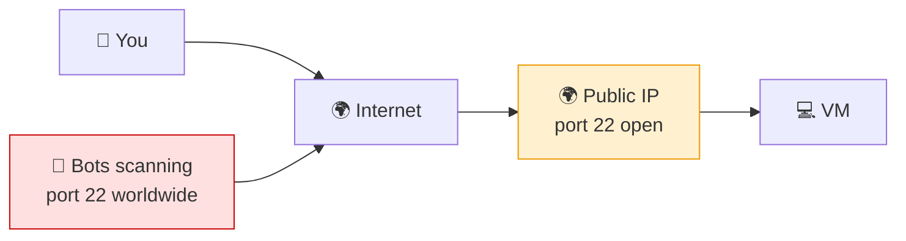
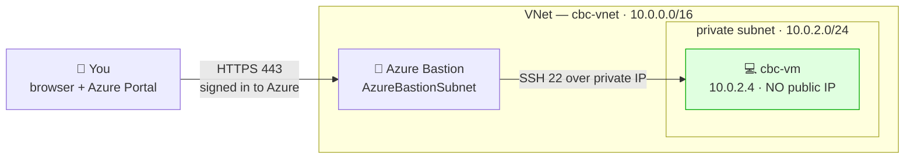

# 🏰 Azure Bastion — Logging into a Private VM

**Week 3 · Session 2 (Class 4 — Saturday, 18 July 2026)**

In Session 1 our VM had a **public IP** and we opened port 22 to the internet. That works, but it is exactly what attackers scan for. In this session we rebuilt the same setup **without any public IP** and logged in through **Azure Bastion** instead.

---

## 🎯 What you will learn

- Why exposing port 22 to the internet is a bad habit
- What Azure Bastion is and how it removes that risk
- How to build a VM with **no public IP** and still log in
- How to turn on Bastion's copy/paste (it is **off** by default)

---

## 🤔 The problem with what we did in Session 1



An open SSH port on a public IP gets **found within minutes** by automated scanners, and they start guessing passwords immediately. In a real company this is a finding an auditor will fail you on.

**What we actually want:** a VM with **no public IP at all**, reachable only through a controlled front door.

---

## 🏰 What Azure Bastion is

Azure Bastion is a **managed jump box**. Azure runs and patches it for you. You open the VM's console **inside your browser**, over HTTPS, and Bastion connects onward to the VM's **private IP**.



**What you gain:**

| Benefit | Why it matters |
|---|---|
| ❌ No public IP on the VM | Nothing for scanners to find |
| ❌ No inbound 22/3389 from the internet | Your NSG stays closed |
| ✅ Access requires an Azure login | Identity-based, not just a password |
| ✅ Works in the browser | No VPN client, no SSH key juggling |
| ✅ Azure patches it | One less server for you to maintain |

---

## 🛠️ Step-by-step — what we built in class

We rebuilt the Session 1 environment with **two changes**: Bastion enabled, and the VM given **no public IP**.

### Step 1 — Resource group

```bash
az group create --name cbc-intrenship-program --location eastus
```

---

### Step 2 — Create the VNet with Bastion enabled

Bastion needs its **own dedicated subnet** with an exact, non-negotiable name.

1. Portal → **Virtual networks** → **+ Create**
2. **Basics:** RG `cbc-intrenship-program`, name `cbc-vnet`, region East US
3. **Security** tab → **Azure Bastion** → **Enable**

| Field | Value |
|---|---|
| Bastion name | `cbc-vnet-bastion` |
| Bastion public IP | Create new |

4. **IP addresses** tab → address space `10.0.0.0/16`, and add your workload subnet:

| Subnet | Range | Purpose |
|---|---|---|
| `AzureBastionSubnet` | `10.0.1.0/26` | ⬅️ created automatically, name is mandatory |
| `private subnet` | `10.0.2.0/24` | Where our VM will live |

5. **Review + create** → **Create**

> ⚠️ **Two hard rules:**
> 1. The subnet **must** be named exactly `AzureBastionSubnet` — not `bastion`, not `Bastion-Subnet`. Azure will reject anything else.
> 2. It must be **/26 or larger** (`/26`, `/25`, `/24`). A `/27` will fail.
>
> ⏳ Bastion takes **5–10 minutes** to deploy. This is normal — don't panic.

---

### Step 3 — Create the VM with **no public IP**

Same VM settings as Session 1, with two critical differences:

| Field | Value used in class |
|---|---|
| Resource group | `cbc-intrenship-program` |
| Virtual machine name | `cbc-vm` |
| Image | Ubuntu Server 24.04 LTS |
| Size | `Standard_B1s` |
| Authentication | Password |
| Username | `learning` |
| Virtual network | `cbc-vnet` |
| **Subnet** | **`private subnet`** ⬅️ change |
| **Public IP** | **None** ⬅️ change |
| Public inbound ports | **None** |

**Review + create** → **Create**

> 🔒 This VM now has **no route in from the internet whatsoever**. Try to SSH to it and there is not even an address to aim at.

---

### Step 4 — Log in through Bastion

1. Open the VM → **Connect** → **Bastion**
2. Enter:

| Field | Value |
|---|---|
| Authentication type | VM Password |
| Username | `learning` |
| Password | *(your VM password)* |

3. Click **Connect**

A **new browser tab** opens with a working shell on the VM. 🎉

```bash
hostname -I     # shows only the private IP, e.g. 10.0.2.4
whoami          # learning
```

> 🔑 Notice what just happened: you got a shell on a machine that has **no public IP and no open inbound ports**. That is the whole point of Bastion.

---

## 📋 Enable copy & paste (off by default)

Straight after connecting, everyone hits the same wall: **Ctrl+V doesn't work.** This caught us in class too.

**Fix:**

1. Portal → search **Bastions** → open `cbc-vnet-bastion`
2. Left menu → **Configuration**
3. Tick **Copy and paste**
4. **Apply**, then reconnect your session

| Setting | Default | What it does |
|---|---|---|
| **Copy and paste** | ❌ Off | Clipboard between your laptop and the VM |
| Native client support | ❌ Off | Lets you use a real `ssh` client via Bastion |
| IP-based connection | ❌ Off | Connect by IP instead of picking a VM |
| File copy | ❌ Off | Upload/download files (Standard SKU) |

> 💡 **Using it:** in the Bastion tab there is a small **clipboard icon** on the left edge. Paste your text there, then paste into the shell. On some browsers plain `Ctrl+Shift+V` works once the setting is on.
> ⚠️ Some options need the **Standard SKU**, not Basic/Developer. If a checkbox is greyed out, that is why.

---

## 💰 Cost warning — read this one carefully

**Bastion is charged per hour, and it keeps charging even when nobody is connected.** It is one of the easiest ways for a student to get a surprise bill.

| Resource | Charged when |
|---|---|
| VM | While running (stop/deallocate to pause) |
| Public IP | Always, once allocated |
| **Bastion** | ⚠️ **Always, per hour, from deploy to delete** |

```bash
# Delete EVERYTHING when the lab is over
az group delete --name cbc-intrenship-program --yes --no-wait
```

> 💳 **Do not leave Bastion running overnight.** Delete the resource group the moment you finish. Stopping the VM is **not** enough — Bastion bills independently.

---

## 🆚 Public IP + SSH vs Bastion

| | **Public IP + open 22** | **Bastion** |
|---|---|---|
| VM has a public IP | ✅ Yes | ❌ No |
| Port 22 open to internet | ✅ Yes ⚠️ | ❌ No |
| Exposed to bot scanning | ✅ Yes ⚠️ | ❌ No |
| Requires Azure sign-in | ❌ No | ✅ Yes |
| Client needed | SSH client | Just a browser |
| Cost | Cheap (IP only) | ⚠️ Hourly charge |
| Suitable for production | ❌ No | ✅ Yes |

---

## 🆘 Troubleshooting cheat-sheet

| Symptom | Cause | Fix |
|---|---|---|
| "Subnet name must be AzureBastionSubnet" | Wrong subnet name | Rename it exactly, case-sensitive |
| Subnet creation rejected | Range smaller than /26 | Use `/26` or bigger |
| Bastion stuck deploying | Normal — it is slow | Wait 5–10 minutes |
| **Connect → Bastion** greyed out | Bastion not deployed in this VNet | Deploy it first |
| Ctrl+V does nothing | Copy/paste disabled | Configuration → tick **Copy and paste** |
| Connects then drops instantly | Wrong username/password | Reset via VM → **Reset password** |
| Bill higher than expected | Bastion still deployed | Delete the resource group |

---

## ✅ Key takeaways

1. A public IP with open SSH is **scanned by bots within minutes**.
2. Bastion gives browser-based access to a VM with **no public IP**.
3. The subnet **must** be named `AzureBastionSubnet` and be **/26 or larger**.
4. **Copy/paste is off by default** — enable it in Configuration.
5. Access now requires an **Azure identity**, not just a password.
6. **Bastion bills hourly** — delete the resource group after every lab.

---

⬅️ **Previous:** [Route Tables & UDR](../session-1/route-tables.md)
➡️ **Next:** [Entra ID — users, groups & RBAC](entra-id-user-group-rbac.md)

_Part of the CareerByteCode Bangalore — Cloud & DevOps Internship Program._
