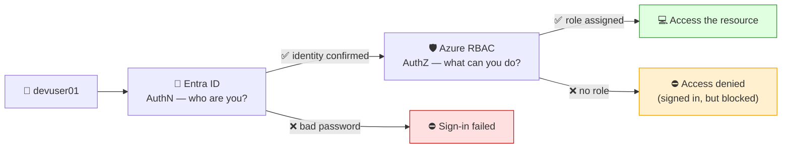
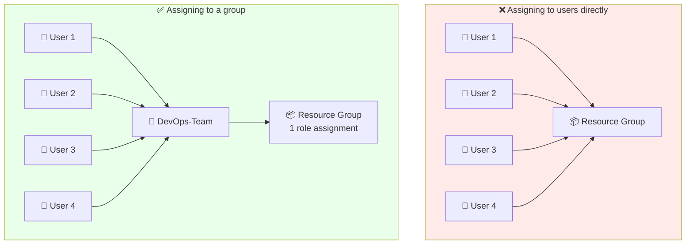
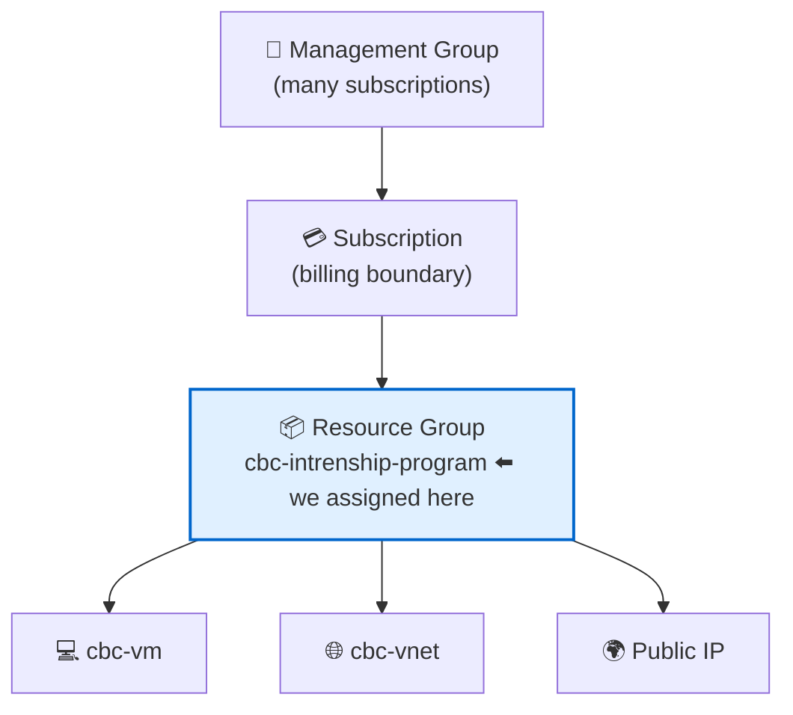
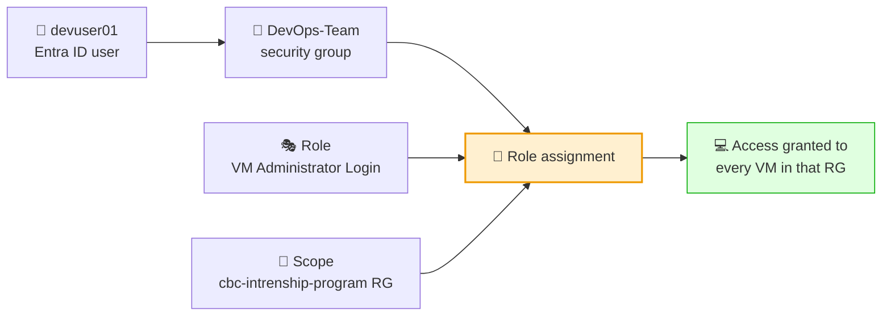

# 🔐 Entra ID & Azure RBAC — The Concepts

**Week 3 · Session 2 (Class 4 — Saturday, 18 July 2026)** · continued in **Class 5 — Sunday, 19 July 2026**

> 📘 **This file explains *why*.** For the click-by-click portal walkthrough with screenshots, use
> ➡️ **[Entra ID — user creation, group assignment & resource permission](entra-id-user-group-rbac.md)**

---

## 🎯 What you will learn

- What Microsoft Entra ID is and why every Azure account has one
- The difference between **authentication** and **authorization**
- Why we assign permissions to **groups**, never to individual users
- How RBAC **scope** works (management group → subscription → RG → resource)
- What the common built-in roles actually let you do

---

## 🪪 Entra ID in one sentence

**Microsoft Entra ID (formerly Azure Active Directory) is the identity system for Azure — it holds your users and groups, and it is what checks who you are when you sign in.**

> 📛 **Name change:** Azure AD was renamed to **Microsoft Entra ID** in 2023. Older tutorials, exam questions and blog posts still say "Azure AD" — same product.

---

## 🚪 Authentication vs Authorization

These two words sound alike and are constantly confused. Keep them apart:

| | **Authentication** (AuthN) | **Authorization** (AuthZ) |
|---|---|---|
| Question | *Who are you?* | *What are you allowed to do?* |
| Handled by | **Entra ID** | **Azure RBAC** |
| Example | Signing in as `devuser01@...` | Being allowed to restart `cbc-vm` |
| Failure looks like | "Wrong username or password" | "You do not have permission to perform this action" |



> 🔍 **This trips everyone up:** a user can log into the Azure Portal successfully and still see **an empty dashboard**. That is not a broken login — it is a *successful* authentication with **no authorization**. They are in the building but hold no keys.

---

## 👥 Why groups, not users

This was the core lesson of the session. Compare the two approaches for a team of 10 engineers needing access to 5 resource groups:

| Approach | Assignments to manage | New joiner | Someone leaves |
|---|---|---|---|
| ❌ Direct to each user | 10 × 5 = **50** | Repeat 5 assignments | Hunt down 5 assignments |
| ✅ Via a group | **5** (group → RG) | Add to 1 group | Remove from 1 group |



> 🏢 **Real-world rule:** permissions follow the **job**, not the person. Assign the role to `DevOps-Team`, then membership becomes an HR action — add on day one, remove on the last day. Nothing is forgotten, and an audit takes seconds.

---

## 🎯 RBAC scope — where a permission applies

A role assignment always has a **scope**, and it **flows downward**. Assign at a resource group and it covers everything inside — present and future.



| Scope | Blast radius | Use it when |
|---|---|---|
| Management group | Every subscription underneath | Enterprise-wide policy |
| Subscription | Everything in that subscription | Platform/admin teams |
| **Resource group** | All resources in the RG ⬅️ *the sweet spot* | Project or environment teams |
| Resource | One single item | Tightly restricted, one-off access |

> ⚖️ **Principle of least privilege:** grant at the **smallest scope that still does the job**. Assigning Owner at the subscription because it is quicker is how companies get breached.
> 💡 In class we assigned at the **resource group** — the practical default for a project team.

---

## 🎭 Built-in roles you must know

| Role | Read | Modify | Delete | Grant access to others |
|---|---|---|---|---|
| **Reader** | ✅ | ❌ | ❌ | ❌ |
| **Contributor** | ✅ | ✅ | ✅ | ❌ |
| **Owner** | ✅ | ✅ | ✅ | ✅ ⚠️ |
| **User Access Administrator** | ✅ | ❌ | ❌ | ✅ |

**The VM-specific roles we used in class:**

| Role | What it grants |
|---|---|
| **Virtual Machine User Login** | Sign in to the VM as a **normal user** |
| **Virtual Machine Administrator Login** | Sign in to the VM with **admin/sudo** rights |
| **Network Contributor** | Manage networking (VNet, NSG, NIC) |

> 🔑 **Important distinction:** *Contributor* lets you **manage the VM resource** (start, stop, resize, delete) but does **not** give you a login inside the operating system. To actually SSH in with your Entra identity you need **Virtual Machine User Login** or **Administrator Login**. Two different layers — control plane vs data plane.

---

## 🧩 How the pieces fit together



**A role assignment is always exactly three things:**

> **WHO** (user/group) + **WHAT** (role) + **WHERE** (scope)

Miss any one and the permission does not exist. When troubleshooting "access denied", check all three in that order.

---

## 🔌 Signing in to the VM with your Entra identity

Once the group holds **Virtual Machine Administrator Login** on the resource group:

```bash
# 1. Sign in as the Entra ID user
az login

# 2. Confirm which identity you are using
az account show --query user.name -o tsv

# 3. SSH to the VM using your Entra identity (no VM password needed)
az ssh vm --resource-group cbc-intrenship-program --name cbc-vm
```

> 💡 `az ssh vm` requires the **Azure AD login extension** on the VM. When creating the VM, tick **"Login with Microsoft Entra ID"** under the Management tab. Without it, `az ssh vm` will fail even with the correct role.

---

## 🆘 Troubleshooting cheat-sheet

| Symptom | Cause | Fix |
|---|---|---|
| Signs in, sees an empty portal | AuthN worked, no role assigned | Assign a role at the RG scope |
| "You do not have permission…" | Role missing, or wrong scope | Check WHO + WHAT + WHERE |
| Added to group, still blocked | Token still holds old claims | Sign out and back in |
| Can start/stop the VM but cannot SSH | Has Contributor, not *VM Login* role | Add **Virtual Machine Administrator Login** |
| `az ssh vm` fails | Entra login extension missing on VM | Enable Microsoft Entra login on the VM |
| Forced to change password on first login | Auto-generated temporary password | Set a new one when prompted |

---

## ✅ Key takeaways

1. **Entra ID = identity (AuthN). Azure RBAC = permissions (AuthZ).**
2. A successful login with an empty portal means **no role assigned** — not a broken account.
3. Always assign roles to **groups**, never to individual users.
4. Permissions **inherit downward** through the scope hierarchy.
5. Every role assignment = **WHO + WHAT + WHERE**.
6. Managing the VM resource ≠ logging into the operating system.
7. Grant the **smallest scope** that gets the job done.

---

⬅️ **Previous:** [Azure Bastion](bastion-host.md)
📘 **Hands-on walkthrough:** [Entra ID user, group & permission steps](entra-id-user-group-rbac.md)
➡️ **Next:** [AKS — managed Kubernetes](../session-3/aks-cluster.md)

_Part of the CareerByteCode Bangalore — Cloud & DevOps Internship Program._
