# Microsoft Entra ID — Users, Security Groups and Azure RBAC

**Week 3 · Session 2 · Hands-on lab**

You will create an identity in Microsoft Entra ID, place it in a security group, deploy a
virtual machine, grant the **group** a role on the resource group, and then prove the whole
chain works by signing in as that user and connecting to the VM.

> **About the diagrams in this document**
> Every figure is an original schematic wireframe generated for this repository — it shows the
> blade layout, the navigation path, the exact fields to fill and the click order. They are
> deliberately drawn as diagrams rather than screenshots: the Azure portal changes its UI
> regularly, and a diagram that shows *structure* stays correct far longer than a screenshot
> that shows *pixels*. All files live in `images/` inside this repo, so they render in forks,
> clones, private repos, offline and in PDF exports.

---

## What you are building

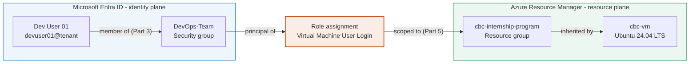

A role assignment is always the same three things: **who** (principal) gets **what**
(role definition) **where** (scope). Break any one link and access disappears — which is
exactly what makes this model auditable.

| Part | What you do | Plane |
|---|---|---|
| 1 | Create a user | Identity |
| 2 | Create a security group | Identity |
| 3 | Add the user to the group | Identity |
| 4 | Deploy a virtual machine | Resource |
| 5 | Assign a role to the group, scoped to the resource group | Authorization |
| 6 | Sign in as the user and connect to the VM | Verification |

---

## Prerequisites

| Requirement | Detail |
|---|---|
| Azure subscription | Any subscription where you can create resources |
| Directory role | **User Administrator** or **Global Administrator** (to create users and groups) |
| Azure role | **Owner** or **User Access Administrator** on the subscription or resource group (to create role assignments) |
| Local tools | Azure CLI with the `ssh` extension, plus WSL / MobaXterm / any terminal |
| Time | ~60 minutes |

> ⚠️ **Cost:** the VM, its managed disk and its public IP all bill while they exist.
> Delete the resource group when you finish — see [Cleanup](#cleanup).

---

## Step 1 — Sign in to the Azure portal

1. Open **https://portal.azure.com**
2. Enter the **user principal name** of your administrator account.
3. Click **Next**, then complete the password and MFA prompts.

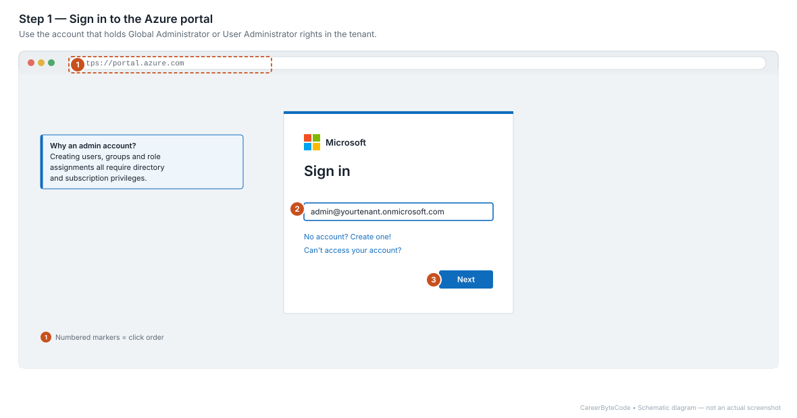

---

## Step 2 — Open Microsoft Entra ID

1. Click the global **search bar** at the top of the portal and type `Microsoft Entra ID`.
2. Select **Microsoft Entra ID** under **Services**.

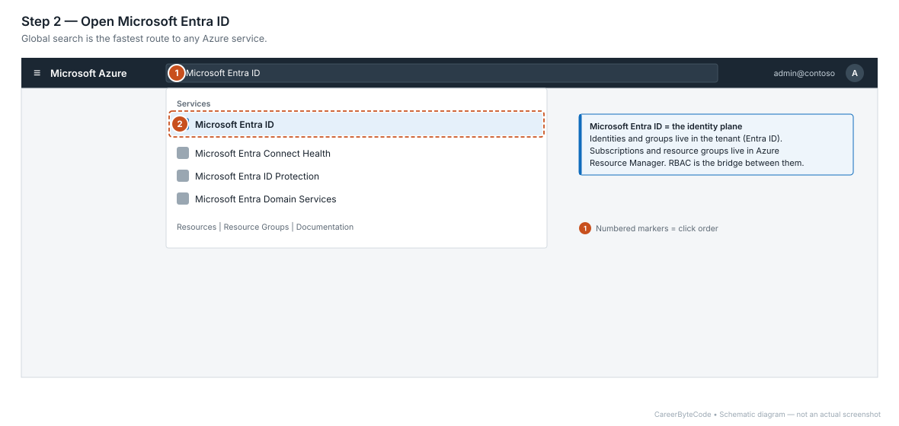

---

# Part 1 — Create a user

## Step 3 — Navigate to Users

1. In the left menu, click **Users**.
2. Make sure the **All users** tab is selected.
3. Click **+ New user** on the command bar.
4. Choose **Create new user**.

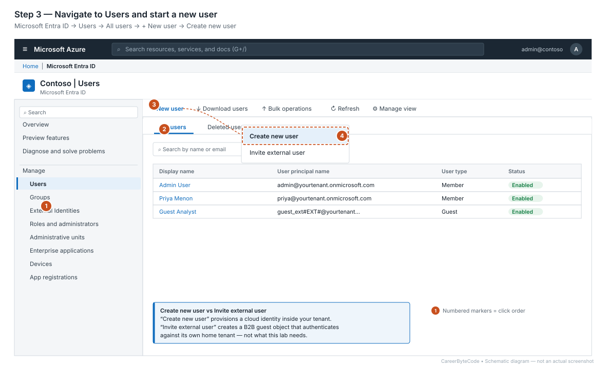

---

## Step 4 — Enter the user details

| Field | Value to use |
|---|---|
| User principal name | `devuser01` @ *yourtenant*.onmicrosoft.com |
| Display name | `Dev User 01` |
| Password | **Auto-generate password** (recommended) |
| Account enabled | ✅ Selected |

Then click **Review + create**.

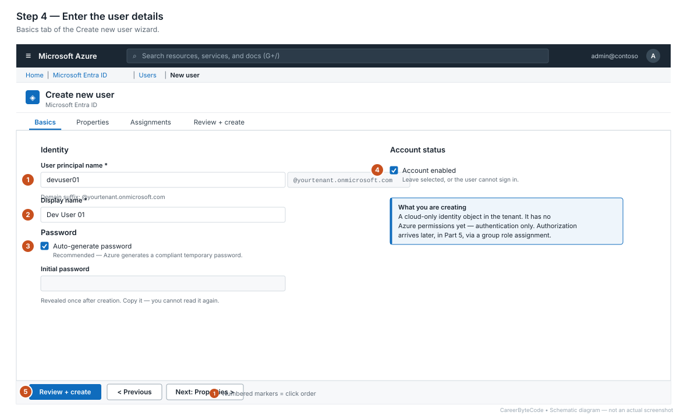

---

## Step 5 — Create the user

1. Confirm **Validation passed**.
2. Review the summary.
3. Click **Create**.

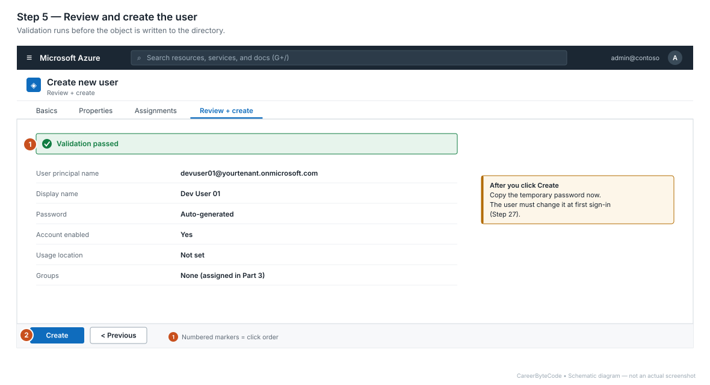

> 🔐 **Copy the temporary password now.** The portal shows it once. The user must change it
> at first sign-in (Step 26).

---

## Step 6 — Verify the user

1. Go to **Users → All users**.
2. Search for `devuser01`.
3. Confirm the **Status** column reads **Enabled**.

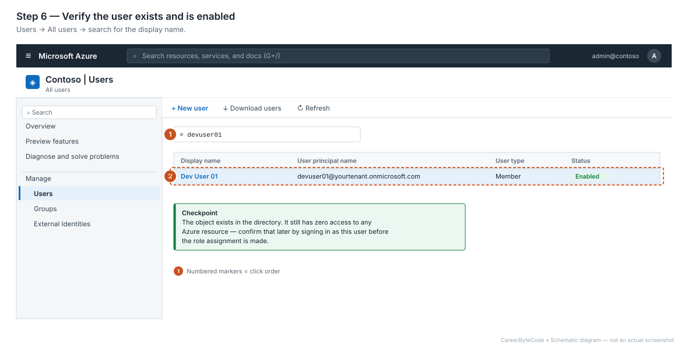

---

# Part 2 — Create a security group

## Step 7 — Navigate to Groups

1. In Microsoft Entra ID, click **Groups**.
2. Select **All groups**.
3. Click **+ New group**.

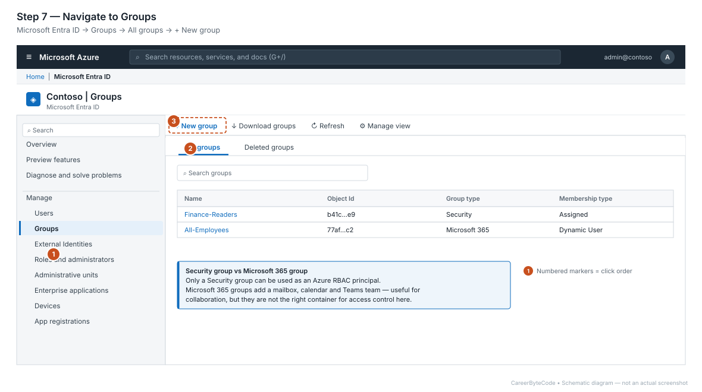

---

## Step 8 — Configure the group

| Field | Value to use |
|---|---|
| Group type | `Security` |
| Group name | `DevOps-Team` |
| Group description | `DevOps Security Group` |
| Entra roles can be assigned | `No` |
| Membership type | `Assigned` |

Click **Create**.

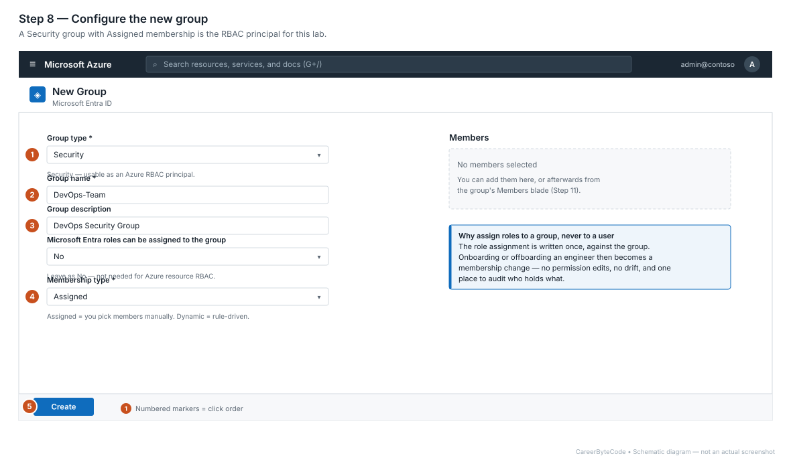

> **Security vs Microsoft 365 group:** only a **Security** group can be used as an Azure RBAC
> principal. A Microsoft 365 group adds a mailbox, calendar and Teams team — useful for
> collaboration, wrong for access control.

---

## Step 9 — Verify the group

1. Go to **Groups → All groups**.
2. Search for `DevOps-Team`.
3. Note the **Object Id** — role assignments reference this, not the display name.

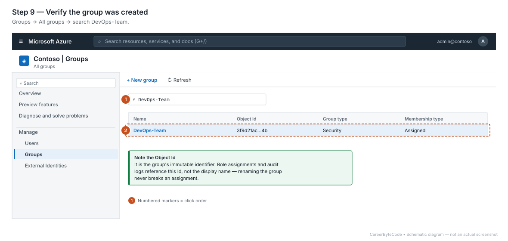

---

# Part 3 — Add the user to the group

## Step 10 — Open the group

1. From **All groups**, click **DevOps-Team**.
2. Note that **Members** currently reads **0**.

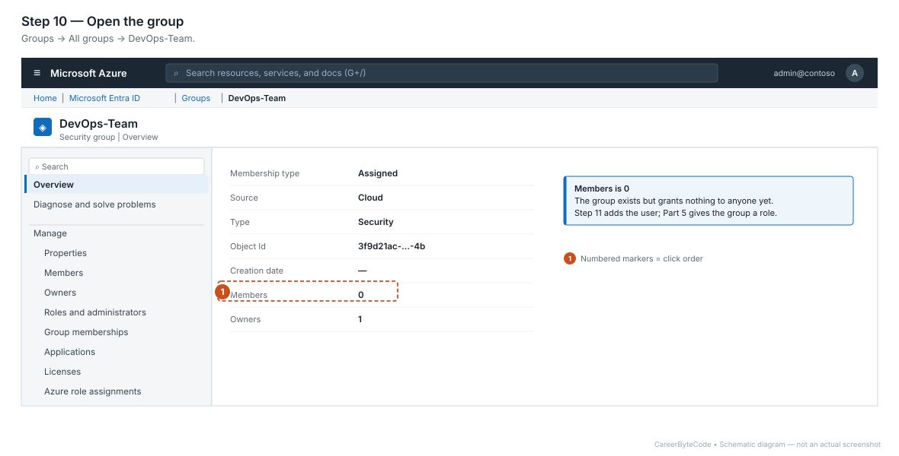

---

## Step 11 — Add members

1. In the group's left menu, click **Members**.
2. Click **+ Add members**.
3. Search for `Dev User 01`.
4. Click the user to select it.
5. Click **Select**.

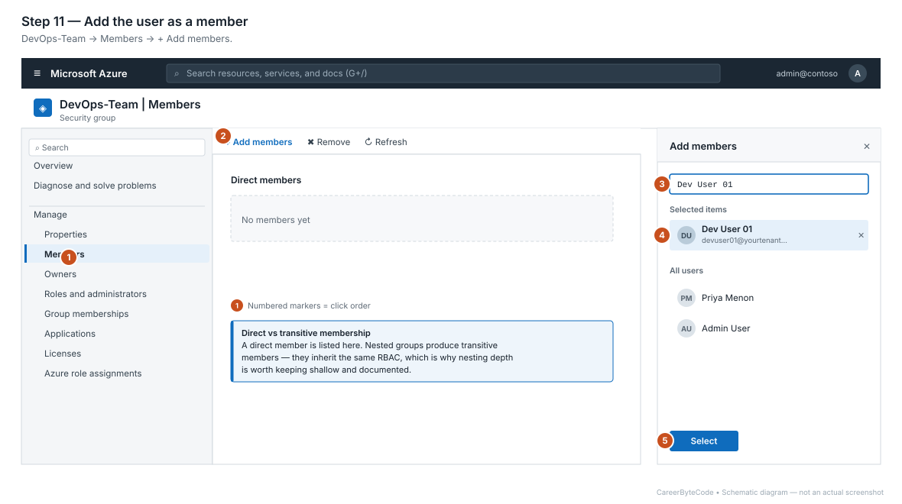

---

## Step 12 — Verify group membership

Confirm the user now appears in the members list.

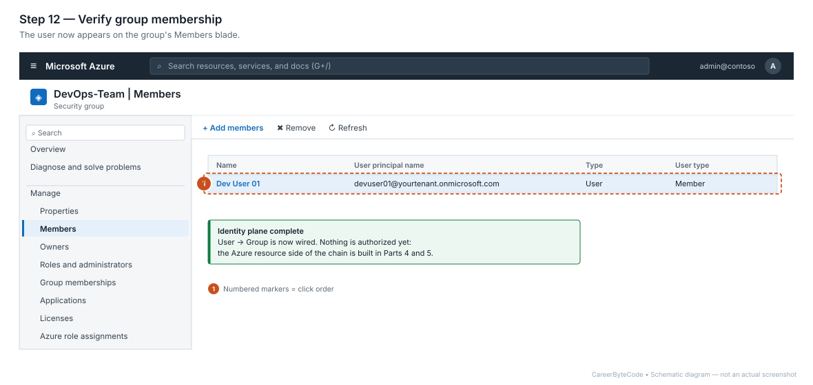

✅ **Identity plane complete.** The user is in the group — and still has access to nothing.

---

# Part 4 — Create the virtual machine

## Step 13 — Open Virtual machines

Search for `Virtual machines` in the global search bar and open the service.

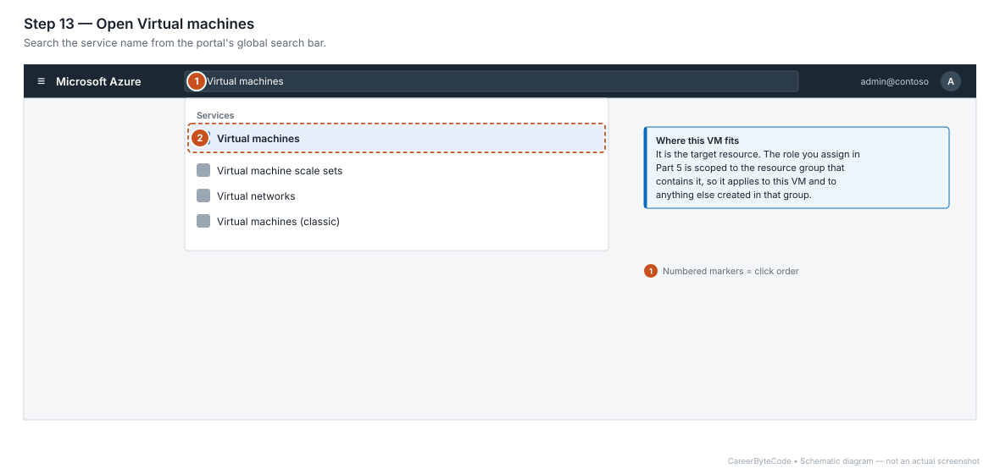

---

## Step 14 — Create a new virtual machine

1. Click **+ Create**.
2. Choose **Azure virtual machine**.

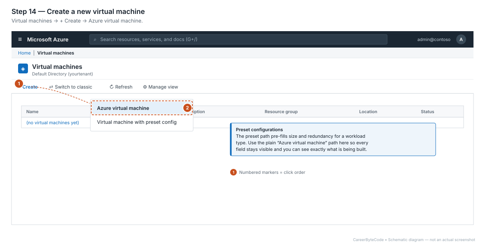

---

## Step 15 — Basics tab

**Project and instance details**

| Field | Value to use |
|---|---|
| Subscription | Your Azure subscription |
| Resource group | `cbc-internship-program` *(create new if needed)* |
| Virtual machine name | `cbc-vm` |
| Region | `(US) East US` — or your nearest region |
| Availability options | `No infrastructure redundancy required` |
| Security type | `Standard` |
| Image | `Ubuntu Server 24.04 LTS – x64 Gen2` |
| VM architecture | `x64` |
| Size | `Standard_B1s` — 1 vcpu, 1 GiB memory |

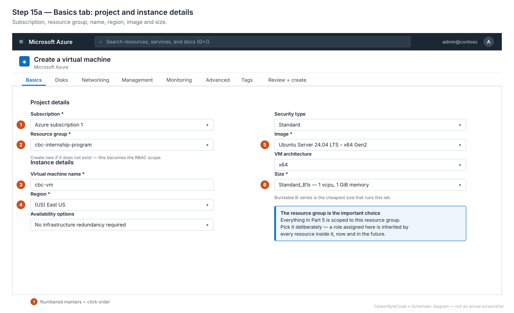

**Administrator account and inbound ports**

| Field | Value to use |
|---|---|
| Authentication type | `Password` |
| Username | `learning` |
| Password / Confirm password | A strong password you control |
| Public inbound ports | `Allow selected ports` |
| Select inbound ports | `SSH (22)`, `HTTP (80)`, `HTTPS (443)` |

Click **Next: Disks >**.

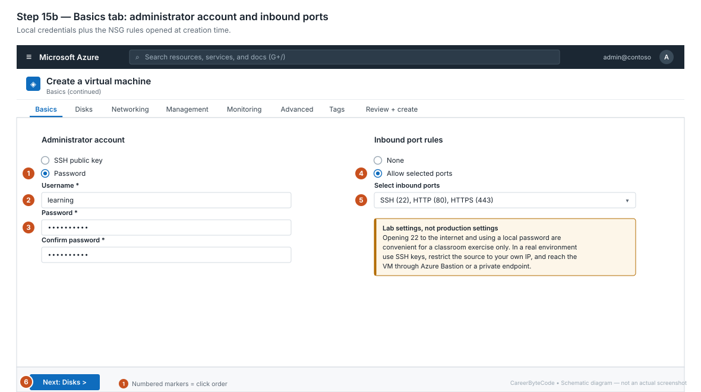

> ⚠️ **Lab settings, not production settings.** A local password plus port 22 open to the
> internet is fine for a classroom exercise and unacceptable in a real environment. Production
> uses SSH keys, a source IP restriction, and Azure Bastion or a private endpoint.

---

## Step 16 — Disks tab

| Field | Value to use |
|---|---|
| OS disk type | `Standard HDD (locally-redundant storage)` |

Leave everything else at its default and click **Next: Networking >**.

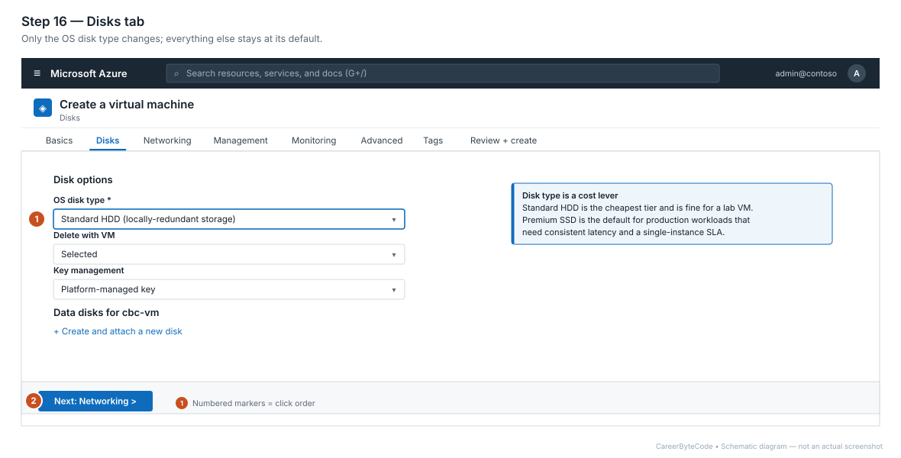

---

## Step 17 — Networking tab

| Field | Value to use |
|---|---|
| Virtual network | Create new, or leave the default |
| Subnet | `default` |
| Public IP | Create new, or leave the default |
| NIC network security group | `Basic` |
| Public inbound ports | `Allow selected ports` |
| Select inbound ports | `22`, `80`, `443` |
| Delete public IP and NIC when VM is deleted | ✅ Selected |

Click through to **Review + create**.

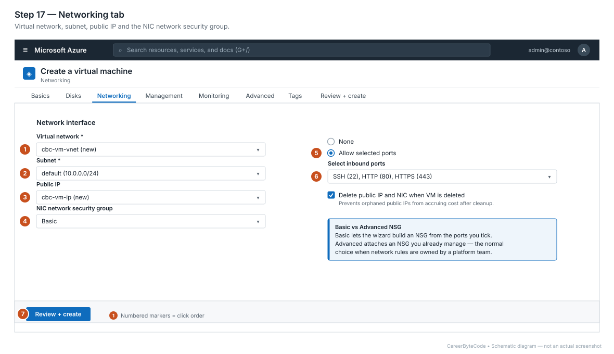

---

## Step 18 — Review + create

1. Confirm **Validation passed**.
2. Review the summary and the estimated cost.
3. Click **Create** and wait for the deployment to finish.

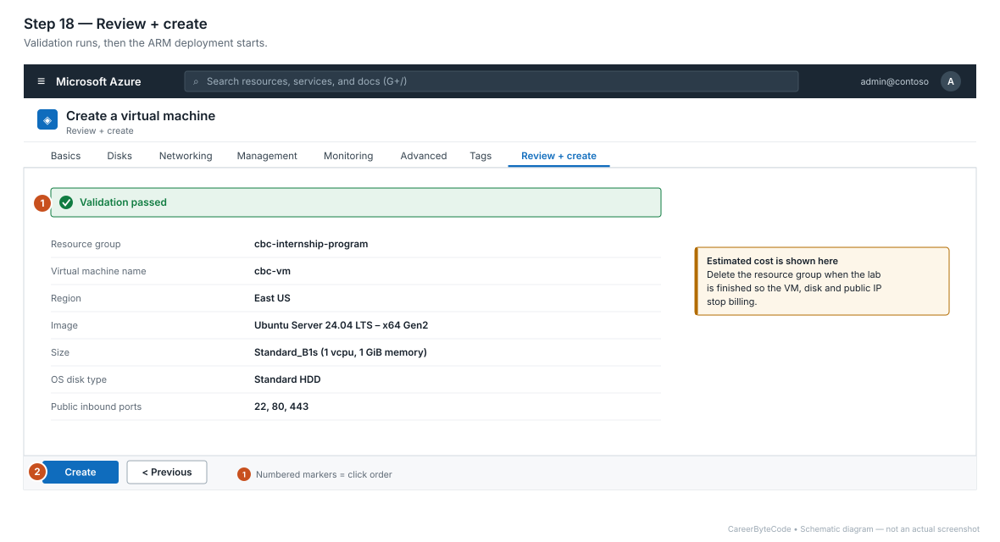

---

## Step 19 — Verify the virtual machine

Open **Virtual machines** and confirm `cbc-vm` shows **Running**.

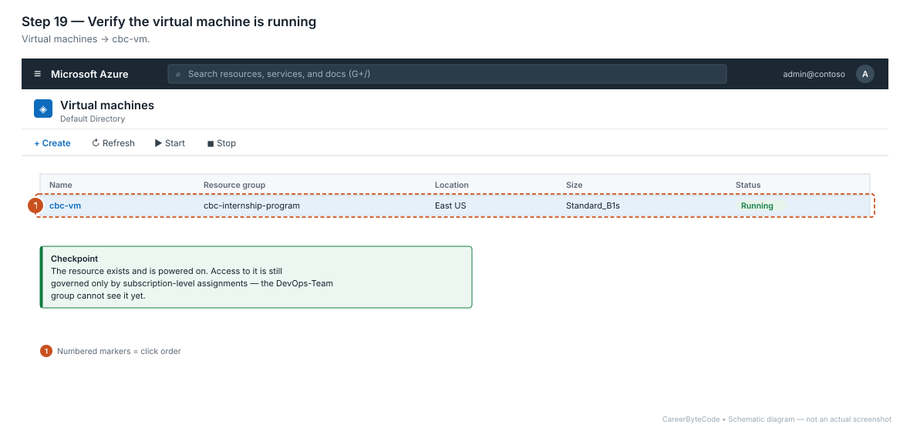

### Enable Entra ID login on the VM

`az ssh vm` in Step 28 needs the Entra ID login extension on the guest OS. If you did not tick
**Login with Microsoft Entra ID** during creation, add it now from Cloud Shell:

```bash
az vm extension set \
  --resource-group cbc-internship-program \
  --vm-name cbc-vm \
  --name AADSSHLoginForLinux \
  --publisher Microsoft.Azure.ActiveDirectory
```

---

# Part 5 — Assign access with Azure RBAC

## Step 20 — Open the resource group

Navigate to **Resource groups** and open **cbc-internship-program**. This resource group is the
**scope** of the assignment you are about to create.

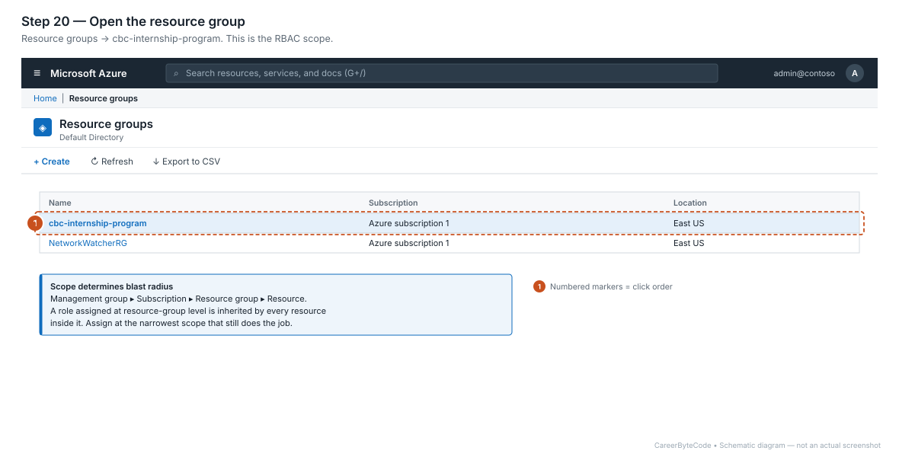

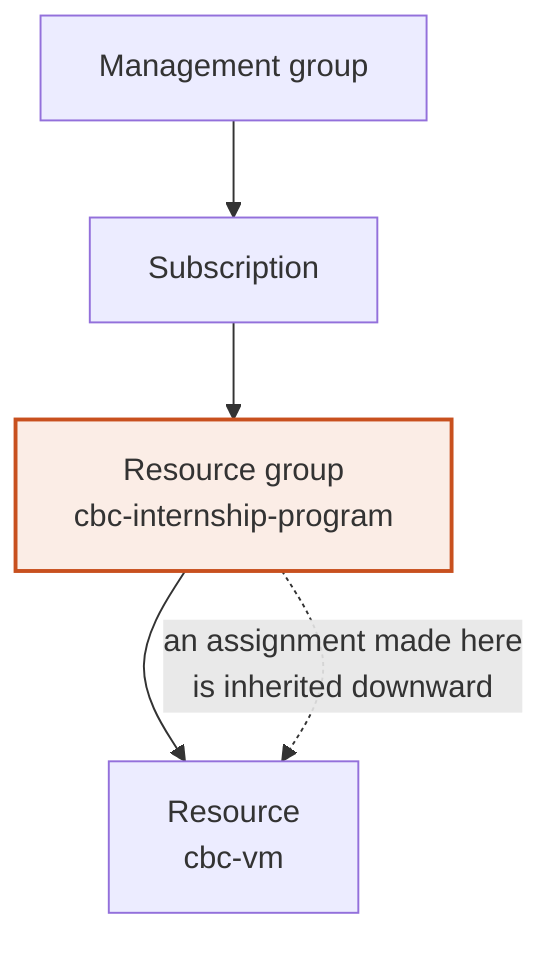

Assign at the **narrowest scope that still does the job**. A role granted on the subscription
reaches everything in it — usually far more than intended.

---

## Step 21 — Open Access control (IAM)

1. In the resource group's left menu, click **Access control (IAM)**.
2. Click **+ Add**.
3. Choose **Add role assignment**.

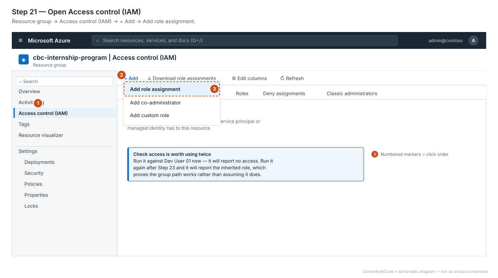

---

## Step 22 — Select the role

Search for `virtual machine` and pick the role you need.

| Role | What it grants |
|---|---|
| **Virtual Machine User Login** | See the VM and sign in with an Entra ID identity as a **standard user** |
| **Virtual Machine Administrator Login** | The same, plus **root / local administrator** rights inside the guest OS |
| Virtual Machine Contributor | Manage the VM resource — but *not* the VNet, and *not* the OS inside it |
| Network Contributor | Manage networking resources (VNet, NSG, public IP) |

**Use `Virtual Machine User Login` for this lab.** Click **Next**.

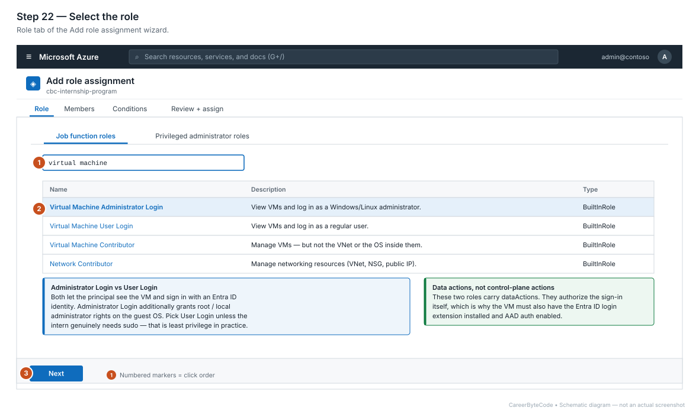

> These two login roles carry **dataActions** — they authorize the sign-in itself, which is why
> the `AADSSHLoginForLinux` extension has to be present on the VM.

---

## Step 23 — Assign the role to the group

1. On the **Members** tab, leave **User, group, or service principal** selected.
2. Click **+ Select members**.
3. Search for `DevOps-Team`.
4. Select the **group** — not the user.
5. Click **Select**.
6. Click **Review + assign**, then **Assign**.

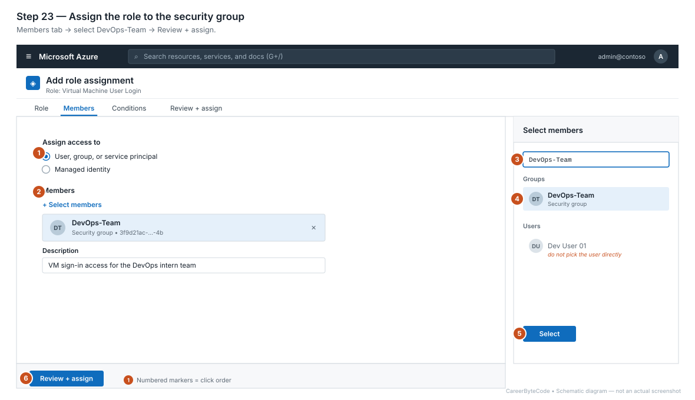

> **Never assign to the user directly.** Assigning to the group means onboarding and
> offboarding become membership changes: no permission edits, no drift, one place to audit.

---

## Step 24 — Verify the role assignment

1. Open **Access control (IAM) → Role assignments**.
2. Filter for `DevOps`.
3. Confirm the entry below exists.

| Principal | Type | Role | Scope |
|---|---|---|---|
| DevOps-Team | Group | Virtual Machine User Login | This resource |

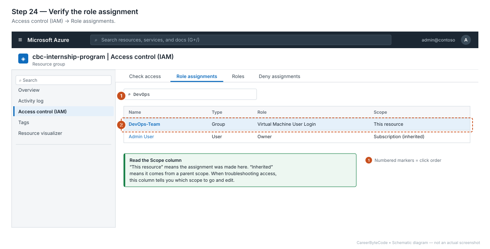

The **Scope** column is the one to read when troubleshooting: *This resource* means the
assignment lives here, *Inherited* means it comes from a parent scope you would have to edit
somewhere else.

---

# Part 6 — Verify as the end user

## Step 25 — Sign out of the administrator account

Click the profile icon in the top-right corner, then **Sign out**.

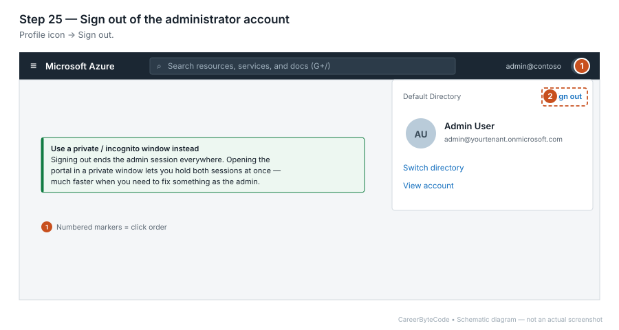

> 💡 Faster alternative: open **https://portal.azure.com** in a **private / incognito window**
> and keep both sessions alive at once.

---

## Step 26 — Sign in as the Entra ID user

| Field | Value |
|---|---|
| Username | `devuser01@yourtenant.onmicrosoft.com` |
| Password | The temporary password from Step 5 |

You will be asked to set a permanent password on first sign-in.

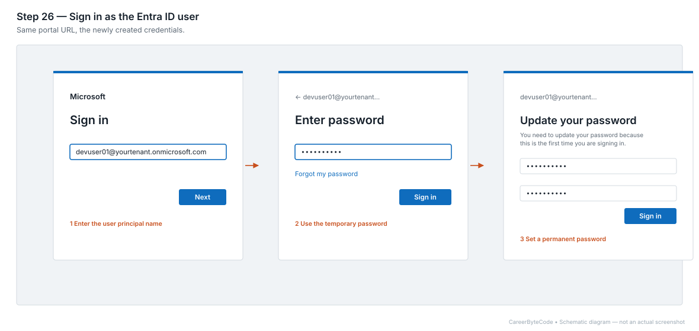

Depending on tenant policy you may also see MFA registration and a "Stay signed in?" prompt.

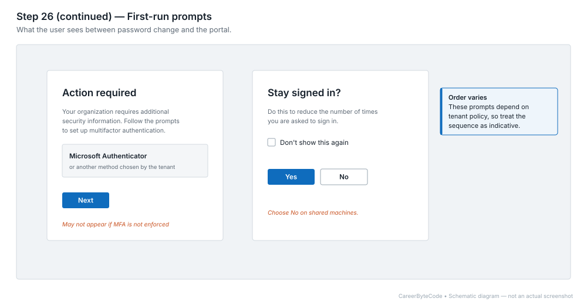

---

## Step 27 — Confirm what the user can see

Search for **Virtual machines**. `cbc-vm` is visible — because of the group membership, not
because anything was granted to the user directly.

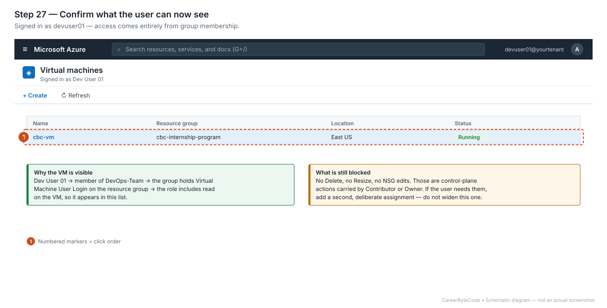

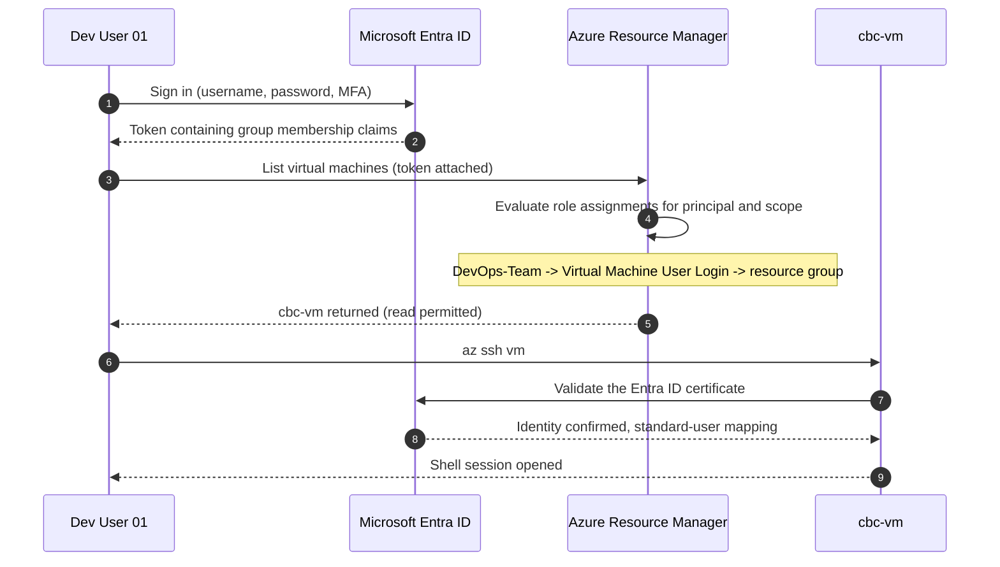

---

## Step 28 — Connect to the virtual machine

**a. Authenticate the CLI as the Entra ID user**

Open WSL, MobaXterm or any terminal and run:

```bash
az login --use-device-code
```

1. The terminal prints a URL and a device code.
2. Open **https://microsoft.com/devicelogin** in a browser and enter the code.
3. Pick **Dev User 01** — or choose *Use another account* and sign in explicitly.
4. Confirm the "Are you trying to sign in to Microsoft Azure CLI?" prompt.
5. Verify the CLI identity with `az account show --query user.name -o tsv`.

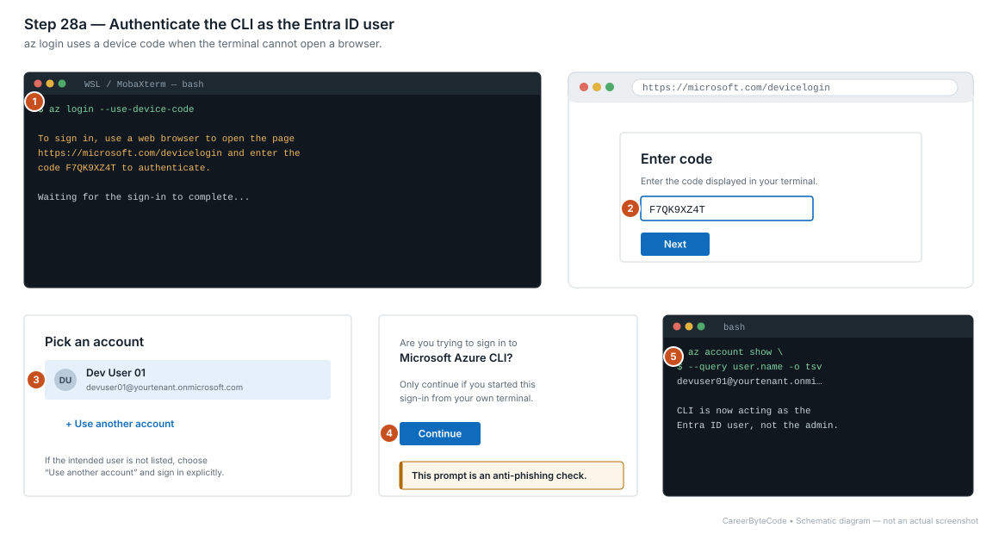

**b. Open the SSH session**

```bash
az ssh vm \
  --resource-group cbc-internship-program \
  --name cbc-vm
```

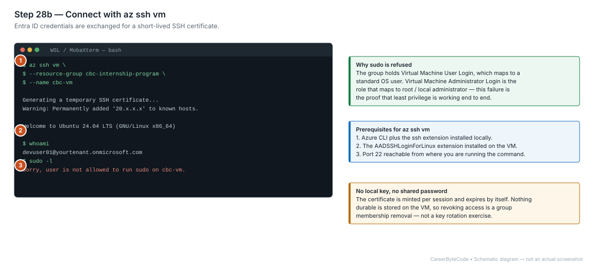

Azure mints a **short-lived SSH certificate** from the Entra ID token. No key sits on the VM
and no password is shared, so revoking access is a group-membership removal rather than a key
rotation exercise.

`sudo` is refused — and that is the correct result. **Virtual Machine User Login** maps to a
standard OS user; **Virtual Machine Administrator Login** is the role that maps to root.
Seeing the refusal is your proof that least privilege is working end to end.

---

# Verification checklist

| # | Check | Where | Expected |
|---|---|---|---|
| 1 | User exists and is enabled | Entra ID → Users | `Dev User 01` · Enabled |
| 2 | Security group exists | Entra ID → Groups | `DevOps-Team` · Security · Assigned |
| 3 | User is a member | Group → Members | `Dev User 01` listed |
| 4 | VM is deployed | Virtual machines | `cbc-vm` · Running |
| 5 | Role assignment exists | Resource group → IAM → Role assignments | `DevOps-Team` · Virtual Machine User Login · This resource |
| 6 | Check access agrees | Resource group → IAM → Check access → `Dev User 01` | Role shown as inherited from the group |
| 7 | User can see the VM | Portal as `devuser01` | `cbc-vm` visible |
| 8 | User can connect | `az ssh vm` | Shell opens; `sudo` refused |

---

# Troubleshooting

| Symptom | Likely cause | Fix |
|---|---|---|
| User sees an empty subscription list | Token predates the role assignment | Sign out and back in, or wait a few minutes for propagation |
| VM not visible to the user | Assignment made at the wrong scope, or made to the user instead of the group | Check the **Scope** column in Role assignments |
| `az ssh vm` → *extension not found* | `AADSSHLoginForLinux` missing on the VM | Run the `az vm extension set` command in Step 19 |
| `az ssh vm` → *permission denied* | Role lacks the login **dataAction** | Use Virtual Machine User Login or Administrator Login — Contributor is not enough |
| Connection times out | Port 22 blocked by the NSG | Check the inbound rules on the NIC network security group |
| CLI still acting as the admin | Old CLI session cached | `az logout`, then `az login --use-device-code` |
| `sudo` refused | Working as designed for User Login | Assign Virtual Machine **Administrator** Login only if root is genuinely required |

---

# Cleanup

Delete the whole resource group when you are finished — the VM, disk, NIC, public IP and NSG
go with it:

```bash
az group delete --name cbc-internship-program --yes --no-wait
```

Then remove the identity objects in Entra ID: delete the `DevOps-Team` group and the
`Dev User 01` user.

---

# What you learned

- A **user** authenticates; it does not authorize. Access comes from a role assignment.
- A **security group** is the right RBAC principal — assign once, manage membership forever.
- A **role assignment** is *principal + role definition + scope*, and scope is inherited downward.
- **Least privilege** is a decision you make at the role-selection screen, and `sudo` being
  refused is what success looks like.
- **Entra ID SSH** replaces shared keys and passwords with short-lived, revocable certificates.

---

<div align="center">

**CareerByteCode** · *Learning Made Simple*

[www.careerbytecode.com](https://www.careerbytecode.com) · careerbytec@gmail.com · +32 471 40 89 08

*Bangalore Cloud & DevOps Internship — Week 3, Session 2*

</div>
