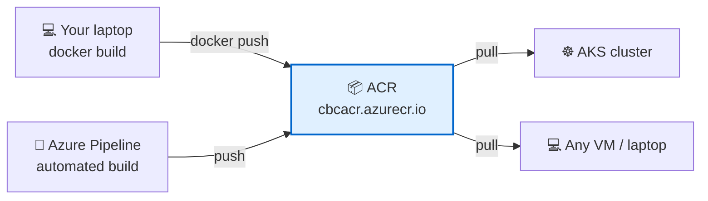
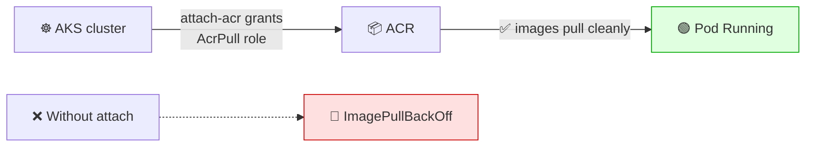

# 📦 Azure Container Registry (ACR)

**Week 3 · Session 3 (Class 5 — Sunday, 19 July 2026)**

In Week 2 you pushed images to **Docker Hub** — a public registry. In a company you almost never do that, because your image contains your source code. **ACR is your own private Docker Hub inside Azure.**

---

## 🎯 What you will learn

- What a container registry is and why private matters
- How to create an ACR
- How to push and pull images
- How to let AKS pull from ACR without any password

---

## 🧠 What a registry is

A **container registry** stores container images, the way GitHub stores code.



| | **Docker Hub (public)** | **ACR (private)** |
|---|---|---|
| Who can pull | 🌍 Anyone | 🔒 Only identities you authorise |
| Your source code inside the image | ⚠️ Exposed to the world | ✅ Private |
| Location | Public internet | Your Azure region — faster to AKS |
| Auth | Docker Hub account | Azure identity / RBAC |
| Pull rate limits | ⚠️ Yes, on the free tier | No |
| Cost | Free for public repos | 💰 Per GB stored |

---

## 🛠️ Step-by-step — creating the registry

1. Portal → search **Container registries** → **+ Create**
2. Fill in:

| Field | Value used in class |
|---|---|
| Resource group | `cbc-intrenship-program` |
| Registry name | `cbcacr` ⬅️ **globally unique**, letters & numbers only |
| Location | East US |
| Pricing plan | **Basic** ⬅️ cheapest, fine for learning |

3. **Review + create** → **Create**

Your **login server** is then `cbcacr.azurecr.io` — this prefix goes in front of every image name.

```bash
az acr create \
  --resource-group cbc-intrenship-program \
  --name cbcacr \
  --sku Basic
```

> ⚠️ The name must be **globally unique across all of Azure** and may contain **only lowercase letters and numbers** — no hyphens, no underscores. If `cbcacr` is taken, try `cbcacr2026` or add your initials.

| SKU | Storage included | Use |
|---|---|---|
| **Basic** | 10 GB | ✅ Learning, small projects |
| Standard | 100 GB | Production |
| Premium | 500 GB | Geo-replication, private endpoints |

---

## 🏷️ How image names work

```
cbcacr.azurecr.io / sampleapp : 42
└────── login server ──────┘  └─repo─┘ └tag┘
```

| Part | Meaning |
|---|---|
| `cbcacr.azurecr.io` | Which registry |
| `sampleapp` | The repository (one app) |
| `42` | The tag — usually the build number |

> 💡 **Never rely on `latest` alone.** `latest` is a moving target: you cannot tell which build is running or roll back cleanly. In the pipeline we tag with **`$(Build.BuildId)`** *and* `latest`, so every build is traceable.

---

## ⬆️ Push an image manually

```bash
# 1. Log in (uses your Azure credentials — no password typed)
az acr login --name cbcacr

# 2. Build with the full registry name
docker build -t cbcacr.azurecr.io/sampleapp:1 ./sampleapp

# 3. Push
docker push cbcacr.azurecr.io/sampleapp:1

# 4. Confirm
az acr repository list --name cbcacr --output table
az acr repository show-tags --name cbcacr --repository sampleapp --output table
```

> 🔑 `az acr login` quietly hands Docker a short-lived token from your Azure sign-in. That is why you never type a registry password.

---

## 🔗 Let AKS pull from ACR (the important bit)

If AKS cannot authenticate to ACR, every pod fails with **`ImagePullBackOff`**. One command fixes it permanently:

```bash
az aks update \
  --resource-group cbc-intrenship-program \
  --name cbc-aks \
  --attach-acr cbcacr
```



This assigns the **AcrPull** role to the cluster's managed identity — no secrets, no `imagePullSecrets` in your YAML.

**Using the image in a manifest:**

```yaml
apiVersion: apps/v1
kind: Deployment
metadata:
  name: sampleapp
spec:
  replicas: 2
  selector:
    matchLabels:
      app: sampleapp
  template:
    metadata:
      labels:
        app: sampleapp
    spec:
      containers:
        - name: sampleapp
          image: cbcacr.azurecr.io/sampleapp:1   # 👈 full ACR path
          ports:
            - containerPort: 5000
```

---

## 🔐 Admin user — and why to avoid it

ACR has an **Access keys → Admin user** toggle that gives a username and password. It is convenient and it is what many tutorials use.

> ⚠️ **Avoid it in real work.** It is a single shared credential, tied to no person, that cannot be scoped or audited. Prefer **`az acr login`** for humans, **service connections** for pipelines, and **`--attach-acr`** for AKS. Use the admin user only for a quick throwaway test.

---

## 🧹 Cleanup

```bash
# Delete one image tag
az acr repository delete --name cbcacr --image sampleapp:1 --yes

# Or remove everything with the resource group
az group delete --name cbc-intrenship-program --yes --no-wait
```

> 💳 ACR bills for **stored GB**. Old image tags pile up quickly when a pipeline runs on every commit — delete unused tags.

---

## 🆘 Troubleshooting cheat-sheet

| Symptom | Cause | Fix |
|---|---|---|
| "Registry name already taken" | Must be globally unique | Add digits/initials |
| "unauthorized: authentication required" | Not logged in | `az acr login --name cbcacr` |
| `docker push` says "repository does not exist" | Missing login-server prefix | Tag as `cbcacr.azurecr.io/app:1` |
| Pod shows `ImagePullBackOff` | AKS cannot authenticate | `az aks update --attach-acr cbcacr` |
| `ImagePullBackOff` after attaching | Wrong image name or tag | `az acr repository show-tags ...` |
| Storage cost creeping up | Old tags accumulating | Delete unused tags |

---

## ✅ Key takeaways

1. ACR is a **private registry** — your code stays inside your Azure tenant.
2. The registry name is **globally unique, lowercase letters and numbers only**.
3. Every image needs the full path: `cbcacr.azurecr.io/app:tag`.
4. `az acr login` uses your Azure identity — no registry password.
5. **`--attach-acr` is the cure for `ImagePullBackOff`** on AKS.
6. Tag with the **build number**, not just `latest`.
7. Avoid the **admin user** — use identities instead.

---

⬅️ **Previous:** [AKS — managed Kubernetes](aks-cluster.md)
➡️ **Next:** [Azure DevOps — organization & project](azure-devops-org-project.md)

_Part of the CareerByteCode Bangalore — Cloud & DevOps Internship Program._
