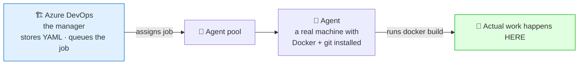
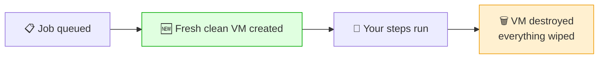
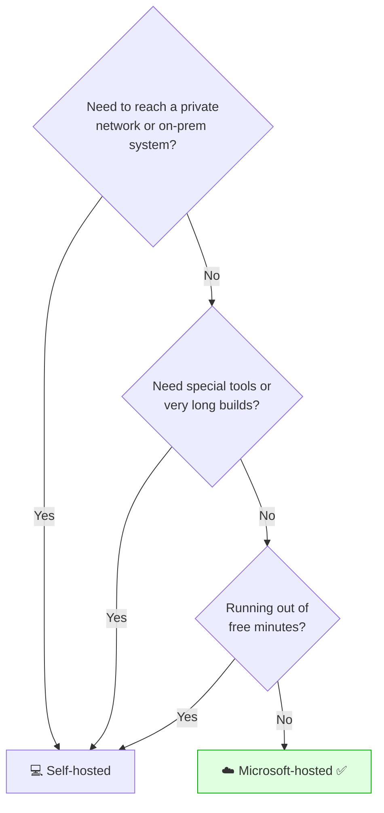

# 🤖 Agents — Microsoft-Hosted vs Self-Hosted

**Week 3 · Session 3 (Class 5 — Sunday, 19 July 2026)**

The question we spent time on in class: **when you click "Run pipeline", where does the work actually happen?** Not in your browser, and not magically "in Azure DevOps". It happens on an **agent** — a real machine running the Azure Pipelines agent software.

---

## 🎯 What you will learn

- What an agent is and why the pipeline cannot run without one
- The difference between Microsoft-hosted and self-hosted agents
- How to register a self-hosted agent on your own laptop
- When to choose each

---

## 🧠 The mental model

Azure DevOps is the **manager**: it stores the YAML, decides when to run, shows the logs. But a manager doesn't do the work.



> 🔑 **The key insight:** if no agent is available, your pipeline sits at **"queued"** forever. Nothing is broken — there is simply nobody to do the work.

---

## ☁️ Microsoft-hosted agents

Azure creates a **brand-new virtual machine** for every run, gives you your job, then **destroys it**.

```yaml
pool:
  vmImage: ubuntu-latest
```

**How a run looks:**



| ✅ Pros | ❌ Cons |
|---|---|
| Zero setup | ⏳ ~30–60s startup every run |
| Always a clean, fresh machine | Nothing is cached — dependencies redownload |
| Docker, git, Node, Python preinstalled | ⏱️ 1,800 free minutes/month, then paid |
| Patched by Microsoft | Cannot reach your private network |
| No hardware to maintain | 60-minute job limit on the free tier |

**Common images:** `ubuntu-latest`, `windows-latest`, `macos-latest`.

> ✅ **Use this by default.** For 90% of work — including this internship — a Microsoft-hosted agent is the right answer.

---

## 💻 Self-hosted agents

A machine **you own** (your laptop, an Azure VM, an on-prem server) running the agent software and polling Azure DevOps for jobs.

```yaml
pool:
  name: my-agent-pool        # 👈 the pool you created
```

This is what we did live in class — registering the mentor's laptop as an agent, then re-running the pipeline so the build executed **locally** and still pushed to ACR.

| ✅ Pros | ❌ Cons |
|---|---|
| ⚡ No startup wait | You install and patch everything |
| Caches persist between runs (fast rebuilds) | ⚠️ Leftover state can cause "works only on my agent" |
| Reaches private networks / on-prem databases | The machine must be **on and online** |
| No per-minute charge | You own the security of the box |
| Custom tools and specific versions | More moving parts to break |

---

## 🛠️ Registering a self-hosted agent (what we did in class)

### Step 1 — Create a Personal Access Token

**User settings** → **Personal access tokens** → **+ New Token**

| Field | Value |
|---|---|
| Name | `agent-registration` |
| Scopes | **Agent Pools → Read & manage** |

Copy the token — you need it in Step 4.

### Step 2 — Create an agent pool

**Organization settings** → **Agent pools** → **Add pool**

| Field | Value |
|---|---|
| Pool type | Self-hosted |
| Name | `my-agent-pool` ⬅️ this goes in your YAML |
| Grant access to all pipelines | ✅ Tick for the lab |

### Step 3 — Download the agent

Open the pool → **New agent** → pick your OS (Windows / Linux / macOS) → **Download**.

### Step 4 — Configure it

**Linux / macOS:**

```bash
mkdir myagent && cd myagent
tar zxvf ~/Downloads/vsts-agent-linux-x64-*.tar.gz
./config.sh
```

**Windows (PowerShell):**

```powershell
mkdir C:\agent ; cd C:\agent
Add-Type -AssemblyName System.IO.Compression.FileSystem
[System.IO.Compression.ZipFile]::ExtractToDirectory("$HOME\Downloads\vsts-agent-win-x64.zip", "$PWD")
.\config.cmd
```

Answer the prompts:

| Prompt | Answer |
|---|---|
| Server URL | `https://dev.azure.com/your-organization` |
| Authentication type | `PAT` |
| Personal access token | *(paste from Step 1)* |
| Agent pool | `my-agent-pool` |
| Agent name | Press Enter for the default |
| Work folder | Press Enter for `_work` |

### Step 5 — Start it

```bash
./run.sh          # Linux/macOS — runs in the foreground
```
```powershell
.\run.cmd         # Windows
```

The pool page now shows your agent as **🟢 Online**.

> 💡 **Run it as a service** (`./svc.sh install && ./svc.sh start`) so it survives a reboot. In the foreground, closing the terminal takes the agent offline and your pipelines go back to "queued".

### Step 6 — Point the pipeline at it and re-run

```yaml
pool:
  name: my-agent-pool
```

Re-run the pipeline. Watch the log — the steps now execute **on your machine**, and the image still lands in ACR. That was the "aha" moment of the class: same pipeline, same result, **completely different machine**.

> ⚠️ **The agent machine needs the tools.** A self-hosted agent has only what *you* installed. Building a Docker image requires **Docker Desktop running locally** — otherwise the step fails with *"docker: command not found"*. Microsoft-hosted agents come with it preinstalled.

---

## 🆚 Side-by-side

| | **Microsoft-hosted** | **Self-hosted** |
|---|---|---|
| Setup | None | Install + register |
| Startup | ~30–60s per run | Instant |
| Environment | Fresh every time | Persists |
| Caching | ❌ None | ✅ Yes |
| Private network access | ❌ No | ✅ Yes |
| Cost | 1,800 free min/month | Your hardware |
| Maintenance | Microsoft | You |
| Must stay online | No | ✅ Yes |
| Best for | ✅ Most work, this internship | Private networks, heavy builds, special tooling |

### Which should you choose?



---

## 🆘 Troubleshooting cheat-sheet

| Symptom | Cause | Fix |
|---|---|---|
| Pipeline stuck at "queued" | No agent online in the pool | Start the agent, or use `vmImage` |
| "No agent found in pool" | Pool name mismatch | Match `pool: name:` exactly |
| Agent shows offline | `run.sh` stopped / machine asleep | Restart it; install as a service |
| "docker: command not found" | Docker missing on your agent | Install and start Docker Desktop |
| Registration fails | PAT lacks the right scope | New PAT with **Agent Pools → Read & manage** |
| Works hosted, fails self-hosted | Missing tool locally | Install it on the agent machine |
| Weird failure after many runs | Stale cached state | Clear the `_work` folder |
| Out of free minutes | 1,800/month used | Wait, pay, or use self-hosted |

---

## ✅ Key takeaways

1. Pipelines run on an **agent** — a real machine, not "in the cloud" abstractly.
2. **Microsoft-hosted**: fresh VM each run, zero setup, 1,800 free minutes.
3. **Self-hosted**: your machine, instant start, caches persist, must stay online.
4. `pool: vmImage:` = hosted · `pool: name:` = self-hosted.
5. A self-hosted agent only has **the tools you installed** — Docker included.
6. "Queued forever" almost always means **no agent is available**.
7. Default to Microsoft-hosted; go self-hosted for private networks or heavy builds.

---

⬅️ **Previous:** [Building the CI Pipeline](pipelines-ci.md)
🏠 **Back to:** [Week 3 overview](../README.md)

_Part of the CareerByteCode Bangalore — Cloud & DevOps Internship Program._
