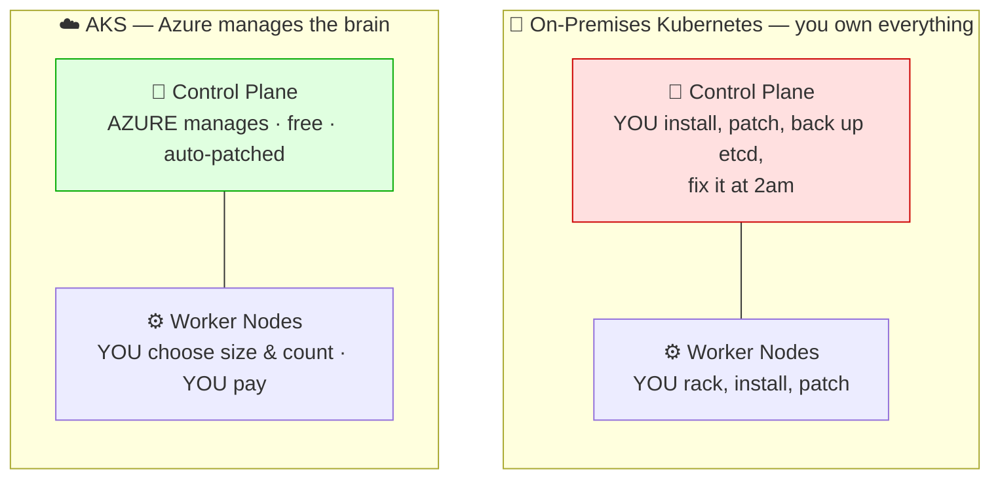
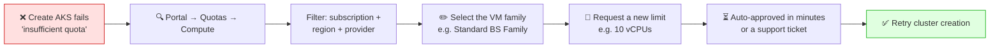
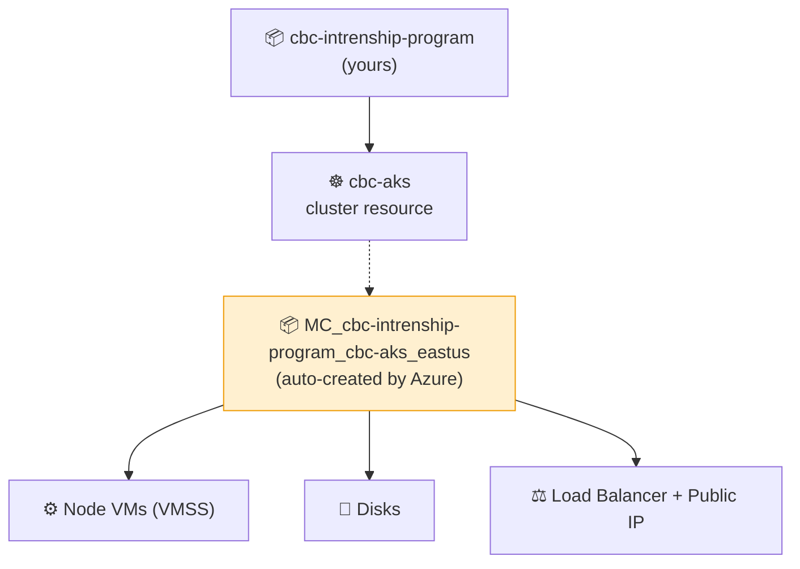

# ☸️ Azure Kubernetes Service (AKS) — Managed Kubernetes

**Week 3 · Session 3 (Class 5 — Sunday, 19 July 2026)**

In Week 2 you ran Kubernetes on **Minikube**, on your own laptop. Now we run the same workloads on a **managed cluster in Azure** — and the first thing to understand is what "managed" actually removes from your plate.

---

## 🎯 What you will learn

- The difference between a **managed** cluster and an **on-premises** cluster
- How to create an AKS cluster in the portal
- How to choose CPU and memory for your nodes
- What to do when Azure says you have **no quota** for a VM family
- How to connect `kubectl` and clean up

---

## 🆚 Managed cluster vs on-premises cluster

A Kubernetes cluster has two halves: the **control plane** (the brain) and the **worker nodes** (where your pods run). The difference is simply **who looks after the brain**.



| | **On-premises Kubernetes** | **AKS (managed)** |
|---|---|---|
| Control plane | You install and maintain it | ✅ Azure does — **and it's free** |
| etcd backups | Your job | ✅ Azure's job |
| Version upgrades | Manual, risky | One click / one command |
| Node scaling | Buy and rack a server (weeks) | `az aks scale` (minutes) |
| High availability | You design it | Built in |
| Hardware failure | You drive to the datacentre | Azure replaces the node |
| You pay for | Everything, up front | Only the **worker node VMs** |
| Setup time | Days to weeks | ~5–10 minutes |
| Best for | Strict data-residency, existing hardware | Almost everything else |

> 💡 **The headline:** with AKS the **control plane costs nothing** — you only pay for the worker node VMs and their disks. That single fact is why most companies stopped self-hosting Kubernetes.

---

## 🛠️ Step-by-step — creating the cluster

### Step 1 — Start the wizard

1. Portal → search **Kubernetes services** → **+ Create** → **Kubernetes cluster**

### Step 2 — Basics tab

| Field | Value used in class |
|---|---|
| Subscription | Your subscription |
| Resource group | `cbc-intrenship-program` |
| Cluster preset configuration | **Dev/Test** ⬅️ cheapest for learning |
| Kubernetes cluster name | `cbc-aks` |
| Region | East US |
| Availability zones | None *(cheaper for a lab)* |
| AKS pricing tier | **Free** |
| Kubernetes version | Default |
| Automatic upgrade | Disabled *(for a short lab)* |
| Node security channel | Default |

> 💡 Always pick the **Dev/Test** preset for learning. The **Production** preset switches on availability zones and multiple nodes, which multiplies the cost.

---

### Step 3 — Node pools tab — choosing CPU & memory

This is the part we spent real time on in class. Click the default node pool → **Node size** → **Choose a size** to open the full VM picker.

| Field | Value used in class |
|---|---|
| Node pool name | `agentpool` |
| Mode | System |
| Node size | `Standard_B2s` (2 vCPU, 4 GiB) |
| Scale method | Manual |
| Node count | **1** ⬅️ keep it at 1 for labs |

**Reading a VM size name:**

```
Standard_B2s
         │││
         ││└── s = premium storage capable
         │└─── 2 = number of vCPUs
         └──── B = family (B = Burstable, cheap)
```

**Common families:**

| Family | Character | Example | Good for |
|---|---|---|---|
| **B** | Burstable, cheapest | `Standard_B2s` | ✅ Labs and learning |
| **D** | General purpose | `Standard_D2s_v5` | Normal production apps |
| **E** | Memory optimised | `Standard_E2s_v5` | Databases, caches |
| **F** | Compute optimised | `Standard_F2s_v2` | CPU-heavy batch work |

> ⚠️ **AKS minimum:** each node needs **at least 2 vCPUs**. A `Standard_B1s` (1 vCPU) will be rejected — the Kubernetes system pods alone won't fit. This surprises people who used `B1s` happily for a plain VM in Session 1.

---

### Step 4 — When Azure says "insufficient quota" 🚧

Very common on new or student subscriptions: you pick a size and the portal blocks you with a **quota** error. Quota is **not** a billing limit — it is a per-region, per-VM-family cap Azure applies by default.

**How to raise a quota request:**

1. Portal → search **Quotas** → **Compute**
2. Filter by your **Subscription**, **Region** (e.g. East US) and **Provider: Microsoft.Compute**
3. Find the family in the list, e.g. **Standard BS Family vCPUs**
4. Click the ✏️ pencil / **Request increase** or **New Quota Request**
5. Enter the **New limit** (e.g. from 0 → 10 vCPUs)
6. **Submit**



> ⏱️ Small increases on standard families are often **approved automatically within minutes**. Large or specialised families (GPU) go to a human and take longer.
> 💡 **Faster workaround:** try a **different region** or a **different VM family** — quota is tracked separately for each combination, so `Standard_D2s_v5` in East US may work when `Standard_B2s` does not.

---

### Step 5 — Finish creating

Leave Networking, Integrations and Monitoring at defaults for the lab, then **Review + create** → **Create**.

⏳ Cluster creation takes **5–10 minutes**.

```bash
# CLI equivalent of everything above
az aks create \
  --resource-group cbc-intrenship-program \
  --name cbc-aks \
  --node-count 1 \
  --node-vm-size Standard_B2s \
  --tier free \
  --generate-ssh-keys
```

---

## 🔗 Connect `kubectl` to the cluster

```bash
# 1. Install kubectl via Azure CLI (once)
az aks install-cli

# 2. Download the cluster credentials into your kubeconfig
az aks get-credentials \
  --resource-group cbc-intrenship-program \
  --name cbc-aks

# 3. Verify
kubectl get nodes
```

Expected output:

```
NAME                                STATUS   ROLES    AGE   VERSION
aks-agentpool-12345678-vmss000000   Ready    <none>   3m    v1.30.x
```

> 🎉 **Same `kubectl` you used on Minikube.** Every manifest from Week 2 — pods, deployments, services — works here unchanged. That is the promise of Kubernetes: the API is identical, only the infrastructure underneath changed.

**Deploy something to prove it:**

```bash
kubectl create deployment web --image=nginx
kubectl expose deployment web --type=LoadBalancer --port=80
kubectl get service web --watch     # wait for EXTERNAL-IP to appear
```

> ⏳ On AKS, `type: LoadBalancer` provisions a **real Azure Load Balancer with a public IP** — it takes a minute or two, and it costs money. On Minikube it never got a real IP; this is a genuine difference.

---

## 🧩 What Azure created behind the scenes

AKS makes a **second, auto-generated resource group** (named `MC_<rg>_<cluster>_<region>`) holding the node VMs, disks, load balancers and NICs.



> ⚠️ **Do not manually edit or delete the `MC_...` resource group.** AKS owns it. Delete the **cluster** and Azure removes that group for you.

---

## 💰 Cost control — critical

| Resource | Cost |
|---|---|
| AKS control plane (Free tier) | ✅ **₹0 / $0** |
| Worker node VMs | 💰 Per hour, per node |
| Managed disks | 💰 Per GB per month |
| Load Balancer + public IP | 💰 Per hour |

```bash
# Option A — stop the cluster (keeps config, stops node billing)
az aks stop --resource-group cbc-intrenship-program --name cbc-aks
az aks start --resource-group cbc-intrenship-program --name cbc-aks   # resume later

# Option B — delete everything (recommended after a lab)
az group delete --name cbc-intrenship-program --yes --no-wait
```

> 💳 **`az aks stop` is your friend** if you want to continue tomorrow — it stops node charges without destroying your work. Otherwise **delete the resource group**. Never leave a cluster running over a weekend.

---

## 🆘 Troubleshooting cheat-sheet

| Symptom | Cause | Fix |
|---|---|---|
| "Insufficient quota" | Family cap in that region | Request a quota increase, or change size/region |
| VM size not selectable | Below the 2-vCPU minimum | Choose `Standard_B2s` or larger |
| `kubectl` says "connection refused" | Credentials not downloaded | `az aks get-credentials ...` |
| Nodes stuck in `NotReady` | Still starting | Wait 2–3 min, then `kubectl describe node` |
| Pods stuck `Pending` | Not enough CPU/memory on the node | Scale up, or lower pod requests |
| `EXTERNAL-IP` stays `<pending>` | Load balancer still provisioning | Wait 1–2 min |
| `MC_...` resource group appeared | Normal AKS behaviour | Leave it alone |

---

## ✅ Key takeaways

1. **Managed = Azure runs the control plane, for free.** You pay only for worker nodes.
2. AKS nodes need **at least 2 vCPUs**.
3. **Quota errors are normal** — request an increase, or switch family/region.
4. `az aks get-credentials` is what wires up `kubectl`.
5. Every Week-2 manifest works unchanged on AKS.
6. AKS creates an **`MC_...` resource group** — don't touch it.
7. **`az aks stop`** to pause billing, **delete the RG** when finished.

---

⬅️ **Previous:** [Entra ID & RBAC concepts](../session-2/entra-id-rbac-concepts.md)
➡️ **Next:** [Azure Container Registry (ACR)](acr.md)

_Part of the CareerByteCode Bangalore — Cloud & DevOps Internship Program._
