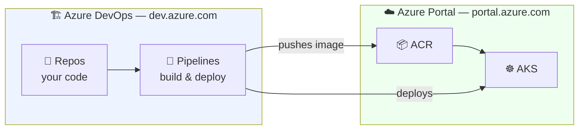
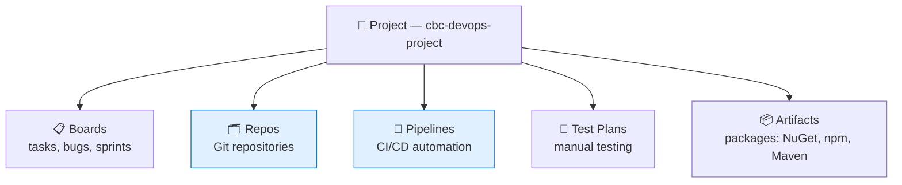

# 🏗️ Azure DevOps — Organization & Project

**Week 3 · Session 3 (Class 5 — Sunday, 19 July 2026)**

Azure DevOps is a **separate portal** from the Azure Portal. This confuses almost everyone the first time: you sign in with the same account, but the URL is different and the resources live in a different place.

---

## 🎯 What you will learn

- How Azure DevOps relates to the Azure Portal
- How to find it and create an **organization**
- How to create a **project**
- What the five services inside a project do

---

## 🧭 Two different portals — get this straight

| | **Azure Portal** | **Azure DevOps** |
|---|---|---|
| URL | `portal.azure.com` | `dev.azure.com` |
| Holds | VMs, AKS, ACR, networking | Repos, Pipelines, Boards, Artifacts |
| Container | Subscription → Resource group | Organization → Project |
| Pays for | Cloud infrastructure | Pipeline minutes, extra users |
| In one word | **Where your app runs** | **How your app gets built and shipped** |



> 🔗 **The bridge between them is a *service connection*** — covered in the next note. That is what lets a pipeline in DevOps touch resources in Azure.

---

## 🛠️ Step-by-step

### Step 1 — Find Azure DevOps

Exactly as we did in class:

- Search **"azure devops"** in your browser, or go straight to **https://dev.azure.com**
- Sign in with the **same Microsoft account** you use for the Azure Portal

> 💡 You can also reach it from the Azure Portal search bar by typing **Azure DevOps** — but it will hand you off to `dev.azure.com` anyway.

---

### Step 2 — Create an organization

An **organization** is the top-level container — usually one per company or per learner.

1. Click **New organization** (first-time users are prompted automatically)
2. Choose a name — **globally unique**, e.g. `cbc-devops-yourname`
3. Choose the region to host your projects (pick one near you, e.g. Central India / East US)
4. Complete the CAPTCHA → **Continue**

Your organization URL becomes:

```
https://dev.azure.com/cbc-devops-yourname
```

> 💰 **Free tier:** 5 users, unlimited private Git repos, and **1,800 free pipeline minutes/month** on Microsoft-hosted agents. Plenty for this internship.

---

### Step 3 — Create a project

A **project** holds one product or application: its code, pipelines, and work items.

| Field | Value used in class |
|---|---|
| Project name | `cbc-devops-project` |
| Description | Week 3 CI/CD demo |
| Visibility | **Private** ⬅️ keep it private |
| Version control | **Git** |
| Work item process | Agile (default) |

Click **+ Create project**.

> 🔒 **Always choose Private.** Public makes your repo readable by anyone on the internet.
> 🌱 **Git vs TFVC:** always pick **Git**. TFVC is a legacy system kept only for old projects.

---

## 🧩 What's inside a project

Down the left-hand menu you get five services. You can turn off the ones you don't need (Project settings → Overview).



| Service | What it does | Used in class |
|---|---|---|
| **Boards** | Work items, sprints, Kanban | — |
| **Repos** | Git repositories | ✅ Yes |
| **Pipelines** | Build & release automation | ✅ Yes |
| **Test Plans** | Manual test management (paid) | — |
| **Artifacts** | Private package feeds | — |

> 🎯 In this internship you live in **Repos** and **Pipelines**. The others exist so you recognise them in a job interview.

---

## 🆚 Azure Repos vs GitHub

Both are Git. The commands are identical — only the hosting differs.

| | **Azure Repos** | **GitHub** |
|---|---|---|
| Git commands | Same | Same |
| Best integration with | Azure Pipelines | GitHub Actions |
| Free private repos | ✅ Yes | ✅ Yes |
| Typical user | Enterprises on Microsoft stack | Open source, most startups |

> 💡 Your **internship submissions still go to GitHub** (the fork + Pull Request workflow in [`CONTRIBUTING.md`](../../../CONTRIBUTING.md)). Azure Repos is what we used *inside the class demo* to show the Microsoft-native path end to end.

---

## 🆘 Troubleshooting cheat-sheet

| Symptom | Cause | Fix |
|---|---|---|
| "Organization name is not available" | Must be globally unique | Add your name or digits |
| Can't see your organization | Signed in with a different account | Check the profile icon, top right |
| No **Pipelines** in the menu | Service switched off | Project settings → Overview → enable |
| Invited a teammate, they can't see it | Not added to the project | Project settings → Permissions → add user |
| Wrong region chosen | Set at organization creation | Organization settings → Overview |

---

## ✅ Key takeaways

1. Azure DevOps (`dev.azure.com`) is **separate** from the Azure Portal (`portal.azure.com`).
2. Hierarchy: **Organization → Project → Repos/Pipelines**.
3. Always choose **Private** visibility and **Git**.
4. The free tier gives **1,800 pipeline minutes/month**.
5. A **service connection** is the bridge from DevOps into Azure.

---

⬅️ **Previous:** [Azure Container Registry](acr.md)
➡️ **Next:** [Service Connections](service-connections.md)

_Part of the CareerByteCode Bangalore — Cloud & DevOps Internship Program._
