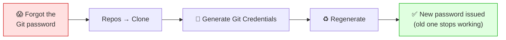

# 🗂️ Azure Repos — Cloning, Pushing & Git Credentials

**Week 3 · Session 3 (Class 5 — Sunday, 19 July 2026)**

Azure Repos is Git — the same `clone`, `add`, `commit`, `push` you learned in Week 1. The only new part is **how you authenticate**, and that is where everyone gets stuck. In class we cloned the repo, pushed a text file, then added the app and Dockerfile.

---

## 🎯 What you will learn

- How to clone an Azure Repos repository
- **How to recover your Git credentials when you forget the password**
- How to push files from your laptop
- The exact folder layout the pipeline expects

---

## 🛠️ Step 1 — Find the clone URL

1. Azure DevOps → your project → **Repos → Files**
2. Click **Clone** (top right)
3. Copy the HTTPS URL:

```
https://dev.azure.com/cbc-devops-yourname/cbc-devops-project/_git/cbc-devops-project
```

A brand-new repo shows an empty-repo page with the same **Clone** button.

---

## 🔑 Step 2 — Git credentials (the part that trips everyone)

Azure Repos does **not** accept your normal Microsoft account password over HTTPS. You need **Git credentials** — a generated username and password just for Git.

### Generating them (and recovering a forgotten one)

This is the exact thing we demonstrated in class:

1. **Repos → Files → Clone**
2. In the panel, click **Generate Git Credentials**
3. You get:

| Field | Example |
|---|---|
| Git username | `cbc-devops-yourname` |
| Git password | *(a long generated string)* |

4. **Copy the password immediately** and store it somewhere safe.

> 🔁 **Forgot the password? You cannot view it again — but you don't need to.**
> Go back to **Clone → Generate Git Credentials** and click **Regenerate**. Azure issues a **brand-new password** and invalidates the old one. Nothing is lost; you just update your saved credential.



> ⚠️ **Regenerating breaks any machine still using the old password.** If your laptop cached it, clear it: Windows → *Credential Manager* → Windows Credentials → remove the `git:https://dev.azure.com` entry. macOS → Keychain Access → delete the same entry.

### The better alternative — a Personal Access Token (PAT)

**User settings** (top-right avatar) → **Personal access tokens** → **+ New Token**

| Field | Value |
|---|---|
| Name | `laptop-git` |
| Expiration | 30–90 days |
| Scopes | **Code → Read & write** |

Use your **email as the username** and the **PAT as the password**.

> ✅ **PATs are better than Git credentials** because you can scope them narrowly, set an expiry, and revoke a single device without disturbing others.

---

## 📥 Step 3 — Clone to your laptop

```bash
git clone https://dev.azure.com/cbc-devops-yourname/cbc-devops-project/_git/cbc-devops-project
cd cbc-devops-project
```

When prompted, enter the Git username and generated password (or your email + PAT).

```bash
# Save the credential so you are not asked every time
git config --global credential.helper store      # Linux
git config --global credential.helper manager    # Windows
```

---

## 📤 Step 4 — Push your first file (exactly as in class)

We started with a plain text file just to prove the connection worked before adding anything complicated. **Do this first — always test the plumbing with something trivial.**

```bash
echo "hello from my laptop" > text.txt

git add text.txt
git commit -m "Add test file"
git push origin main
```

Refresh **Repos → Files** in the browser — `text.txt` is there. ✅

> ⚠️ **`main` or `master`?** Check what your repo actually uses:
> ```bash
> git branch          # shows your current branch
> ```
> Azure Repos defaults to **`main`** for new repos, but some are created with **`master`**. This matters because the pipeline `trigger:` must name the **same** branch — a mismatch means the pipeline never fires.

---

## 📦 Step 5 — Add the application and Dockerfile

Now add the real content. The layout we used:

```
cbc-devops-project/
├── azure-pipelines.yml        ← the pipeline definition
├── text.txt                   ← our first test file
└── sampleapp/
    ├── Dockerfile
    ├── app.py                 ← Flask "Hello from Azure DevOps!"
    └── requirements.txt
```

**`sampleapp/app.py`**

```python
from flask import Flask

app = Flask(__name__)

@app.route("/")
def home():
    return "Hello from Azure DevOps!"

app.run(host="0.0.0.0", port=5000)
```

**`sampleapp/Dockerfile`**

```dockerfile
FROM python:3.12-slim
WORKDIR /app
COPY . .
RUN pip install -r requirements.txt
EXPOSE 5000
CMD ["python","app.py"]
```

**`sampleapp/requirements.txt`**

```
Flask==3.0.3
requests==2.32.3
gunicorn==23.0.0
```

Test it locally **before** pushing — always cheaper than debugging in a pipeline:

```bash
docker build -t sampleapp:test ./sampleapp
docker run -p 5000:5000 sampleapp:test
# open http://localhost:5000  →  "Hello from Azure DevOps!"
```

Then push:

```bash
git add .
git commit -m "Add sample Flask app and Dockerfile"
git push origin main
```

> 📁 **The path matters.** The pipeline refers to `sampleapp/Dockerfile`. If you rename the folder, update `dockerfilePath` in the YAML to match, or the build fails with *"Dockerfile not found"*.

---

## 🆚 Azure Repos vs GitHub — commands are identical

```bash
git clone <url>
git add .
git commit -m "message"
git push origin main
git pull
git checkout -b feature/my-branch
```

Everything from your Week 1 Git session applies unchanged. **Only the authentication differs.**

---

## 🆘 Troubleshooting cheat-sheet

| Symptom | Cause | Fix |
|---|---|---|
| "Authentication failed" | Using your Microsoft password | Generate Git credentials or a PAT |
| Forgot the Git password | Cannot be viewed again | **Regenerate** it |
| Still fails after regenerating | Old password cached | Clear Credential Manager / Keychain |
| "src refspec main does not match any" | Wrong branch name | `git branch`, then push that name |
| "Updates were rejected" | Remote has newer commits | `git pull origin main` then push |
| Pushed, pipeline didn't run | `trigger:` names a different branch | Match the YAML to your branch |
| "Dockerfile not found" in build | Path mismatch | Fix `dockerfilePath` in the YAML |
| PAT stopped working | Expired | Create a new one |

---

## ✅ Key takeaways

1. Azure Repos is **plain Git** — only authentication is new.
2. Your Microsoft password **will not work**; use Git credentials or a PAT.
3. Forgotten password → **Regenerate**, then clear the cached credential.
4. **PATs are safer**: scoped, expiring, individually revocable.
5. **Push a trivial file first** to prove the connection.
6. Confirm whether your branch is **`main` or `master`** — the pipeline trigger depends on it.

---

⬅️ **Previous:** [Service Connections](service-connections.md)
➡️ **Next:** [Building the CI Pipeline](pipelines-ci.md)

_Part of the CareerByteCode Bangalore — Cloud & DevOps Internship Program._
