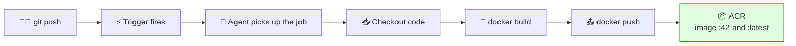
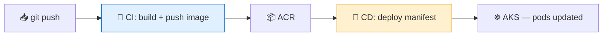

# 🔄 Azure Pipelines — Building the CI Pipeline

**Week 3 · Session 3 (Class 5 — Sunday, 19 July 2026)**

This is where everything from the week comes together: code in **Azure Repos**, a **service connection** for credentials, and an image landing in **ACR** — with nobody touching a keyboard after the `git push`.

---

## 🎯 What you will learn

- What CI actually means
- How to create a pipeline from the GUI
- Every line of the `azure-pipelines.yml` we used
- How to confirm the image reached ACR

---

## 🧠 What CI means

**Continuous Integration** = every time code is pushed, it is automatically built and verified. No "it works on my machine".



---

## 🛠️ Creating the pipeline in the GUI

Exactly as demonstrated in class:

1. Azure DevOps → your project → **Pipelines** → **Create Pipeline**
2. **Where is your code?** → **Azure Repos Git**
3. Select your repository → `cbc-devops-project`
4. **Configure your pipeline** → **Starter pipeline** (or *Existing Azure Pipelines YAML file* if you already pushed one)
5. Replace the contents with the YAML below
6. **Save and run** → commit `azure-pipelines.yml` to the repo → **Save and run**

> 💡 The pipeline definition **lives in your repo** as `azure-pipelines.yml`. That is "pipeline as code" — it is versioned, reviewable, and rolls back with your code.

---

## 📄 The pipeline, line by line

Here is the file we used, annotated. The raw copy is in [`demo-app/azure-pipelines.yml`](demo-app/azure-pipelines.yml).

```yaml
trigger:
- master                      # 👈 run automatically on a push to this branch

pool:
  name: shgfkasdh             # 👈 the AGENT POOL — see the agents note

variables:
  imageRepository: cbcacr           # repository name created inside ACR
  containerRegistry: my-docker-registry   # 👈 the SERVICE CONNECTION name
  dockerfilePath: sampleapp/Dockerfile    # path to the Dockerfile in the repo
  tag: $(Build.BuildId)                   # auto-incrementing build number

steps:

- checkout: self              # download the repo onto the agent

- task: Docker@2
  displayName: Build and Push Docker Image
  inputs:
    command: buildAndPush     # build then push, in one task
    repository: $(imageRepository)
    dockerfile: $(dockerfilePath)
    containerRegistry: $(containerRegistry)
    tags: |
      $(tag)                  # e.g. 42 — traceable to this exact run
      latest                  # moving pointer to the newest build
```

### What each block does

| Block | Purpose |
|---|---|
| `trigger:` | Which branch pushes start the pipeline |
| `pool:` | **Which machine runs the job** — hosted or self-hosted |
| `variables:` | Reusable values, referenced as `$(name)` |
| `steps:` | The work, executed top to bottom |
| `checkout: self` | Clones your repo onto the agent |
| `Docker@2` | Microsoft's built-in Docker task |
| `tags:` | Applies **two** tags to the same image |

### 🔑 The three values you must change

These are the ones that break for everybody:

| Variable | Must equal |
|---|---|
| `containerRegistry` | The **service connection name** — exactly, case-sensitive |
| `pool: name` | Your **agent pool name** |
| `trigger` | Your **actual branch** (`main` or `master`) |

> ⚠️ **The demo file above uses class-specific values.** `shgfkasdh` was the pool name on the mentor's machine and `my-docker-registry` was their service connection. **Yours will differ** — see the corrected template below.

---

## ✅ A clean template to copy

```yaml
trigger:
- main                                   # ← your branch

pool:
  vmImage: ubuntu-latest                 # ← Microsoft-hosted agent (no setup)

variables:
  imageRepository: sampleapp             # ← repo name to create in ACR
  containerRegistry: my-acr-connection   # ← YOUR service connection name
  dockerfilePath: sampleapp/Dockerfile
  tag: $(Build.BuildId)

steps:
- checkout: self

- task: Docker@2
  displayName: Build and Push Docker Image
  inputs:
    command: buildAndPush
    repository: $(imageRepository)
    dockerfile: $(dockerfilePath)
    containerRegistry: $(containerRegistry)
    tags: |
      $(tag)
      latest
```

> 🔍 **Note the difference:** `pool: vmImage: ubuntu-latest` uses a **Microsoft-hosted** agent — nothing to install. `pool: name: <something>` points at a **self-hosted pool** you registered yourself. Both are explained in the [agents note](agents-hosted-vs-selfhosted.md).

---

## ▶️ Running it and reading the result

1. **Save and run**
2. Open the run → click the job → watch the live log

A successful log ends with something like:

```
Successfully built  a1b2c3d4e5f6
Successfully tagged cbcacr.azurecr.io/cbcacr:42
The push refers to repository [cbcacr.azurecr.io/cbcacr]
42: digest: sha256:... size: 1573
latest: digest: sha256:... size: 1573
Finishing: Build and Push Docker Image
```

### Confirm the image landed in ACR

**Portal:** Container registries → `cbcacr` → **Repositories** → your repo → you should see tags `42` and `latest`.

```bash
az acr repository list --name cbcacr --output table
az acr repository show-tags --name cbcacr --repository cbcacr --output table
```

---

## 🔁 Prove the automation works

The real test of CI is that you never press a button again:

```bash
# change one line in app.py
git add .
git commit -m "Update greeting"
git push origin main
```

Open **Pipelines** — a new run started **by itself**, and a moment later ACR has tag `43`. That is continuous integration. 🎉

---

## 🚀 What CD would add (next step)

This pipeline is **CI only** — it stops at "image in registry". **Continuous Deployment** adds a stage that rolls the image out to AKS:

```yaml
- task: KubernetesManifest@1
  inputs:
    action: deploy
    kubernetesServiceConnection: my-aks-connection
    manifests: k8s/deployment.yaml
    containers: cbcacr.azurecr.io/sampleapp:$(tag)
```



> 🎓 **This is your Week 3 assignment and the backbone of your Week 4 capstone**: push → build → ACR → AKS, with no manual step.

---

## 🆘 Troubleshooting cheat-sheet

| Error in the log | Cause | Fix |
|---|---|---|
| "Could not find a service connection" | `containerRegistry` name wrong | Copy the exact connection name |
| "No agent found in pool" | Pool empty or misnamed | Use `vmImage: ubuntu-latest`, or start your agent |
| "Dockerfile not found" | Wrong `dockerfilePath` | Match the real repo path |
| "unauthorized" on push | Connection lacks AcrPush | Recreate the connection |
| Pipeline never triggers | `trigger:` names another branch | Match `main` / `master` |
| "This pipeline needs permission" | Resource not authorised | Open the run → **Authorize resources** |
| Build hangs at queued | No available agent | Check the pool / free minutes |
| `pip install` fails | Bad `requirements.txt` | Test `docker build` locally first |

---

## ✅ Key takeaways

1. CI = **every push is built automatically**.
2. The pipeline definition lives **in your repo** as `azure-pipelines.yml`.
3. `containerRegistry:` is the **service connection name**, not a URL.
4. Tag with **`$(Build.BuildId)`** *and* `latest` for traceability.
5. `pool: vmImage:` = hosted; `pool: name:` = self-hosted.
6. Confirm success **in ACR**, not just by a green tick.
7. CD is one more stage — deploy the image to AKS.

---

⬅️ **Previous:** [Azure Repos — Git](azure-repos-git.md)
➡️ **Next:** [Agents — Microsoft-hosted vs self-hosted](agents-hosted-vs-selfhosted.md)

_Part of the CareerByteCode Bangalore — Cloud & DevOps Internship Program._
