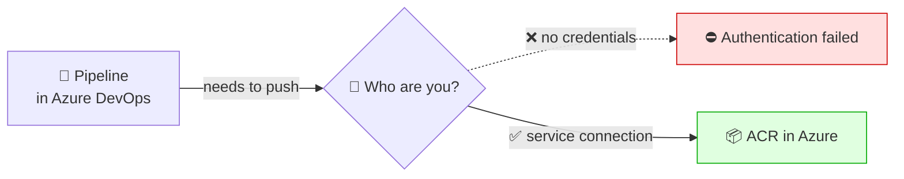
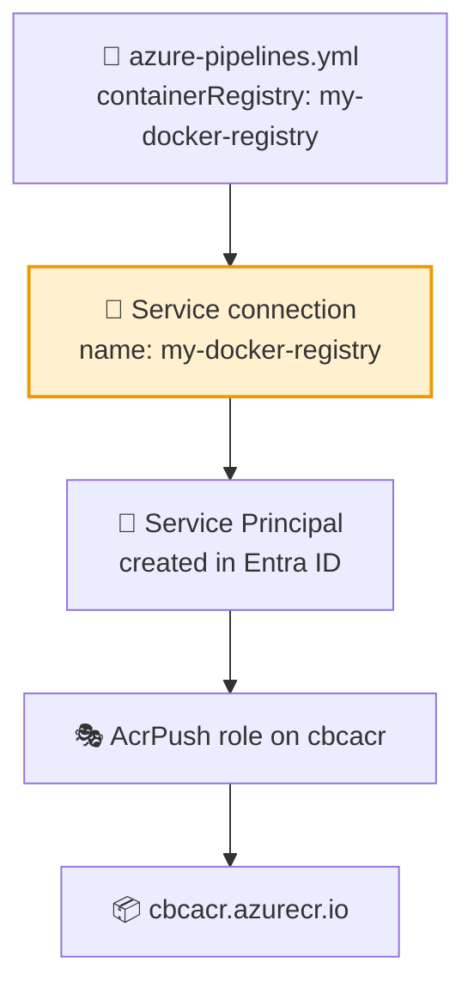

# 🔗 Service Connections — The Bridge from DevOps to Azure

**Week 3 · Session 3 (Class 5 — Sunday, 19 July 2026)**

Your pipeline runs inside **Azure DevOps**. Your ACR and AKS live inside **Azure**. Two separate systems — so how does the pipeline get permission to push an image? Through a **service connection**.

---

## 🎯 What you will learn

- What a service connection is and why it exists
- The connection types you will actually use
- The authentication options we opened up in class
- How the `containerRegistry:` value in your YAML maps to it

---

## 🤔 The problem it solves



A pipeline is a robot. It has no human to type a password. A **service connection** is a **stored, reusable credential** that you create once and reference by name from any pipeline in the project.

> 🧠 **Analogy:** a service connection is a **visitor badge** you print once for the robot. The robot shows the badge at the ACR door. You can revoke the badge without touching the robot.

---

## 🛠️ Where to create one

**Project settings** (bottom-left gear ⚙️) → **Pipelines → Service connections** → **New service connection**

You are then shown the full list of connection types.

---

## 📋 The connection types (what we opened in class)

| Type | Connects to | When you need it |
|---|---|---|
| **Azure Resource Manager** | Your whole Azure subscription | Deploy to AKS, VMs, App Service |
| **Docker Registry** | ACR / Docker Hub | ✅ Push images — **what we used** |
| **Kubernetes** | A K8s cluster | `kubectl apply` from a pipeline |
| **GitHub** | GitHub repos | Build code hosted on GitHub |
| **Generic** | Any URL + credentials | Custom REST endpoints |
| **SSH** | A remote server | Deploy over SSH |
| **npm / NuGet / Maven** | Package feeds | Publish libraries |

---

## 🐳 Option A — Docker Registry connection (used in class)

This is the one referenced by `containerRegistry:` in the pipeline YAML.

1. **New service connection** → **Docker Registry** → **Next**
2. Choose **Azure Container Registry**
3. Fill in:

| Field | Value used in class |
|---|---|
| Authentication type | **Service Principal** |
| Subscription | Your Azure subscription |
| Azure container registry | `cbcacr` |
| Service connection name | `my-docker-registry` ⬅️ must match the YAML |
| Grant access to all pipelines | ✅ Tick for the lab |

4. **Save**

> ⚠️ **The name is not cosmetic.** Whatever you type here must appear **character-for-character** in your YAML:
> ```yaml
> variables:
>   containerRegistry: my-docker-registry   # 👈 the service connection NAME
> ```
> A mismatch produces *"Could not find a service connection"* — the single most common pipeline error in this class.

**Docker Registry connection — authentication choices:**

| Option | Meaning |
|---|---|
| **Service Principal** | ✅ Azure creates an app identity automatically — recommended |
| **Managed Identity** | Uses an identity attached to the agent (self-hosted scenarios) |
| **Others** (Docker Hub) | Username + password / access token |

---

## ☁️ Option B — Azure Resource Manager connection

Needed when the pipeline must talk to **Azure itself** (deploying to AKS, running `az` commands).

1. **New service connection** → **Azure Resource Manager** → **Next**
2. Pick an authentication method:

| Method | Notes |
|---|---|
| **Workload identity federation (automatic)** | ✅ Modern default — no secrets stored at all |
| Workload identity federation (manual) | Same, but you configure the trust yourself |
| **Service principal (automatic)** | Azure creates the app registration for you |
| Service principal (manual) | You supply client ID, tenant ID, secret |
| Managed identity | For self-hosted agents running on an Azure VM |

3. Scope level: **Subscription** → choose your subscription → optionally a **resource group** (`cbc-intrenship-program`)
4. Name it, e.g. `azure-subscription-connection` → **Save**

> 🔐 **Prefer workload identity federation** when offered. It uses short-lived tokens instead of a stored secret, so there is nothing to leak and nothing to rotate. Service principal with a secret still works but the secret **expires** — a classic cause of a pipeline that "suddenly broke" months later.
> ⚖️ **Least privilege:** scope to the **resource group**, not the whole subscription, when you can.

---

## 🔒 Security settings worth knowing

| Setting | Where | What it does |
|---|---|---|
| **Grant access permission to all pipelines** | Creation screen | Off = you approve each pipeline explicitly |
| **Security → user roles** | Connection → ⋮ → Security | Who may edit or use the connection |
| **Approvals and checks** | Connection → ⋮ | Require a human approval before use |

> 🏢 In production, leave "all pipelines" **unticked** so a new pipeline cannot silently borrow your production credentials.

---

## 🧭 How it all links together



Notice this ties back to **Session 2**: the service principal is an **Entra ID identity**, and pushing to ACR requires an **RBAC role**. Same WHO + WHAT + WHERE model, applied to a robot instead of a person.

---

## 🆘 Troubleshooting cheat-sheet

| Symptom | Cause | Fix |
|---|---|---|
| "Could not find a service connection" | Name mismatch with YAML | Make them identical, case-sensitive |
| "The pipeline is not authorized to use this connection" | Access not granted | Open the failed run → **Authorize resources** |
| "AuthorizationFailed" pushing to ACR | Principal lacks AcrPush | Recreate the connection, or grant the role in ACR → IAM |
| Worked for weeks, now fails | Service principal secret expired | Recreate, or move to workload identity federation |
| Cannot see your subscription | Wrong tenant / no rights | Confirm the account and its Azure permissions |

---

## ✅ Key takeaways

1. A service connection is a **stored credential** letting a pipeline act on your behalf.
2. **Docker Registry** connection → push to ACR. **Azure Resource Manager** → everything else.
3. The connection **name must match the YAML exactly**.
4. Prefer **workload identity federation** — no secret to leak or expire.
5. Scope to a **resource group**, not the whole subscription.
6. Behind the scenes it is an **Entra ID service principal with an RBAC role**.

---

⬅️ **Previous:** [Azure DevOps org & project](azure-devops-org-project.md)
➡️ **Next:** [Azure Repos — Git](azure-repos-git.md)

_Part of the CareerByteCode Bangalore — Cloud & DevOps Internship Program._
