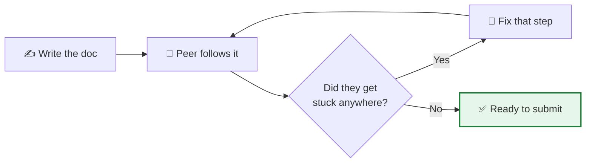

# ✅ Documentation Standards — Capstone

The one rule that matters:

> ## 📏 THE GOLDEN RULE
> **Anyone who reads your document — someone who has never seen your project — must be able to follow it step by step and reach the same working result.**

If a step assumes knowledge that isn't written down, it fails. This page is the checklist your document must pass **before you submit**.

---

## 🎯 Why this bar exists

In a real DevOps job, your documentation is read by on-call engineers at 2 a.m., by new joiners, and by auditors. "It works, trust me" is worthless. **Reproducible steps** are the deliverable — the running app is just proof they worked.

That's why every student writes their steps the same way: consistency means any mentor (or any peer) can pick up any document and run it.

---

## ✅ The submission checklist

Copy this into your PR description and tick each box.

### Structure
- [ ] Follows [`IMPLEMENTATION-TEMPLATE.md`](IMPLEMENTATION-TEMPLATE.md) section order
- [ ] Problem statement in 2–3 plain sentences
- [ ] Architecture diagram included (Mermaid or an image)
- [ ] Repository structure shown

### Every step
- [ ] Each step says **what it achieves** before the command
- [ ] Each command is **exact and copy-pasteable** — no `⟨placeholders⟩` left behind
- [ ] **Expected output** shown for each command
- [ ] A **screenshot** follows every major step
- [ ] Steps are in the **order you actually ran them** — no gaps, no "meanwhile also do X"

### Screenshots
- [ ] Stored in `screenshots/` inside the project folder
- [ ] Numbered and referenced from the doc (Screenshot 1, 2, 3…)
- [ ] Actually show the described result (not a blank or wrong screen)
- [ ] No secrets/passwords/tenant IDs visible — **blur them**

### Correctness
- [ ] **Prerequisites** list every tool + version
- [ ] **Verification** section proves it works with real checks
- [ ] **Troubleshooting** documents problems you actually hit
- [ ] **Cleanup** command included

### Deliverables
- [ ] `app/` + `Dockerfile`, `k8s/` manifests, `azure-pipelines.yml` present
- [ ] Project `README.md` complete
- [ ] 3–5 minute demo video linked
- [ ] LinkedIn post linked (tags CBC + all 7 mentors)

---

## ✍️ Consistency rules (write every step the same way)

Every step is **four parts, always in this order**:

```
### Step N — <what it does>

**Goal:** <one line>

​```bash
<exact command>
​```

**Expected output:**
​```
<real output>
​```

> 📸 Screenshot N: <what it shows>
```

---

## 🟢 Good vs 🔴 Bad — see the difference

| 🔴 Too vague (fails) | 🟢 Reproducible (passes) |
|---|---|
| "Set up the cluster." | "Run `az aks create --resource-group cbc-rg --name cbc-aks --node-count 1 --node-vm-size Standard_B2s`" |
| "Configure kubectl." | "Run `az aks get-credentials --resource-group cbc-rg --name cbc-aks`, then confirm with `kubectl get nodes` showing `Ready`." |
| "Deploy the app." | "Run `kubectl apply -f k8s/`. Expected: `deployment.apps/web created`, `service/web created`." |
| "It should work now." | "Run `curl http://<gateway-ip>`. Expected response: `Welcome to the Banking App`. See Screenshot 7." |
| "Add a screenshot." | "📸 Screenshot 5: `kubectl get pods` showing 3/3 pods `Running`." |

> 🔑 **The tell:** if a step contains a **verb without a command** ("configure", "set up", "deploy") and no exact command follows, it's too vague. Fix it.

---

## 📸 Screenshot guidance

| Do | Don't |
|---|---|
| Capture the **whole relevant window** | Crop so tightly the context is lost |
| Show the **command AND its output** together | Screenshot only a success tick |
| **Blur** passwords, keys, subscription/tenant IDs | Leave credentials visible |
| Name them meaningfully (`05-pods-running.png`) | `Screenshot (37).png` |
| One screenshot per major step | 20 screenshots of the same screen |

> 🔐 **Security:** a screenshot with a live secret or subscription ID in it is a real leak — this repo is shared with your whole cohort. Blur before committing.

---

## 🧪 Self-test before you submit

Do this and you'll pass review the first time:

1. **Hand your doc to someone else** (a peer who built a different project).
2. Ask them to follow it **without asking you anything**.
3. Every time they get stuck or ask a question → that's a step to fix.
4. Repeat until they reach the working app with zero questions.



---

⬅️ **Back to:** [Week 4 overview](README.md) · [Implementation Template](IMPLEMENTATION-TEMPLATE.md)

_Part of the CareerByteCode Bangalore — Cloud & DevOps Internship Program._
