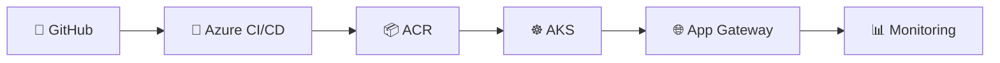

# 📋 Implementation Documentation — Template

> **HOW TO USE THIS FILE**
> 1. Copy it into your project folder as `IMPLEMENTATION.md`
>    (`interns/Your-Name/Project01-[DEVOPS]-Your-Project/IMPLEMENTATION.md`).
> 2. Replace every `⟨placeholder⟩` with your real values.
> 3. Fill each step **as you do it**, not at the end.
> 4. Take a **screenshot after every major step** and drop it in `screenshots/`.
> 5. Delete these instructions and this quote block before submitting.
>
> ✅ The test your document must pass: **a person who has never seen your project can follow it top to bottom and end up with the same working result.** See [`DOCUMENTATION-STANDARDS.md`](DOCUMENTATION-STANDARDS.md).

---

# ⟨Project Title⟩ — End-to-End Implementation

**Student:** ⟨Your Name⟩
**Project:** ⟨Project N — Name from PROJECTS-CATALOG.md⟩
**Date:** ⟨DD Month YYYY⟩

---

## 1. Overview

### 1.1 Problem statement
⟨In 2–3 sentences: what does this project deploy, and why?⟩

### 1.2 What this project demonstrates
⟨The DevOps focus — e.g. "automatic scaling under load using HPA".⟩

### 1.3 Architecture diagram
⟨Describe the flow, and include a diagram. A simple Mermaid diagram works and needs no upload:⟩



> 📸 **Screenshot 1:** your architecture diagram (or a photo of it drawn on paper).

---

## 2. Prerequisites

List **everything** needed before Step 1, with versions. A reader must be able to match your setup exactly.

| Requirement | Version used | How to check |
|---|---|---|
| Azure CLI | ⟨e.g. 2.62⟩ | `az version` |
| kubectl | ⟨e.g. 1.30⟩ | `kubectl version --client` |
| Docker | ⟨e.g. 27.0⟩ | `docker --version` |
| An Azure subscription | — | `az account show` |
| ⟨other⟩ | ⟨⟩ | ⟨⟩ |

**Accounts / access needed:** ⟨Azure subscription, GitHub account, etc.⟩

> 📸 **Screenshot 2:** output of the version-check commands.

---

## 3. Repository structure

Show the reader what your folder contains, so they know what each file is:

```
Project01-[DEVOPS]-⟨Your-Project⟩/
├── app/
│   ├── ⟨app files⟩
│   └── Dockerfile
├── k8s/
│   ├── deployment.yaml
│   ├── service.yaml
│   └── ⟨configmap / secret / ingress / hpa as needed⟩
├── azure-pipelines.yml
├── scripts/
│   └── ⟨provision.sh, etc.⟩
├── screenshots/
├── IMPLEMENTATION.md   ← this file
└── README.md
```

---

## 4. Step-by-step implementation

> ✍️ **The rule for every step below:**
> **(a)** say what the step achieves → **(b)** give the **exact** command or click → **(c)** show the **expected output** → **(d)** add a **screenshot**.
> Never write "configure the cluster" — write the exact command that configures it.

### Step 1 — ⟨e.g. Create the resource group⟩

**Goal:** ⟨one line⟩

```bash
⟨exact command⟩
```

**Expected output:**
```
⟨paste the real output you saw⟩
```

> 📸 **Screenshot 3:** ⟨what the screenshot should show⟩

---

### Step 2 — ⟨e.g. Build and push the Docker image to ACR⟩

**Goal:** ⟨one line⟩

```bash
⟨exact commands⟩
```

**Expected output:**
```
⟨real output⟩
```

> 📸 **Screenshot 4:** ⟨e.g. the image tag visible in ACR⟩

---

### Step 3 — ⟨e.g. Create the AKS cluster and connect kubectl⟩

**Goal:** ⟨one line⟩

```bash
⟨exact commands⟩
```

**Expected output:**
```
⟨real output⟩
```

> 📸 **Screenshot 5:** ⟨e.g. `kubectl get nodes` showing Ready⟩

---

### Step 4 — ⟨e.g. Deploy the manifests⟩

**Goal:** ⟨one line⟩

```bash
kubectl apply -f k8s/
kubectl get pods,svc
```

**Expected output:**
```
⟨real output⟩
```

> 📸 **Screenshot 6:** ⟨pods in Running state⟩

---

### Step 5 — ⟨e.g. Expose via Application Gateway / access the app⟩

**Goal:** ⟨one line⟩

```bash
⟨exact commands⟩
```

> 📸 **Screenshot 7:** ⟨the app open in a browser⟩

---

### Step ⟨N⟩ — ⟨your project's signature step⟩

> This is where your project differs from the others. Examples:
> - **HPA:** run the load test, show `kubectl get hpa` scaling up
> - **Blue-green:** switch the Service selector, show zero downtime
> - **Secrets:** rotate a secret, show the app pick it up
> - **Observability:** run a KQL query, trigger an alert
> - **Multi-stage pipeline:** show each stage passing

**Goal:** ⟨one line⟩

```bash
⟨exact commands⟩
```

> 📸 **Screenshot ⟨N⟩:** ⟨the proof that your signature feature works⟩

---

## 5. Verification

How does the reader confirm everything works? Give concrete checks, not "it should work".

| # | Check | Command | Expected result |
|---|---|---|---|
| 1 | Pods are running | `kubectl get pods` | All `Running` |
| 2 | App is reachable | `curl http://⟨endpoint⟩` | ⟨expected response⟩ |
| 3 | ⟨project-specific⟩ | ⟨command⟩ | ⟨result⟩ |

> 📸 **Screenshot ⟨N⟩:** final working state.

---

## 6. Troubleshooting

Document the problems **you actually hit** and how you fixed them. This is the most valuable section for the next person.

| Problem | Cause | Fix |
|---|---|---|
| ⟨e.g. ImagePullBackOff⟩ | ⟨AKS not attached to ACR⟩ | `az aks update --attach-acr ⟨acr⟩` |
| ⟨⟩ | ⟨⟩ | ⟨⟩ |

---

## 7. Cleanup

Always include this — it protects the reader's wallet.

```bash
az group delete --name ⟨your-rg⟩ --yes --no-wait
```

> 📸 **Screenshot ⟨N⟩:** empty resource group list after cleanup.

---

## 8. What I learned

⟨3–5 bullet points. What was hard? What clicked? What would you do differently?⟩

---

## 9. Links

- **GitHub folder:** ⟨link⟩
- **Demo video:** ⟨link⟩
- **LinkedIn post:** ⟨link⟩

---

_Part of the CareerByteCode Bangalore — Cloud & DevOps Internship Program._
