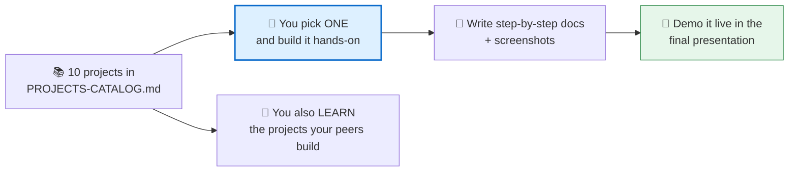
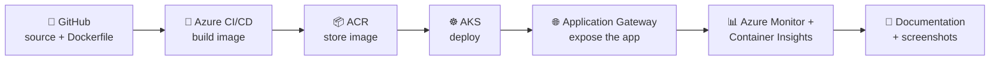
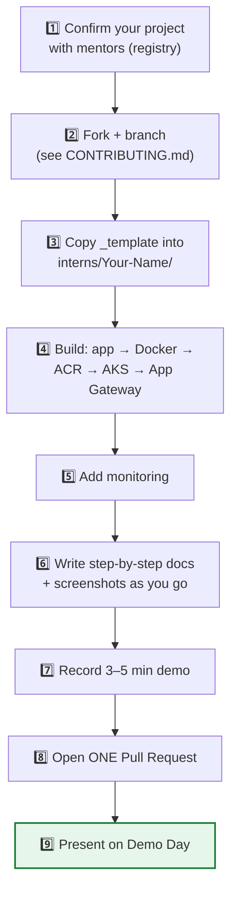

# 📘 Week 4 — Capstone Projects

**Kickoff:** Saturday **25 July 2026** (Class 6 — Capstone Projects)

Three weeks of training are done. Week 4 is where you **build one real DevOps project end to end**, document it so clearly that anyone could reproduce it, and **demo it live**.

---

## 🎯 The model — pick 1, learn 5, document everything

This was the core message of the kickoff:

| What | Detail |
|---|---|
| **Build** | Each student implements **one** project from the catalog (see the registry). |
| **Learn** | You are expected to **understand all the projects your cohort builds** — every student demos theirs, so you learn 5. |
| **Document** | Produce **end-to-end, step-by-step implementation docs** so consistent that *anyone who reads them can execute them*. |
| **Screenshot** | Every major step needs a screenshot as proof. |
| **Demo** | Present a live hands-on walkthrough of your project. |

> 🎓 **Why "learn 5, build 1"?** In interviews you'll be asked about approaches you didn't personally build. Sitting through every teammate's demo means you can speak to autoscaling, blue-green, observability and microservices even if you built the banking app.

---

## 🧱 The shared backbone (every project uses it)

What changes per project is the **DevOps focus**. The pipeline underneath is the same one you built across Weeks 2–3:

Source in GitHub → **Dockerize** → **Azure CI/CD** (build → push to **ACR**) → **deploy to AKS** (Service + **Application Gateway**) → **monitoring** (Azure Monitor + Container Insights) → **documentation**.

---

## 📂 What's in this folder

| File | Use it for |
|---|---|
| [`capstone-kickoff.md`](capstone-kickoff.md) | The Class 6 notes — all 10 projects explained, what "done" looks like for each |
| [`IMPLEMENTATION-TEMPLATE.md`](IMPLEMENTATION-TEMPLATE.md) | **Copy this** — the step-by-step doc you fill in as you build |
| [`DOCUMENTATION-STANDARDS.md`](DOCUMENTATION-STANDARDS.md) | The bar your docs must clear before you submit (self-check rubric) |

---

## 🗺️ Your path through Week 4

1. **Confirm your project** — check the registry in [`PROJECTS-CATALOG.md`](../../PROJECTS-CATALOG.md).
2. **Fork + branch** — the safe workflow in [`CONTRIBUTING.md`](../../CONTRIBUTING.md).
3. **Copy the template** — `_template/` → `interns/Your-Name/Project01-[DEVOPS]-Your-Project/`.
4. **Build** using the shared backbone above.
5. **Add monitoring** (Container Insights).
6. **Document as you go** using [`IMPLEMENTATION-TEMPLATE.md`](IMPLEMENTATION-TEMPLATE.md) — don't leave it to the end.
7. **Record** a 3–5 minute demo.
8. **Submit** with one Pull Request.
9. **Present** on Demo Day.

---

## ✅ What you submit

Straight from [`PROJECTS-CATALOG.md`](../../PROJECTS-CATALOG.md) and [`CERTIFICATE-CRITERIA.md`](../../CERTIFICATE-CRITERIA.md):

- **App + Dockerfile** in `app/`, **manifests** in `k8s/`, **pipeline** in `azure-pipelines.yml`
- A complete **step-by-step implementation doc** (from the template) + **screenshots** in `screenshots/`
- A project **`README.md`** — problem, architecture, workflow, technologies, future enhancements
- A **3–5 minute demo video**
- A capstone **LinkedIn post** (with GitHub link), tagging CBC + all 7 mentors
- A **Demo Day presentation**

> 💳 **Cloud-cost reminder:** your capstone runs on **your own Azure account** and bills while resources are live. Keep everything in one resource group and run `az group delete --name <your-rg> --yes --no-wait` after each working session. **Bastion, AKS nodes and Application Gateway bill hourly.**

---

## 🎥 Recording

The Class 6 recording is linked in [`CLASS-RECORDINGS.md`](../../CLASS-RECORDINGS.md).

_Part of the CareerByteCode Bangalore — Cloud & DevOps Internship Program._
