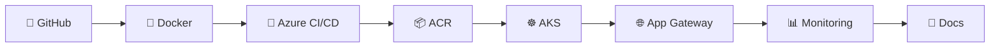
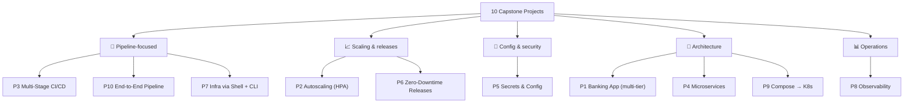

# 🎤 Capstone Kickoff — All 10 Projects Explained

**Week 4 · Class 6 (Saturday, 25 July 2026)**

In this session we walked through **all 10 projects** in [`PROJECTS-CATALOG.md`](../../PROJECTS-CATALOG.md). Each student picks **one** to build, learns the rest from their peers' demos, and submits **end-to-end step-by-step documentation with screenshots**.

> 📘 This file explains what each project *is*, what its **DevOps focus** is, and **what "done" looks like** — so you can pick confidently and know when you've finished. For the fill-in doc, use [`IMPLEMENTATION-TEMPLATE.md`](IMPLEMENTATION-TEMPLATE.md).

---

## 🧱 The one backbone behind all 10

Before the projects, remember: they **all** share the same pipeline. Only the **focus** differs.



| Skill | Where you learned it |
|---|---|
| Docker, images, Dockerfile | Week 2, Session 1 |
| Kubernetes, Pods, Deployments, Services, HPA | Week 2, Session 2 |
| Azure, AKS, ACR, Azure DevOps pipelines | Week 3, Session 3 |

Everything below is a **recombination** of those skills with a different emphasis.

---

## 🗺️ How the 10 projects map to focus areas



---

# The projects

Each card below follows the same shape: **Scenario · DevOps focus · Key concepts · What "done" looks like · Signature commands**.

---

## ⭐ Project 1 — Banking Application on AKS *(flagship / worked example)*
**Assigned to: Amna**

- **Scenario:** Deploy a multi-tier banking application to Kubernetes with secure config.
- **DevOps focus:** Full end-to-end pipeline · multi-tier Deployment · **ConfigMaps + Secrets** · Service + Application Gateway.
- **Key concepts:** Docker · AKS · Azure CI/CD · ConfigMaps/Secrets · Container Insights.
- **✅ Done when:** the app is reachable through Application Gateway, config comes from a ConfigMap, credentials come from a Secret, and the pipeline rebuilds on every push.

```bash
kubectl apply -f k8s/            # deployment, service, ingress, configmap, secret
kubectl get pods,svc,ingress
```

> 📁 A full worked example already exists: [`interns/EXAMPLE-Intern-Aarav-S/`](../../interns/EXAMPLE-Intern-Aarav-S/). Study it — everyone can use it as a reference regardless of their own project.

---

## 📈 Project 2 — Multi-Tier App with Autoscaling (HPA)
**Assigned to: Arun**

- **Scenario:** Deploy a multi-tier web app and make it scale automatically under load.
- **DevOps focus:** **Horizontal Pod Autoscaler** · resource requests/limits · load-test to trigger scaling.
- **Key concepts:** Deployments · HPA · Container Insights metrics.
- **✅ Done when:** you can generate load, show the HPA adding pods, then show it scaling back down — with screenshots of `kubectl get hpa` changing.

```bash
kubectl autoscale deployment web --cpu-percent=50 --min=1 --max=10
kubectl get hpa --watch          # watch REPLICAS climb under load
```

> 💡 The demo *is* the load test. Record `kubectl get hpa --watch` while you hammer the app.

---

## 🔧 Project 3 — Multi-Stage CI/CD Pipeline (Azure DevOps)
**Assigned to: Malathi**

- **Scenario:** Ship an application through a complete multi-stage pipeline.
- **DevOps focus:** **Azure DevOps YAML pipeline** — build → test → containerize → push to **ACR** → deploy to AKS.
- **Key concepts:** Azure DevOps Pipelines · multi-stage YAML · ACR.
- **✅ Done when:** a single push runs distinct **stages** (Build → Test → Push → Deploy), each visible as its own block in the pipeline run.

```yaml
stages:
  - stage: Build
  - stage: Test
  - stage: Push        # to ACR
  - stage: Deploy      # to AKS
```

> 🎯 The focus is the **stages**, not just one build task. Show the multi-stage graph in the run.

---

## 🧩 Project 4 — Microservices Deployment on AKS
**Assigned to: Nandini**

- **Scenario:** Deploy a small set of services that talk to each other on Kubernetes.
- **DevOps focus:** Multiple Deployments · **service-to-service** networking · **Application Gateway** path routing.
- **Key concepts:** Microservices · Services · Ingress routing · ConfigMaps.
- **✅ Done when:** two or more services are deployed, one calls another by its Service name, and Application Gateway routes different paths (e.g. `/api`, `/web`) to different services.

```bash
kubectl get svc                  # each microservice has its own ClusterIP
curl http://frontend/            # frontend calls backend by service name
```

> 💡 The magic is DNS: a pod reaches another service at `http://<service-name>` inside the cluster.

---

## 🔐 Project 5 — Secrets & Config Management Deployment
**Assigned to: Riswan**

- **Scenario:** Deploy an app where all configuration and credentials are managed the right way.
- **DevOps focus:** All config via **ConfigMaps**, all credentials via **Secrets** (+ Azure Key Vault note) · live secret rotation.
- **Key concepts:** ConfigMaps · Secrets · secure configuration.
- **✅ Done when:** nothing sensitive is hard-coded in the image; changing a ConfigMap/Secret changes app behaviour after a rollout; you demo rotating a secret.

```bash
kubectl create configmap app-config --from-literal=ENV=prod
kubectl create secret generic app-secret --from-literal=DB_PASS='***'
kubectl rollout restart deployment web   # pick up the new values
```

> 🔐 Bonus: mention **Azure Key Vault** as the production-grade next step beyond K8s Secrets.

---

## 🔁 Project 6 — Zero-Downtime Releases (Rolling + Blue-Green)  *(spare / learning)*

- **Scenario:** Release new versions of an app safely with no downtime.
- **DevOps focus:** **Rolling updates** · **blue-green** switch via Services · rollback demo.
- **Key concepts:** Deployment strategies · Services · rollback.
- **✅ Done when:** you deploy v2 with zero dropped requests, then **roll back** to v1 — both shown live.

```bash
kubectl set image deployment/web web=myacr.azurecr.io/web:v2   # rolling update
kubectl rollout status deployment/web
kubectl rollout undo deployment/web                            # instant rollback
```

---

## 🔧 Project 7 — Infra Provisioning with Shell + Azure CLI  *(spare / learning)*

- **Scenario:** Automate the creation of cloud infrastructure, then deploy an app onto it.
- **DevOps focus:** **Shell-script toolkit** that provisions VM + networking + AKS via **Azure CLI**.
- **Key concepts:** Linux/shell scripting · Azure CLI · VM/AKS/networking provisioning.
- **✅ Done when:** running one script builds the whole environment from nothing, and a teardown script removes it.

```bash
bash scripts/provision.sh        # RG + VNet + AKS + ACR, all via az CLI
bash scripts/teardown.sh         # clean removal
```

---

## 📊 Project 8 — Observability with Azure Monitor + Container Insights  *(spare / learning)*

- **Scenario:** Deploy an app to AKS and build full monitoring around it.
- **DevOps focus:** **Container Insights** · metrics · **KQL log queries** · alerts on CPU/memory/pod restarts.
- **Key concepts:** Azure Monitor · Container Insights · alerting.
- **✅ Done when:** you show live CPU/memory dashboards, run a KQL query against pod logs, and trigger an alert.

```kql
ContainerLog
| where LogEntry contains "error"
| summarize count() by bin(TimeGenerated, 5m)
```

---

## 🔄 Project 9 — Docker Compose → Kubernetes Migration  *(spare / learning)*

- **Scenario:** Take a multi-container app defined in Docker Compose and run it on Kubernetes.
- **DevOps focus:** Containerize a multi-container app · translate **Compose → K8s manifests** · deploy to AKS.
- **Key concepts:** Docker · Docker Compose · Deployments/Services on AKS.
- **✅ Done when:** the same app that ran under `docker compose up` now runs on AKS, with each service turned into a Deployment + Service.

```bash
docker compose up                # the "before"
kubectl apply -f k8s/            # the "after" — same app, now on K8s
```

> 💡 Map each Compose concept: `service` → Deployment+Service, `environment` → ConfigMap, `secrets` → Secret, `ports` → Service port.

---

## 🚀 Project 10 — End-to-End DevOps Pipeline (Web App)  *(spare / learning)*

- **Scenario:** Build the complete DevOps lifecycle for a web application.
- **DevOps focus:** Repo → Dockerfile → **Azure CI/CD** → AKS → **Application Gateway** → **monitoring** → docs.
- **Key concepts:** Full CI/CD · the complete pipeline end to end.
- **✅ Done when:** every stage of the backbone is present and working, and the docs let someone reproduce it from scratch.

---

## 📝 What every project must produce (identical for all)

No matter which project you build, the deliverables are the same:

1. `app/` + `Dockerfile`, `k8s/` manifests, `azure-pipelines.yml`
2. **Step-by-step implementation doc** (from [`IMPLEMENTATION-TEMPLATE.md`](IMPLEMENTATION-TEMPLATE.md)) with a **screenshot after every major step**
3. A project `README.md` (problem · architecture · workflow · tech · future work)
4. A **3–5 minute demo video**
5. A capstone **LinkedIn post** tagging CBC + all 7 mentors
6. A **Demo Day** presentation

See the exact bar in [`DOCUMENTATION-STANDARDS.md`](DOCUMENTATION-STANDARDS.md).

---

## 🆘 Choosing your project — quick guidance

| If you enjoyed… | Consider |
|---|---|
| Writing pipelines | P3 Multi-Stage CI/CD · P10 End-to-End |
| Kubernetes scaling | P2 Autoscaling · P6 Zero-Downtime |
| Security & config | P5 Secrets & Config |
| System design | P1 Banking · P4 Microservices · P9 Compose→K8s |
| Linux & automation | P7 Infra Provisioning |
| Dashboards & metrics | P8 Observability |

> 🎓 Whatever you pick, you'll **see the other four** in your peers' demos — so you graduate able to talk about all of them.

---

⬅️ **Back to:** [Week 4 overview](README.md)
➡️ **Next:** [Implementation Template](IMPLEMENTATION-TEMPLATE.md)

_Part of the CareerByteCode Bangalore — Cloud & DevOps Internship Program._
